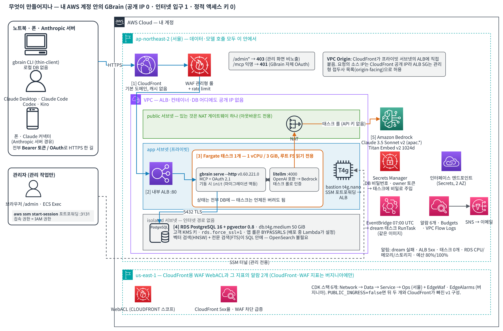
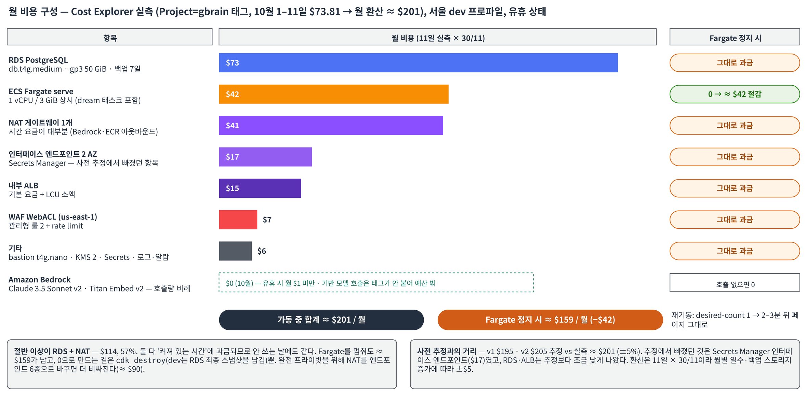
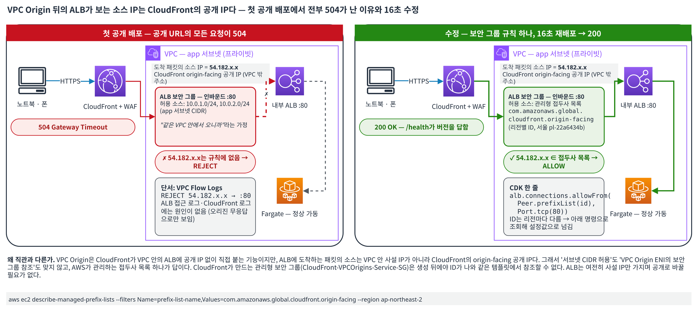
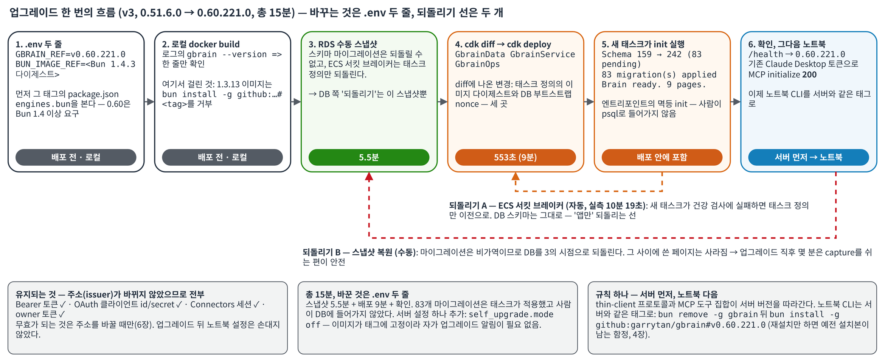
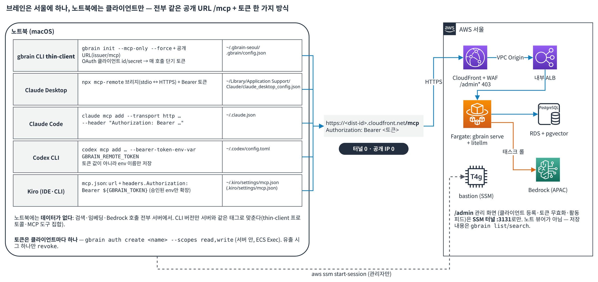
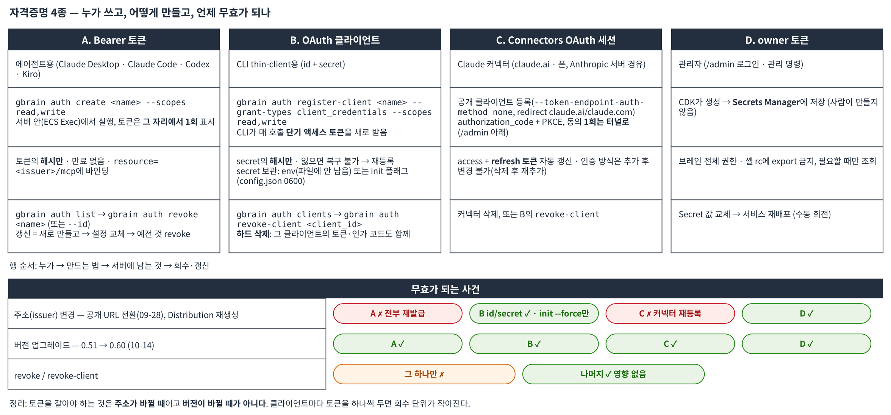

# AI 에이전트에게 "내 기억"을 달아주기 — GBrain을 AWS에 프라이빗하게 배포하고 노트북에서 쓰는 법

> 이 글은 [garrytan/gbrain](https://github.com/garrytan/gbrain)을 **코드 수정 없이** AWS CDK만으로 서울 리전에 올리고, 맥북의 CLI와 Claude Desktop·Claude Code·Codex·Kiro에서 실제로 사용하기까지의 기록입니다. 처음 며칠은 SSM 터널로만 접속했고(v1, 09-22), 그다음 CloudFront VPC Origin으로 **공개 URL 하나만** 열었습니다(v2, 09-28). 10-14에는 서버를 v0.51.6.0에서 **v0.60.221.0**으로 제자리 업그레이드했습니다(v3). 모든 수치는 2026-09-22부터 10-15 사이에 직접 측정한 값이고, 명령은 실제로 실행해 동작을 확인한 것입니다. 아직 직접 돌려 보지 않은 것은 본문에 그렇게 적었습니다.

> **갱신 이력** — v1 09-25 초판(터널) · v2 09-28 공개 URL 추가 · v3 10-15 0.60 업그레이드 기록, 노트북 CLI 재설치 함정, Claude Code·Codex·Kiro 연동(5장), 토큰 발급·회수(6장), 첨부파일 PR 결과(8장), 노트북 쪽 증상별 표(9장) 반영.

---

## 1. 왜 이걸 했나

Claude, Kiro, Codex 같은 AI 에이전트를 매일 쓰다 보면 한 가지가 계속 아쉽습니다. **대화가 끝나면 다 잊는다**는 것. 어제 결정한 내용, 지난주 회의 메모, 어떤 고객이 뭘 물어봤는지를 매번 다시 붙여넣어야 합니다.

GBrain은 이 문제를 푸는 오픈소스입니다. 마크다운 페이지를 PostgreSQL + pgvector에 저장하고, 어떤 에이전트든 MCP(Model Context Protocol)로 붙어서 **검색하고, 기억하고, 인용하며 답하게** 해 줍니다. 밤에는 `dream`이라는 배치가 돌아 중복을 정리하고 사실을 추출합니다. Y Combinator의 Garry Tan이 자기 에이전트용으로 만들어 공개했고, 15만 페이지 규모로 운영 중이라고 합니다.

문제는 **어디에 둘 것인가**입니다. 업스트림 문서는 Supabase나 Railway 같은 SaaS, 혹은 Tailscale로 노트북을 공개하는 방법을 안내합니다. 저는 세 가지 조건이 있었습니다.

1. 데이터는 **내 AWS 계정** 안에, 서울 리전에 머물러야 한다.
2. 서버(ALB, 컨테이너, DB)에 **공개 IP가 하나도 없어야** 한다. 인터넷에서 들어오는 길은 없거나, 있다면 WAF 뒤의 CloudFront 하나여야 한다.
3. IAM 사용자 정적 액세스 키를 **하나도 만들지 않아야** 한다.

3번은 회사 계정 정책이지만, 개인 계정에서도 그렇게 하는 것이 맞습니다. 이 글은 그 조건을 전부 만족시키면서 GBrain을 올린 결과물입니다. 처음(v1)에는 2번을 "인터넷 입구 0"으로 잡고 SSM 터널로만 썼는데, 폰이나 Claude 커넥터에서도 쓰고 싶어져서 며칠 뒤 CloudFront **VPC Origin**으로 입구 하나를 열었습니다(v2). 그 과정에서 배운 것이 이 글의 절반입니다.

---

## 2. 무엇이 만들어지나



*그림 1. 무엇이 만들어지나. 인터넷에서 들어오는 길은 CloudFront 하나이고 그 뒤의 ALB·컨테이너·DB는 전부 프라이빗 서브넷에 있습니다. 용어: **VPC Origin**은 CloudFront가 프라이빗 서브넷의 ALB에 공개 IP 없이 직접 붙는 기능, **pgvector**는 PostgreSQL 안에서 벡터(임베딩) 유사도 검색을 해 주는 확장, **태스크 롤**은 컨테이너에 자동으로 주어지는 임시 자격증명(API 키를 둘 필요가 없음)입니다.*

| 구성 요소 | 선택 | 이유 |
|---|---|---|
| 컴퓨트 | ECS Fargate 1태스크 (1 vCPU / 3 GiB), 루트 FS 읽기 전용 | 서버 관리 없음. gbrain은 상태를 전부 DB에 두므로 컨테이너는 언제든 버려도 됨 |
| gbrain | **v0.60.221.0** (10-14 업그레이드, 스키마 v242), Bun 1.4.3 이미지 | 업스트림은 하루에도 여러 번 릴리스. 이미지에 태그를 고정하고 서버 먼저, 노트북 다음 순서로 올림(3장) |
| DB | RDS PostgreSQL 16.13 + pgvector 0.8.1, db.t4g.medium 50 GiB | 업스트림 권장 엔진. isolated 서브넷, `rds.force_ssl=1`, 고객 KMS 키 |
| LLM | LiteLLM 사이드카 -> Amazon Bedrock | gbrain은 OpenAI 호환 API를 기대. LiteLLM이 Bedrock으로 번역하고 **태스크 롤**로 인증 -> API 키 0개 |
| 모델 | 채팅 `apac.anthropic.claude-3-5-sonnet-20241022-v2:0`, 임베딩 `amazon.titan-embed-text-v2:0` (1024차원) | 둘 다 APAC 안에서만 라우팅. 최신 Claude는 서울에서 `global.*` 프로파일만 있어 데이터가 리전 밖으로 나갈 수 있어 제외 |
| 입구 (v1) | 내부 ALB + SSM 포트포워딩 bastion | 공개 IP 없음. 접속 권한 = IAM 권한. v2 이후에도 관리 화면(`/admin`) 전용으로 남김 |
| 입구 (v2) | CloudFront(기본 도메인) → **VPC Origin** → 같은 내부 ALB, 앞에 WAF | ALB를 공개로 바꾸지 않고도 CloudFront가 프라이빗 서브넷의 ALB에 직접 붙음. 인터넷 게이트웨이 경유 인바운드 여전히 0. 도메인·인증서 없이 `*.cloudfront.net`으로 시작 |
| 운영 | dream 스케줄 태스크, 알람 6개(+CloudFront·WAF 2개), Budgets, VPC Flow Logs | 밤에 알아서 돌고, 깨지면 메일 |

CDK 스택은 v1 4개(`Network -> Data -> Service -> Ops`)에 v2에서 us-east-1 2개(`EdgeWaf`, `EdgeAlarms` -- CloudFront용 WAF와 그 지표의 알람은 버지니아에만 만들 수 있습니다)가 붙습니다. 비용은 **v1 추정 $195, 실측 $210/월**이었고, v2(WAF ≈ $10)를 포함한 10월 1–11일 실측은 **≈ $200/월**(유휴 상태, Bedrock 호출 거의 0)입니다. 절반 이상이 RDS(≈ $73)와 NAT 게이트웨이(≈ $41)입니다(그림 2).



*그림 2. 월 비용 구성(Cost Explorer, `Project=gbrain` 태그, 10월 1–11일 실측을 월로 환산). 절반 이상이 RDS와 NAT 게이트웨이이고 둘 다 "켜져 있는 시간"에 과금되므로, Fargate를 멈춰도 ≈ $160는 남습니다. Bedrock은 호출량 비례(유휴 시 월 $1 미만)이고 태그가 붙지 않아 예산 밖입니다. 용어: **NAT 게이트웨이**는 프라이빗 서브넷이 밖으로 나가는(인바운드는 없는) 출구, **인터페이스 엔드포인트**는 NAT를 거치지 않고 AWS 서비스(여기서는 Secrets Manager)에 사설망으로 붙는 접점입니다.*

---

## 3. 배포 — 실제로 걸린 시간

```bash
cp .env.example .env      # 계정 ID, 리전, 모델 ID, 이미지 다이제스트, 알람 이메일
npm ci && npx cdk synth   # 스택 합성 + 단위 테스트(현재 90개)
npx cdk deploy GbrainNetwork GbrainData     # 17분 (RDS 생성이 14분)
npx cdk deploy GbrainService GbrainOps      # 13분 (이미지 빌드·푸시 포함)
```

두 가지 설계 선택이 배포를 단순하게 만들었습니다.

**DB 초기화를 CloudFormation 커스텀 리소스로.** pgvector 확장 설치와 애플리케이션 롤 생성을 Lambda가 배포 중에 수행합니다. 사람이 psql로 들어갈 일이 없고, 로그에 비밀이 남지 않도록 결과만 (`vector extension ok`, `BYPASSRLS ok`) 찍습니다.

**컨테이너 엔트리포인트가 `gbrain init`을 매번 실행.** 첫 태스크는 스키마 마이그레이션을 적용하고, 이후 태스크는 `Brain ready. N pages`만 찍고 지나갑니다. 멱등이라는 것을 실측으로 확인했기 때문에 "초기화 완료 여부"를 어디에 기록할 필요가 없습니다. 이 선택이 3주 뒤 업그레이드를 "이미지 태그 한 줄"로 만들어 줬습니다(아래).

**v2 공개 인그레스(09-28)**는 `.env`에 플래그 하나(`PUBLIC_INGRESS=true`)를 켜고 `cdk deploy` 4스택으로 19분 20초. 대부분이 CloudFront VPC Origin 생성(9분 35초)과 Distribution(2분 48초)이었고, 태스크 정의에 `GBRAIN_PUBLIC_URL`이 들어가면서 서비스가 한 번 롤링 교체됐습니다(4분 25초). 플래그가 꺼져 있으면 v1 템플릿은 바이트 단위로 동일합니다 -- 테스트가 그것을 고정합니다.

### 실제로 부딪힌 것들

문서만 보고 짠 코드가 실제 배포에서 깨진 지점들입니다. 같은 구성을 하실 분들이 시간을 아끼시길 바라며 그대로 적습니다.

| 증상 | 원인 | 해결 |
|---|---|---|
| `self signed certificate in certificate chain` | gbrain 런타임인 Bun은 시스템 CA 저장소를 안 보고, postgres.js는 URL의 `sslrootcert`를 무시 | Dockerfile에 RDS CA 번들을 넣고 `NODE_EXTRA_CA_CERTS`로 지정 |
| `unrecognized configuration parameter "sslrootcert"` | postgres.js가 모르는 URL 파라미터를 그대로 서버 세션 설정으로 넘김 | URL에서 제거, `?sslmode=verify-full`만 남김 |
| ECS Exec `agent STOPPED` | 루트 FS를 읽기 전용으로 잠갔더니 SSM 에이전트가 쓸 곳이 없음 | `/var/lib/amazon`, `/var/log/amazon`에 임시 볼륨 마운트 |
| Bedrock `model_not_found` + "marked by provider as Legacy" | 인퍼런스 프로파일 상태는 ACTIVE인데 실제 호출은 거부 | 프로파일 목록만 믿지 말고 `converse` 1회 호출로 확인. 모델 교체 |
| dream이 `ANTHROPIC_API_KEY` 요구 | 업스트림 기본값이 게이트웨이(LiteLLM)를 안 씀 | `gbrain config set agent.use_gateway_loop true` |
| Budgets 재배포 실패 "same name but a different internalId" | 구독자 변경 = 리소스 교체인데 이름이 고정 | 구독자를 SNS 토픽으로 고정하고 토픽이 이메일로 fan-out |
| (v2) 공개 URL이 전부 **504** | VPC Origin을 거친 요청은 ALB에 **CloudFront의 공개 IP**(54.182.x.x)를 소스로 도착. 서브넷 CIDR로 연 SG 규칙은 무효 -- Flow Logs REJECT로 확인 | ALB SG에 관리형 접두사 목록 `com.amazonaws.global.cloudfront.origin-facing`(리전별 `pl-…`) 허용. 16초 재배포 |
| (v2) 공개 URL 전환 후 모든 클라이언트 401 | 토큰이 `resource=<issuer>/mcp`에 묶여 있어 issuer가 localhost → CloudFront로 바뀌면 전부 무효 | 토큰 재발급. OAuth 클라이언트(id/secret)는 유효해서 `init`만 다시 하면 됨(6장) |
| (v2) CloudFront 지표 알람을 서울 스택에 만들면 지표가 없음 | CloudFront·WAF 지표는 us-east-1, 알람과 SNS 액션은 지표와 같은 리전이어야 함 | us-east-1에 알람 스택 하나 더 |
| (v2) 크로스리전 참조에 Secrets Manager 동적 참조를 얹으면 실패 | `{{resolve:secretsmanager}}`를 SSM 파라미터 경유 토큰과 중첩 불가 | 헤더 검증용 Secret을 ALB와 같은 리전에 |
| (v3) 새 gbrain 이미지 빌드 자체가 실패 | 0.60은 **Bun 1.4.0 이상**을 요구. 기존 1.3.13 이미지로는 `bun install -g github:garrytan/gbrain#<tag>`가 거부됨 | 태그의 `package.json` `engines.bun`을 먼저 보고 `BUN_IMAGE_REF`를 1.4.3 다이제스트로 함께 올림 |
| (v3) `cdk diff`에 없던 bastion 교체 | `latestAmazonLinux2023()`가 배포 시점에 SSM에서 최신 AMI를 조회 → 새 AMI가 나오면 매 배포마다 인스턴스가 바뀜 | 터널 명령은 외우지 말고 매번 스택 Output(`TunnelCommand`)에서 다시 읽기 |

표에서 가장 비직관적인 것은 504 건입니다. 그림으로 보면 이렇습니다.



*그림 3. 첫 공개 배포에서 모든 요청이 504였던 이유. **VPC Origin**으로 들어온 요청은 ALB에 CloudFront의 공개 IP(54.182.x.x)를 소스로 도착하므로, "같은 VPC 안에서 오니까"라고 서브넷 CIDR을 허용한 **보안 그룹**(인스턴스 단위 방화벽) 규칙은 한 건도 맞지 않습니다. 답은 AWS가 관리하는 CloudFront origin-facing **접두사 목록**(IP 대역 묶음, 리전마다 ID가 다름) 하나를 허용하는 것이고, 단서는 ALB 로그가 아니라 VPC Flow Logs의 REJECT 줄이었습니다. ALB는 그대로 사설 IP만 가집니다.*

배포 후 "잘못된 태스크 정의를 배포하면 어떻게 되나"도 확인했습니다. 일부러 DB 포트를 틀리게 넣어 배포하자 ECS 서킷 브레이커가 **10분 19초에 자동 롤백**했고, 브레인의 페이지는 그대로였습니다.

### 업그레이드 (v3, 10-14) — 0.51.6.0에서 0.60.221.0으로

업스트림은 3주 사이에 0.51에서 0.60으로 뛰었고(릴리스가 하루 수 회), 스키마는 **v159에서 v242로 83개 마이그레이션**이 쌓였습니다. 절차는 네 단계였고 총 15분이 걸렸습니다.



*그림 4. 업그레이드 한 번의 흐름과 되돌리기 선 두 개. ECS **서킷 브레이커**는 새 태스크가 건강 검사를 통과하지 못하면 자동으로 이전 태스크 정의로 돌아가는 기능이지만 DB 스키마는 건드리지 않습니다. 그래서 스키마 **마이그레이션**(DB 구조를 새 버전에 맞게 바꾸는 SQL, 되돌릴 수 없음)의 되돌리기는 배포 전 **스냅샷**(RDS가 찍는 DB 전체의 시점 복사본)뿐입니다. 토큰과 OAuth 클라이언트는 주소(issuer)가 바뀌지 않았으므로 전부 그대로입니다.*

1. `.env`의 `GBRAIN_REF`를 `v0.60.221.0`으로, `BUN_IMAGE_REF`를 1.4.3 다이제스트로. 배포 전에 로컬에서 `docker build`해서 로그의 `gbrain --version =>` 줄로 설치가 되는지만 확인(위 표의 Bun 1.4 요구가 여기서 걸렸습니다).
2. **RDS 수동 스냅샷**(5.5분). 스키마 마이그레이션은 되돌릴 수 없고, ECS 서킷 브레이커는 태스크 정의만 되돌리기 때문에 DB 쪽 "되돌리기"는 스냅샷이 유일합니다.
3. `npx cdk deploy GbrainData GbrainService GbrainOps` — 553초. `cdk diff`에 나온 변경은 태스크 정의 이미지 다이제스트와 DB 부트스트랩의 nonce 세 곳뿐이었습니다.
4. 새 태스크 로그 확인: `Schema version 159 → 242 (83 migration(s) pending)` → `83 migration(s) applied` → `Brain ready. 9 pages.` 공개 URL `/health`가 `0.60.221.0`을 답하고, **기존 Claude Desktop 토큰으로 MCP `initialize`가 200** — 업그레이드로는 토큰·OAuth 클라이언트가 무효가 되지 않았습니다(issuer 변경 때만 무효, 6장).

업그레이드에서 바꾼 설정 하나: 0.60은 **자가 업그레이드 체커**(`self_upgrade.mode`, 기본 `notify`)가 생겼습니다. 서버 이미지는 태그에 고정되어 있으므로 엔트리포인트에 `gbrain config set self_upgrade.mode off`를 추가했습니다. 새로 나온 경고 하나(`GBRAIN_HTTP_CORS_ORIGIN unset`)는 브라우저에서 OAuth 엔드포인트를 직접 치는 교차 출처 요청만 거부하는 것이라 그대로 두었습니다. mcp-remote나 Claude Connectors의 서버 간 토큰 교환과는 무관합니다.

규칙은 하나입니다. **서버 먼저, 노트북 다음.** thin-client 프로토콜과 MCP 도구 집합이 서버 버전을 따라가므로 노트북만 올리면 어긋납니다.

---

## 4. 노트북에서 쓰기

여기서부터가 매일 하는 일입니다. 구조를 먼저 그리면: 데이터·검색·임베딩·Bedrock 호출은 전부 서울 Fargate의 gbrain 서버에서 일어나고, 노트북에 설치한 gbrain은 **thin-client**(`gbrain init --mcp-only`)라 로컬 DB가 없습니다. `capture`/`search`/`think`를 서버 `/mcp`에 위임하는 터미널용 클라이언트입니다. Claude Desktop·Claude Code·Codex·Kiro는 이 CLI를 거치지 않고 **각자 MCP(HTTP)로 같은 `/mcp`에 직접** 붙습니다(5장).



*그림 5. 브레인은 서울에 하나, 노트북에는 클라이언트만. 다섯 클라이언트가 전부 같은 주소에 같은 방식(Bearer 토큰)으로 붙고, 설정이 남는 파일이 각각 다릅니다. 용어: **thin-client**는 로컬 DB 없이 모든 명령을 서버 `/mcp`에 위임하는 CLI 모드, **MCP**는 에이전트가 외부 도구(여기서는 브레인)를 호출하는 표준 프로토콜입니다.*

### 4.1 준비물 (한 번)

- AWS CLI v2 + `session-manager-plugin` (`brew install awscli session-manager-plugin`) -- 토큰 발급(ECS Exec)과 관리 화면(`/admin`) 터널에만
- 그 계정에 `ssm:StartSession`(터널)과 `ecs:ExecuteCommand`(자격증명 발급) 권한
- Bun 1.4.0+ (`curl -fsSL https://bun.sh/install | bash`, 있으면 `bun upgrade`) — 0.60 요구 사항
- Node 18+ (`brew install node`) — Claude Desktop 브리지 `mcp-remote`를 `npx`로 띄울 때만. Claude Code·Codex·Kiro는 필요 없음
- gbrain CLI — **npm에 없습니다.** npm의 `gbrain`은 이름만 같은 무관한 패키지라 설치하면 진짜 바이너리를 가립니다. 서버와 같은 태그로 GitHub에서 설치합니다.

```bash
bun install -g github:garrytan/gbrain#v0.60.221.0
gbrain --version   # gbrain 0.60.221.0
```

이미 `npm install -g gbrain`을 했다면 `npm uninstall -g gbrain` 뒤에 위 명령으로 재설치합니다. `which -a gbrain`에 `~/.bun/bin/gbrain` 외의 경로가 나오면 그쪽이 가리는 것이고, `gbrain doctor`도 가려진 설치를 찾아 알려 줍니다.

**재설치 함정(10-15 실측).** 0.51이 이미 깔린 노트북에서 위 명령을 태그만 바꿔 다시 실행했는데 `gbrain --version`이 계속 `0.51.6.0`이었습니다. `bun install -g`가 전역 `package.json`의 spec은 새 태그로 바꿔 놓고도 `bun.lock`에 잠긴 예전 커밋 해석을 그대로 두어 `node_modules/gbrain`을 교체하지 않은 것입니다. 확인과 해결:

```bash
grep gbrain ~/.bun/install/global/package.json                              # spec은 v0.60.221.0인데
grep '"version"' ~/.bun/install/global/node_modules/gbrain/package.json     # 실제 설치본은 0.51.6.0이면 이 경우

bun remove -g gbrain
bun install -g github:garrytan/gbrain#v0.60.221.0
rehash                                                                      # zsh 명령 캐시 갱신
gbrain --version                                                            # gbrain 0.60.221.0
```

### 4.2 터널 열기 (관리할 때만)

v1에서는 이것이 매일 첫 번째 일이었습니다. v2 이후 터널은 `/admin` 관리 화면과 Claude 커넥터의 OAuth 동의 화면(5.1)에만 필요합니다. 로컬 포트는 **반드시 3131** -- `--public-url`을 설정하지 않은 v1 서버는 OAuth 발급자 주소를 `http://localhost:3131`로 고정해서 돌려주기 때문에, 3132로 열면 토큰 요청이 400으로 실패합니다(직접 확인했습니다).

```bash
aws ssm start-session --target <bastion-instance-id> \
  --document-name AWS-StartPortForwardingSessionToRemoteHost \
  --parameters host=<internal-alb-dns>,portNumber=80,localPortNumber=3131 \
  --region ap-northeast-2

curl -s localhost:3131/health
# {"status":"ok","version":"0.60.221.0","engine":"postgres"}
```

별도 터미널 탭에 띄워 두고 쓰는 동안 닫지 않습니다. `curl`이 빈 응답이면 터널이 닫힌 것이고, 3131을 다른 프로세스(예: 다른 브레인의 터널)가 쓰고 있으면 `lsof -i :3131`로 찾아 먼저 닫아야 합니다.

이 명령은 CDK 스택 Output(`TunnelCommand`)에 완성된 형태로 나오므로 외울 필요는 없고, **외우면 안 됩니다.** 10-14 업그레이드 때 `cdk diff`에 없던 bastion 교체가 일어나 `--target` 인스턴스 ID가 바뀌었습니다. 배포 뒤에는 아래로 다시 읽습니다.

```bash
aws cloudformation describe-stacks --stack-name GbrainService --region ap-northeast-2 \
  --query "Stacks[0].Outputs[?OutputKey=='TunnelCommand'].OutputValue" --output text
```

### 4.3 자격증명 만들기 — 두 종류

| 종류 | 누가 쓰나 | 만드는 명령 | 서버에 남는 것 |
|---|---|---|---|
| **OAuth 클라이언트** (`gbrain_cl_…` id + `gbrain_cs_…` secret) | gbrain CLI thin-client. 매 호출마다 `client_credentials`로 단기 액세스 토큰을 받아 씀 | `gbrain auth register-client <name> --grant-types client_credentials --scopes read,write` | secret의 해시만. 잃으면 복구 불가, 재등록 |
| **Bearer 토큰** (`gbrain_…`) | Claude Desktop·Claude Code·Codex·Kiro 같은 MCP 클라이언트. 만료 없음 | `gbrain auth create <name> --scopes read,write` | 토큰의 해시만. 발급 순간 1회 표시 |

둘 다 서버 안에서 `gbrain auth` 명령을 실행해야 합니다. 컨테이너에 SSH가 없으니 ECS Exec을 씁니다. 노트북 터미널에서 그대로 치면 AWS가 컨테이너 안에서 대신 실행해 결과를 보여 줍니다. 터널은 필요 없습니다.

```bash
aws sts get-caller-identity --query Account --output text       # 배포한 계정인지 먼저 확인

TASK=$(aws ecs list-tasks --cluster gbrain-dev --service-name gbrain-dev-serve \
  --desired-status RUNNING --region ap-northeast-2 --query 'taskArns[0]' --output text | awk -F/ '{print $NF}')
echo "$TASK"                                                     # 32자 hex. 비어 있으면 자격증명/리전 문제

# CLI용 OAuth 클라이언트 (id + secret)
aws ecs execute-command --cluster gbrain-dev --task "$TASK" --container gbrain --interactive --region ap-northeast-2 \
  --command 'gbrain auth register-client laptop --grant-types client_credentials --scopes read,write'

# MCP 클라이언트용 Bearer 토큰 — 에이전트마다 하나씩 (회수 단위를 나누기 위해)
aws ecs execute-command --cluster gbrain-dev --task "$TASK" --container gbrain --interactive --region ap-northeast-2 \
  --command 'gbrain auth create claude-desktop --scopes read,write'
```

출력되는 secret과 토큰은 **그 자리에서만** 보입니다. 서버는 해시만 저장하니 바로 저장하세요. 잃으면 새로 만들면 됩니다(6장). `gbrain remote doctor`(원격 진단)까지 쓰려면 `--scopes read,write,admin` 클라이언트를 따로 하나 더 만드는 쪽을 권합니다. 일상용과 진단용을 분리해 두는 편이 안전합니다.

> 자동화 도구에서 이 명령을 돌리면 TTY가 없어 `script -qec "…" /dev/null` 래퍼가 필요한데, macOS의 BSD `script`에는 `-c`가 없습니다. 사람이 터미널에서 칠 때는 래퍼 없이 위 명령 그대로가 맞습니다.

### 4.4 CLI 초기화

```bash
export GBRAIN_HOME=~/.gbrain-seoul          # 다른 브레인 설정과 분리
gbrain init --mcp-only --force \
  --issuer-url https://<dist-id>.cloudfront.net \
  --mcp-url    https://<dist-id>.cloudfront.net/mcp \
  --oauth-client-id     gbrain_cl_여기에_4.3의_Client_ID \
  --oauth-client-secret gbrain_cs_여기에_4.3의_Client_Secret
# ✓ OAuth discovery  ✓ token  ✓ MCP initialize → Thin-client mode configured
```

세 가지를 알고 실행하면 됩니다.

- **`--force`는 0.60부터 필수**입니다. 홈에 thin-client 설정이 이미 있으면 `Thin-client config already present ... Use --force to overwrite`로 거부합니다. 공개 URL로 처음 init하는 경우라도 09-28 이전에 `localhost:3131`로 init한 홈이 남아 있으면 같은 메시지를 봅니다.
- **secret을 어디에 둘지.** 플래그로 주면 `~/.gbrain-seoul/.gbrain/config.json`(gbrain이 0600으로 씀)에 평문 저장되고 이후 env 없이 동작합니다. 대신 `GBRAIN_REMOTE_CLIENT_ID` / `GBRAIN_REMOTE_CLIENT_SECRET` 환경변수로 주면 파일에는 남지 않지만 **이후 모든 실행에 그 env가 필요**합니다. 저는 09-23에 env 방식을 썼고, 10-15에 `.zshrc`에서 그 줄이 사라진 것을 발견했습니다. 서버에는 해시만 있어 복구가 안 되므로 클라이언트를 새로 등록해 플래그 방식으로 갈아탔습니다(6.3). 셸 히스토리에 secret이 남는 것이 싫으면 실행 후 `history -d`로 지우세요.
- v1(터널)에서 v2(공개 URL)로 넘어갈 때는 한 번 다시 `init`해야 합니다. 토큰은 발급자(issuer) 주소에 묶여 있어 전부 무효가 되지만, 클라이언트 id/secret은 그대로 쓰면 됩니다.

확인은 한 줄입니다. 첫 줄에 어디에 붙었는지가 찍힙니다.

```bash
GBRAIN_HOME=~/.gbrain-seoul gbrain search "예산"
# [thin-client → <dist-id>.cloudfront.net · brain: 9 pages, 12 chunks · v0.60.221.0]
```

이때 함께 뜬 `gbrain 0.60.221.0 -> 0.60.238.0 available. Run: gbrain self-upgrade`는 노트북 CLI의 자가 업그레이드 알림입니다. **노트북에서 `self-upgrade`를 하면 안 됩니다** -- 서버는 이미지에 고정되어 있어 노트북만 올라가면 어긋납니다. 알림은 환경변수 `GBRAIN_SELF_UPGRADE_MODE=off`로 끕니다(0.60은 env > 파일 설정 > 기본 `notify` 순으로 읽습니다). 파일 설정을 바꾸는 `gbrain config set self_upgrade.mode off`는 `config`가 로컬 엔진을 요구하는 명령으로 분류돼 thin-client에서는 `requires_local_engine`으로 거부될 수 있어 쓰지 않습니다.

**`GBRAIN_HOME`을 매번 붙이지 않기.** `GBRAIN_HOME` 없이 `gbrain list`를 치면 CLI가 기본 홈 `~/.gbrain`(비어 있음)을 보고 `Error [no_brain]: No brain configured. Run: gbrain init` 과 함께 `Fix: gbrain init --pglite --no-embedding`을 제안합니다. **그 Fix를 실행하지 마세요.** `~/.gbrain`에 빈 로컬 브레인이 생겨, 이후 env를 빼먹은 명령이 오류 대신 빈 결과를 조용히 돌려줍니다. 대신 셸 설정에 고정합니다(노트북 `~/.gbrain`에 다른 브레인이 없을 때. 있으면 `alias gbs='GBRAIN_HOME=$HOME/.gbrain-seoul gbrain'`처럼 별칭으로).

```bash
cat >> ~/.zshrc <<'EOF'

# gbrain thin-client (Seoul)
export GBRAIN_HOME="$HOME/.gbrain-seoul"
export GBRAIN_SELF_UPGRADE_MODE=off
EOF
source ~/.zshrc
gbrain list --limit 100      # env 없이 바로 동작, self-upgrade 알림 없음
```

### 4.5 일상 명령

```bash
gbrain capture "오늘 회의: 예산 필터를 Project 태그로 바꾸기로 함"
gbrain capture --file ./notes/2026-10-15-meeting.md
gbrain list --limit 100
gbrain search "예산"
gbrain think "예산 관련해서 결정한 게 뭐였지?"
```

`list`는 최근 수정순 페이지 목록(슬러그·제목·시각)이라 "뭐가 들어 있지?"를 훑는 용도입니다. `search`는 관련 페이지 목록을 돌려주고, `think`는 그 페이지들을 근거로 **답변 + 인용 + "브레인이 모르는 부분"**을 써 줍니다. "뭘 결정했었지?"에는 `think`가 맞고, "그 문서 어디 있지?"에는 `search`가 맞습니다.

두 가지 실사용 교훈. 첫째, `capture`는 인자를 **텍스트 그대로** 저장합니다. 파일을 넣으려다 경로를 인자로 넘기면 경로 문자열 한 줄이 페이지가 되어 검색 노이즈만 됩니다(제 브레인에도 그런 페이지가 하나 생겼습니다. 지우는 명령은 `gbrain delete <slug>`입니다). 파일은 `--file`, 파이프는 `--stdin`입니다. 둘째, 페이지가 열 장도 안 되는 상태에서 `search "예산"`을 치면 "예산"과 무관한 유전체 논문이 0.72점으로 1위에 옵니다. 키워드 매칭이 0건이면 벡터 유사도만으로 줄을 세우기 때문입니다. 검색 품질은 실제 메모와 문서를 몇백 장 적재한 뒤에 평가해야 합니다.

---

## 5. 에이전트에 붙이기 — Claude Desktop · Claude Code · Codex · Kiro

GBrain에는 공식 데스크톱 앱이 없습니다. 설계 철학이 "UI는 여러분이 이미 쓰는 에이전트, GBrain은 그 뒤의 기억"이기 때문입니다. 네 가지 클라이언트 모두 같은 원리입니다. **공개 URL `/mcp` + `Authorization: Bearer <토큰>`**, 터널 없음. 토큰은 4.3의 `gbrain auth create <name> --scopes read,write`로 클라이언트마다 하나씩 만듭니다.

업스트림 튜토리얼의 `claude mcp add gbrain -- gbrain serve …` 같은 **로컬 stdio 방식은 이 구성에 해당하지 않습니다.** thin-client는 `gbrain serve`를 띄울 수 없고(엔진이 없음), 브레인은 서버에 있으니 전부 원격 HTTP로 붙어야 합니다.

한 가지 먼저 짚을 것. 브레인을 내 계정 안에 두는 것과, 그 내용을 외부 AI 서비스(Claude Desktop·Connectors·Codex 등)로 보내는 것은 별개의 문제입니다. 에이전트가 `search`를 호출하면 검색 결과 본문이 그 에이전트의 모델 제공자로 올라갑니다. 저는 이 브레인에 업무 데이터를 넣지 않는 것을 전제로 썼고, 회사 데이터를 넣으려면 배포 설계가 아니라 **데이터 취급 정책**을 먼저 확인해야 합니다.

연결 전에 서버 쪽이 정상인지 가르는 한 줄(200이면 서버·토큰 정상, 401이면 토큰 문제):

```bash
curl -sS -o /dev/null -w '%{http_code}\n' -X POST https://<dist-id>.cloudfront.net/mcp \
  -H "Authorization: Bearer <토큰>" -H 'content-type: application/json' -H 'accept: application/json, text/event-stream' \
  -d '{"jsonrpc":"2.0","id":1,"method":"initialize","params":{"protocolVersion":"2025-06-18","capabilities":{},"clientInfo":{"name":"curl","version":"0"}}}'
```

| 클라이언트 | 방법 | 설정이 남는 곳 | 검증 상태 |
|---|---|---|---|
| Claude Desktop | 설정 파일 + `mcp-remote` 브리지 (또는 Connectors) | `claude_desktop_config.json` | 09-28 실측. 10-14 업그레이드 뒤 같은 토큰으로 `initialize` 200 재확인 |
| Claude Code | `claude mcp add --transport http … --header` | `~/.claude.json` | 설정 기준(10-15 작성 시점에 직접 실행 전) |
| Codex CLI | `codex mcp add … --bearer-token-env-var` | `~/.codex/config.toml` | 설정 기준(같음) |
| Kiro (IDE·CLI) | `mcp.json`에 `url` + `headers` | `~/.kiro/settings/mcp.json` | 설정 기준(같음) |

Claude Code와 Codex의 명령은 gbrain 0.60에 들어 있는 `gbrain connect <mcp-url> --token <토큰> --agent claude-code|codex --install`이 내부적으로 생성·실행하는 것과 같은 형태입니다(소스 `src/core/mcp-registration.ts`). `connect`는 등록 뒤 `get_brain_identity` 호출로 스모크 테스트까지 해 주는데, thin-client CLI에서의 동작은 아직 제가 직접 돌려 보지 않아 아래에는 각 도구의 명령을 직접 적었습니다.

### 5.1 Claude Desktop

**v1(터널)에서의 함정.** Claude Desktop의 **Settings > Connectors**(예전 이름 Integrations)에 `http://localhost:3131/mcp`를 넣으면 안 됩니다. 커넥터는 Anthropic 서버를 경유해 접속하므로 노트북에서만 보이는 주소에 닿지 못합니다. 그래서 v1에서는 **로컬 stdio 브리지**(`mcp-remote`)를 썼습니다. Claude Desktop이 노트북에서 작은 프로세스를 띄우고, 그 프로세스가 터널을 타고 서버로 갑니다.

**v2(공개 URL)에서는 셋 다 됩니다.** 실제로 검증한 순서대로:

1. **설정 파일 + `mcp-remote` 브리지** (기본). v1과 같은 방식인데 URL과 토큰만 바뀌고 **터널이 필요 없습니다.** `~/Library/Application Support/Claude/claude_desktop_config.json`에 기존 내용은 그대로 두고 `mcpServers`만 추가합니다. (조직이 배포한 빌드는 `Application Support` 아래 디렉터리 이름이 다를 수 있으니 같은 파일명을 찾으세요.)

```json
{
  "preferences": { "...기존 내용 그대로..." },
  "mcpServers": {
    "gbrain-seoul": {
      "command": "npx",
      "args": [
        "-y", "mcp-remote@latest",
        "https://<dist-id>.cloudfront.net/mcp",
        "--header", "Authorization:Bearer ${GBRAIN_TOKEN}"
      ],
      "env": { "GBRAIN_TOKEN": "4.3에서 받은 토큰" }
    }
  }
}
```

순서: Claude Desktop 완전 종료(Cmd+Q, 실행 중에 고치면 종료 시 덮어쓸 수 있음) -> 원본 백업 후 편집 -> 문법 확인 -> `chmod 600` -> 앱 실행 -> 새 대화에서 "내 브레인에서 배포 검증 찾아줘". 도구 목록에 `gbrain-seoul`이 뜨면 성공입니다.

```bash
CFG="$HOME/Library/Application Support/Claude/claude_desktop_config.json"
cp "$CFG" "$CFG.bak"
python3 -m json.tool "$CFG" > /dev/null && echo OK      # JSON 문법 확인 (쉼표 하나로 전체가 무시됨)
chmod 600 "$CFG"
```

안 보이면 (a) `which npx` 절대경로를 `command`에(Claude Desktop은 로그인 셸 PATH를 물려받지 못함), (b) 조직 정책("disabled by organization")을 확인하고, (c) 로그 `~/Library/Logs/Claude*/mcp*.log`에서 브리지 프로세스가 뭐라고 죽었는지 봅니다. `Authorization:Bearer` 사이에 공백이 없는 것은 인자 분리 문제를 피하는 `mcp-remote` 권장 표기입니다.

2. **Connectors > Add custom connector + Request headers.** URL을 넣고 Authentication을 "No sign-in"으로, Request headers에 `authorization: Bearer <토큰>`(앞의 `Bearer `와 공백 포함). 가장 깔끔하지만 Anthropic이 베타로 일부 조직에만 열어 두어 대화상자에 이 섹션이 없을 수 있습니다.

3. **Connectors + 자체 OAuth 클라이언트.** 서버에 `authorization_code` + PKCE 공개 클라이언트를 등록하고(redirect URI는 `https://claude.ai/api/mcp/auth_callback`과 `https://claude.com/api/mcp/auth_callback` 둘 다) Client ID만 입력합니다.

```bash
aws ecs execute-command --cluster gbrain-dev --task "$TASK" --container gbrain --interactive --region ap-northeast-2 \
  --command 'gbrain auth register-client claude-connector --scopes "read write" --redirect-uri https://claude.ai/api/mcp/auth_callback --redirect-uri https://claude.com/api/mcp/auth_callback --token-endpoint-auth-method none'
```

여기서 재미있는 함정이 하나 나옵니다. GBrain의 `/authorize`는 동의 화면을 **`/admin/?oauth_request=…`로 리다이렉트**하는데, 우리는 CloudFront에서 `/admin*`을 403으로 막아 두었습니다(owner 로그인·magic link를 인터넷에 내지 않기 위해). 그래서 403 페이지가 뜨면 주소창의 호스트만 `localhost:3131`로 바꿔 터널로 열고 승인합니다. 커넥터 등록 때 한 번이고, 이후에는 refresh 토큰으로 알아서 갱신됩니다. `/admin` 비노출을 유지하는 대가로 받아들일 만한 절차라고 판단했습니다.

커넥터 대화상자에서 두 가지는 이 서버에 맞지 않습니다. "Use Claude's published identity"와 "Register automatically"(동적 클라이언트 등록)는 동작하지 않으니 **"Use your own OAuth client"**에 위 Client ID만 넣고 Secret은 비웁니다. 그리고 한 번 추가한 커넥터의 인증 방식은 바꿀 수 없어, 방식 2에서 3으로 옮기려면 커넥터를 지우고 다시 추가해야 합니다.

### 5.2 Claude Code

Claude Code는 원격 HTTP MCP 서버를 직접 지원하므로 브리지 없이 한 줄입니다. `--scope user`를 주면 모든 프로젝트에서 보이고(`~/.claude.json`에 저장), 빼면 현재 프로젝트에만 등록됩니다.

```bash
claude mcp add --transport http --scope user gbrain-seoul https://<dist-id>.cloudfront.net/mcp \
  --header "Authorization: Bearer <토큰>"

claude mcp list                     # gbrain-seoul … ✓ Connected 가 보여야 함
claude mcp get gbrain-seoul
claude mcp remove --scope user gbrain-seoul   # 끊을 때
```

토큰 값이 `~/.claude.json`에 평문으로 들어가므로 파일 권한을 확인하고(`chmod 600 ~/.claude.json`), 노트북을 바꾸거나 유출이 의심되면 6장의 `revoke`로 서버 쪽에서 끊습니다.

### 5.3 Codex CLI

Codex는 토큰 **값**이 아니라 토큰이 들어 있는 **환경변수 이름**을 설정에 저장합니다. 그래서 `~/.codex/config.toml`에는 비밀이 남지 않습니다.

```bash
echo 'export GBRAIN_REMOTE_TOKEN=<토큰>' >> ~/.zshrc && source ~/.zshrc

codex mcp add gbrain-seoul --url https://<dist-id>.cloudfront.net/mcp --bearer-token-env-var GBRAIN_REMOTE_TOKEN

codex mcp list
codex mcp remove gbrain-seoul       # 끊을 때
```

`~/.codex/config.toml`에는 다음 블록이 생깁니다.

```toml
[mcp_servers.gbrain-seoul]
url = "https://<dist-id>.cloudfront.net/mcp"
bearer_token_env_var = "GBRAIN_REMOTE_TOKEN"
```

Codex를 셸이 아닌 곳(IDE 확장 등)에서 띄우면 `.zshrc`의 변수를 못 읽어 인증이 실패할 수 있습니다. 그 경우 `GBRAIN_REMOTE_TOKEN`이 export된 셸에서 Codex를 다시 띄우면 됩니다. 회사에서 배포한 Codex 래퍼가 실행 때 `config.toml`을 다시 쓰는 경우가 있는데, 등록한 블록이 사라지면 `codex --profile <이름>`용 별도 설정 파일에 같은 블록을 두는 방법이 있습니다(이 부분은 아직 확인하지 않았습니다).

### 5.4 Kiro (IDE·CLI 공통)

Kiro는 `mcp.json`에 원격 서버를 `url` + `headers`로 직접 적습니다. 전역은 `~/.kiro/settings/mcp.json`, 프로젝트별은 `.kiro/settings/mcp.json`입니다.

```json
{
  "mcpServers": {
    "gbrain-seoul": {
      "url": "https://<dist-id>.cloudfront.net/mcp",
      "headers": { "Authorization": "Bearer ${GBRAIN_TOKEN}" }
    }
  }
}
```

`${GBRAIN_TOKEN}`은 환경변수에서 확장되는데, Kiro는 **승인한 변수만** 확장합니다. IDE에서는 처음 저장할 때 승인 팝업이 뜨고(설정 "Mcp Approved Env Vars"), CLI에서는 Kiro를 띄운 셸에 `export GBRAIN_TOKEN=<토큰>`이 있어야 합니다. Dock에서 띄운 IDE가 셸 env를 못 받아 안 붙으면 값을 직접 적되 파일 권한을 600으로 둡니다. 파일을 저장하면 서버가 자동으로 재연결되고, 채팅에서 `gbrain-seoul`의 `search`/`think` 도구가 보이면 성공입니다.

---

## 6. 토큰 발급·갱신·회수

운영 3주 동안 토큰과 관련해 세 번 손을 댔습니다. 그때 정리한 규칙입니다.

### 6.1 무엇이 어디에 묶여 있나



*그림 6. 자격증명 네 가지와 무효가 되는 사건. 서버에는 어느 것도 원문이 남지 않고 해시만 남습니다. 용어: **OAuth 클라이언트**는 프로그램(여기서는 CLI)에 주는 아이디·비밀번호 한 쌍이고 그걸로 매번 짧게 쓰는 토큰을 받아 옵니다. **Bearer 토큰**은 그 자체가 열쇠인 긴 문자열로 에이전트 설정 파일에 들어갑니다. **issuer**는 토큰을 발급한 서버 주소이며 토큰이 그 주소에 묶입니다.*

| 자격증명 | 발급 | 유효 기간 | 무효가 되는 때 |
|---|---|---|---|
| Bearer 토큰 (에이전트용) | `gbrain auth create <name> --scopes read,write` | 만료 없음 | `revoke`, 또는 **issuer(공개 URL) 변경** |
| OAuth 클라이언트 (CLI용) | `gbrain auth register-client <name> --grant-types client_credentials --scopes read,write` | 만료 없음. CLI가 매 호출 단기 액세스 토큰을 새로 받음 | `revoke-client`. issuer가 바뀌어도 **id/secret은 유효**, `init --force`만 다시 |
| Connectors OAuth 세션 (Claude 커넥터) | 커넥터 등록 시 `authorization_code` + PKCE, 동의 1회 | refresh 토큰으로 자동 갱신 | 커넥터 삭제, 클라이언트 `revoke-client`, issuer 변경 |
| owner 토큰 (관리자) | CDK가 생성해 Secrets Manager에 저장 | 회전은 수동 | Secret 값 교체 후 서비스 재배포 |

두 사건을 겪었습니다. **09-28 공개 URL 전환**: 토큰이 `resource=<issuer>/mcp`에 묶여 있어 issuer가 `http://localhost:3131`에서 CloudFront 도메인으로 바뀌자 모든 토큰이 `401 Token is bound to a different resource`가 됐습니다. Bearer 토큰은 전부 재발급, CLI는 `init --force`로 해결(클라이언트 id/secret은 그대로). **10-14 0.60 업그레이드**: 반대로 아무것도 무효가 되지 않았습니다. 기존 토큰으로 `initialize` 200. 즉 토큰을 갈아야 하는 것은 **주소가 바뀔 때**이고, 버전이 바뀔 때가 아닙니다. CloudFront Distribution이 재생성되면(기본 도메인이 바뀌므로) 전환과 같은 일이 다시 일어납니다 -- 켠 채로 두는 이유입니다.

### 6.2 발급과 회수 (Bearer 토큰)

갱신(rotate) 명령은 따로 없습니다. **새로 만들고, 클라이언트 설정을 바꾸고, 예전 것을 끊는** 세 단계입니다. 전부 서버 안에서 실행하므로 4.3의 `TASK` 변수를 그대로 씁니다.

```bash
# 현재 토큰 목록 (이름, id, 스코프, 생성일 — 토큰 값은 보이지 않음)
aws ecs execute-command --cluster gbrain-dev --task "$TASK" --container gbrain --interactive --region ap-northeast-2 \
  --command 'gbrain auth list'

# 1) 새 토큰
aws ecs execute-command --cluster gbrain-dev --task "$TASK" --container gbrain --interactive --region ap-northeast-2 \
  --command 'gbrain auth create kiro-laptop-2 --scopes read,write'

# 2) 5장의 해당 클라이언트 설정에 새 토큰을 넣고 재연결 확인

# 3) 예전 토큰 회수 — 이름으로, 또는 auth list에 나온 id로
aws ecs execute-command --cluster gbrain-dev --task "$TASK" --container gbrain --interactive --region ap-northeast-2 \
  --command 'gbrain auth revoke kiro-laptop'
aws ecs execute-command --cluster gbrain-dev --task "$TASK" --container gbrain --interactive --region ap-northeast-2 \
  --command 'gbrain auth revoke --id <auth list의 uuid>'
```

클라이언트마다 토큰을 하나씩 둔 이유가 여기 있습니다. 노트북 하나가 의심스러우면 그 토큰만 끊고 나머지는 그대로 둘 수 있습니다. 0.60은 `gbrain auth clients --usage --days 30`으로 클라이언트별 호출 사용량도 보여 주므로, 쓰지 않는 토큰을 골라 정리할 수 있습니다.

### 6.3 OAuth 클라이언트 — secret을 잃었을 때

secret은 서버에 해시만 있어 복구할 수 없습니다. 새 클라이언트를 등록하고, 플래그로 `init`한 뒤, 예전 클라이언트를 지웁니다. 10-15에 실제로 밟은 순서입니다.

```bash
# 1) 새 클라이언트 등록 (서버 안)
aws ecs execute-command --cluster gbrain-dev --task "$TASK" --container gbrain --interactive --region ap-northeast-2 \
  --command 'gbrain auth register-client laptop-2 --grant-types client_credentials --scopes read,write'

# 2) 노트북에서 새 id/secret으로 init (4.4의 명령과 동일)
export GBRAIN_HOME=~/.gbrain-seoul
gbrain init --mcp-only --force \
  --issuer-url https://<dist-id>.cloudfront.net \
  --mcp-url    https://<dist-id>.cloudfront.net/mcp \
  --oauth-client-id     <1)의 Client ID> \
  --oauth-client-secret <1)의 Client Secret>
GBRAIN_HOME=~/.gbrain-seoul gbrain search "예산"        # 첫 줄 [thin-client → <dist-id>.cloudfront.net …] 확인

# 3) 예전 클라이언트 삭제 — 하드 삭제이며 그 클라이언트의 토큰·인가 코드도 함께 사라짐
aws ecs execute-command --cluster gbrain-dev --task "$TASK" --container gbrain --interactive --region ap-northeast-2 \
  --command 'gbrain auth clients'
aws ecs execute-command --cluster gbrain-dev --task "$TASK" --container gbrain --interactive --region ap-northeast-2 \
  --command 'gbrain auth revoke-client <예전 Client ID>'
aws ecs execute-command --cluster gbrain-dev --task "$TASK" --container gbrain --interactive --region ap-northeast-2 \
  --command 'gbrain auth clients'
```

`revoke-client`를 Claude Connectors용 공개 클라이언트(5.1의 `claude-connector`)에 실행하면 커넥터 세션도 함께 끊기니 대상을 확인하고 지웁니다.

### 6.4 owner 토큰과 `/admin`

`/admin` 대시보드 로그인과 관리 명령에 쓰는 최상위 자격증명입니다. CDK가 생성해 Secrets Manager에 넣어 두었으므로 읽기만 하고, 셸 rc 파일에 export하지 않습니다.

```bash
aws secretsmanager get-secret-value --secret-id <admin-token-secret-id> --region ap-northeast-2 \
  --query SecretString --output text | jq -r .token
```

`/admin`은 4.2의 터널을 연 상태에서 [http://localhost:3131/admin](http://localhost:3131/admin)으로만 열립니다(공개 URL에서는 CloudFront가 403). 있는 것은 **클라이언트 등록·권한 편집·토큰 무효화·실시간 활동 피드**입니다. 6.2의 `auth list`/`revoke`를 화면으로 하는 곳이라고 보면 되고, 노트를 읽고 쓰는 화면은 아닙니다(8장).

---

## 7. 알아서 돌아가는 것

- **매일 16:00 KST dream.** 페이지 정리, 사실 추출, 임베딩, 중복 제거. 첫 수동 실행은 53초, 리포트 `status: ok`. 파일시스템 브레인 디렉터리가 없는 DB-only 구성이라 lint/sync 단계는 `no_brain_dir`로 건너뛰는데, 이것이 정상입니다.
- **실패하면 메일.** dream 태스크가 exit 0이 아니면 EventBridge -> SNS -> 이메일. 일부러 잘못된 플래그로 돌려 알림이 오는지까지 확인했습니다. ALB 5xx, 태스크 0개, RDS CPU/메모리/스토리지 알람 6개도 같은 토픽으로 옵니다.
- **인터넷 쪽 방어.** WAF 관리형 룰(Common, IP Reputation) + IP당 5분 300요청 rate limit, 그 뒤 GBrain 자체 OAuth. CloudFront 5xx율과 WAF 차단 급증은 별도 알람. 일부러 504를 낸 첫 배포 직후 `CloudFront5xx` 알람이 정확히 한 번 울었습니다.
- **예산.** `Project=gbrain` 태그가 붙은 리소스만 집계하는 월 $300 예산(실사용 80%, 예측 100%에 알림). 계정 전체 예산으로 시작했다가 다른 워크로드까지 합산돼 첫날부터 알림이 와서 태그 필터로 바꿨습니다. Bedrock 호출분은 기반 모델 ID 호출이라 태그가 붙지 않아 예산 밖입니다(유휴 상태에서 월 $1 미만).
- **비용 멈추기.** `aws ecs update-service --cluster gbrain-dev --service gbrain-dev-serve --desired-count 0 --region ap-northeast-2`으로 Fargate만 내리면 데이터는 그대로 두고 월 ≈ $160(RDS·NAT·인터페이스 엔드포인트·ALB·WAF·bastion, 그림 2)만 남습니다. 줄어드는 것은 Fargate 몫 ≈ $42뿐이고, 나머지는 "켜져 있는 시간"에 과금되는 것들입니다. `--desired-count 1`로 되살리면 2–3분 뒤 페이지가 그대로 나옵니다.
- **전부 지우기.** `npx cdk destroy GbrainOps GbrainService GbrainData GbrainNetwork`(생성의 역순; us-east-1의 `GbrainEdgeAlarms GbrainEdgeWaf`는 그 전에). dev 프로파일은 RDS를 **최종 스냅샷을 남기고** 지우므로 브레인은 복구 가능합니다. 남는 것: 그 스냅샷, CloudWatch 로그 그룹(30일 후 만료), Secrets Manager 비밀(7일 복구 창), CDK 부트스트랩 리포지토리의 컨테이너 이미지.

---

## 8. 안 되는 것과 다음

**첨부파일(`gbrain files upload`)은 여전히 꺼져 있습니다.** GBrain의 S3 저장소 코드가 정적 액세스 키(`accessKeyId`/`secretAccessKey`)만 받고, 없으면 생성자에서 예외를 던집니다. 컨테이너에는 IAM 롤(임시 자격증명)이 있지만 코드가 그걸 쓰려 하지 않습니다. 정적 키를 만들지 않는 것이 조건이므로 파일 기능을 포기했습니다. 노트북에서 시도하면 `not routable … localOnly`(thin-client는 파일 명령을 서버로 넘기지 않음), 서버에서 시도하면 `no storage backend configured`가 나오는데 둘 다 이 구성에서 의도된 동작입니다.

두 키가 없을 때 SDK 기본 자격증명 체인(롤)으로 떨어지게 하는 20줄짜리 변경을 업스트림에 PR로 보냈는데([garrytan/gbrain#5344](https://github.com/garrytan/gbrain/pull/5344)), **10-10에 머지 없이 닫혔습니다.** 메인테이너의 판단은 "두 키를 요구하는 가드는 의도된 것이고, 이것은 버그 수정이 아니라 기능"이라는 것이었고, 대신 `storage.credentials: 'sdk-default'` 같은 **명시적 opt-in 설정 + 문서**라면 받을 수 있다는 방향을 알려 줬습니다. 그 설계로 이슈를 다시 올리는 것이 다음 할 일입니다. 반영된 릴리스가 나오면 `.env`의 `GBRAIN_REF`를 올리고 S3 버킷 + 태스크 롤 권한을 CDK에 추가하는 것으로 정적 키 없이 첨부파일이 켜집니다.

그 외 제한:
- **저장된 내용을 훑어보는 화면이 없습니다.** `/admin`은 클라이언트·토큰·활동 피드를 보는 관리 콘솔이고, 노트를 읽는 UI가 아닙니다. 목록·열람은 CLI `gbrain list` / `search`, 또는 연결한 에이전트(5장)에게 "최근 페이지 보여줘"라고 묻는 것이 업스트림의 설계입니다.
- 공개 URL이 CloudFront **기본 도메인**(`*.cloudfront.net`)이라 뷰어 최소 TLS를 1.0에서 올릴 수 없고, Distribution이 재생성되면 주소와 함께 모든 토큰이 바뀝니다(6.1). 다음 단계는 Route 53 + ACM으로 커스텀 도메인을 붙이는 것인데 구조 변경 없이 `domainNames`와 인증서만 추가하면 됩니다.
- `/admin` 관리 화면은 터널 전용 — 의도한 것이지만 Claude 커넥터 OAuth 동의 때 한 번 번거롭습니다(5.1)
- Fargate 태스크 1개 — 재배포 중 2–3분 끊김 (개인용이라 감수)
- 최신 Claude(Sonnet 4.x)는 서울에서 글로벌 프로파일만 있어 제외 — `.env`의 `CHAT_MODEL_BEDROCK_ID` 한 줄과 `cdk deploy GbrainService`로 바꿀 수 있지만, 데이터가 APAC 밖으로 나갈 수 있다는 점을 알고 바꿔야 함
- 리랭커 미설정 — 서울 리전에는 Bedrock Rerank 모델이 없어(도쿄·오레곤에 있음) 켜려면 교차 리전 호출을 감수해야 합니다. 코퍼스가 작아 평가할 수 없으므로 데이터를 채운 뒤 볼 항목입니다.

---

## 9. 안 될 때 — 노트북에서 보는 증상별

3주 동안 실제로 만난 증상만 모았습니다. 서버 쪽 배포 문제는 3장의 표에, 여기는 노트북에서 보이는 것들입니다.

| 증상 | 원인 | 조치 |
|---|---|---|
| `zsh: command not found: gbrain` | CLI 미설치, 또는 `~/.bun/bin`이 PATH에 없음 | 4.1 설치 후 `exec zsh` |
| `gbrain --version`이 재설치 뒤에도 예전 버전 | `bun install -g`가 전역 lock의 예전 커밋을 유지 | 4.1: `bun remove -g gbrain` 후 재설치, `rehash` |
| CLI 첫 줄 `gbrain 0.60.x -> 0.60.y available. Run: gbrain self-upgrade` | 노트북 CLI의 자가 업그레이드 알림. 서버는 이미지에 고정 | 노트북 단독 업그레이드 금지. `~/.zshrc`에 `export GBRAIN_SELF_UPGRADE_MODE=off` (4.4) |
| `Error [no_brain]: No brain configured. Run: gbrain init` (`Fix: gbrain init --pglite --no-embedding`) | 그 셸에 `GBRAIN_HOME`이 없어 빈 기본 홈 `~/.gbrain`을 봄 | Fix 명령 실행 금지(빈 로컬 브레인이 생김). `~/.zshrc`에 `export GBRAIN_HOME="$HOME/.gbrain-seoul"` (4.4) |
| `init --mcp-only`가 `Thin-client config already present ... Use --force to overwrite` | 0.60부터 기존 설정은 `--force` 없이 덮어쓰지 않음 | `gbrain init --mcp-only --force …` (4.4) |
| `init`이 `--oauth-client-secret is required (or set GBRAIN_REMOTE_CLIENT_SECRET)` | secret이 셸 env에서 사라짐. 서버에는 해시만 있어 복구 불가 | 6.3: 클라이언트 재등록 → 플래그 init → 예전 클라이언트 삭제 |
| 터널 없이 CLI가 `OAuth discovery … network` 오류, `config.json`의 `issuer_url`이 `http://localhost:3131` | 터널 전용으로 init한 예전 설정이 남아 있음 | 공개 URL로 `init --mcp-only --force` 재실행 (4.4) |
| `/mcp` 401 `Token is bound to a different resource`, 갑자기 모든 클라이언트 실패 | issuer(주소)가 바뀜 — 공개 URL 전환 또는 Distribution 재생성 | Bearer 토큰 재발급(6.2), CLI는 `init --force`(4.4). 클라이언트 id/secret은 그대로 |
| `insufficient_scope` (`gbrain remote doctor`) | write 스코프 클라이언트로 admin API 호출 | `--scopes read,write,admin` 클라이언트를 따로 등록 (4.3) |
| `execute-command`의 `TASK`가 비어서 실패 | 노트북 자격증명이 다른 계정/리전 | `aws sts get-caller-identity`로 계정 확인, `--region ap-northeast-2` 명시 |
| `script: illegal option -- c` | macOS BSD `script`에 `-c` 없음 | 터미널에서는 래퍼 없이 `aws ecs execute-command … --interactive` 직접 실행 |
| `TargetNotConnectedException` (터널) | `session-manager-plugin` 미설치, 또는 bastion이 SSM에 등록되지 않음(교체 직후) | `brew install --cask session-manager-plugin`; `aws ssm describe-instance-information --region ap-northeast-2`로 bastion 상태 확인 |
| `curl localhost:3131/health` 빈 응답 | 터널이 닫혀 있음, 또는 3131을 다른 프로세스가 점유 | 터널 재실행, `lsof -i :3131` (4.2) |
| 공개 URL `/health`가 504 | CloudFront → ALB 경로. ALB SG가 CloudFront origin-facing 접두사 목록을 허용하지 않음 | 3장 표와 그림 3: `aws ec2 describe-security-group-rules --filters Name=group-id,Values=<ALB SG ID> --region ap-northeast-2`로 규칙 확인 |
| 공개 URL `/admin`이 403 | 의도된 동작 | 터널로 `http://localhost:3131/admin` (6.4) |
| Connectors OAuth 로그인 중 403 페이지 | 동의 화면이 `/admin/` 아래에 있음 | 5.1 방식 3: 호스트를 `localhost:3131`로 바꿔 터널로 승인 |
| Claude Desktop에 도구가 안 보임 | `npx` PATH, JSON 문법, 조직 정책 중 하나 | 5.1 순서대로. 로그 `~/Library/Logs/Claude*/mcp*.log` |
| `files upload` 실패 | 의도된 동작 (8장) | — |
| `search` 결과가 비어 있음 | dream 전 새 페이지는 임베딩이 늦을 수 있음 | 잠시 후 재시도, 또는 admin 클라이언트로 `gbrain remote doctor`에서 큐 상태 확인 |

---

## 10. 정리

| | |
|---|---|
| 배포 시간 | v1 약 30분 (RDS 14분이 대부분) + v2 약 20분 (VPC Origin 10분) + v3 업그레이드 15분 (스냅샷 5.5분 + 배포 9분) |
| 월 비용 | v1 ≈ $210 실측, v2 포함 10월 실측 ≈ $200 (Fargate 정지 시 ≈ $160) |
| 인터넷 인바운드 | v1: 0 (SSM 터널). v2: CloudFront 하나 (WAF, VPC Origin, `/admin` 차단). ALB·컨테이너·DB 공개 IP는 여전히 0 |
| 정적 AWS 키 | 0 (Bedrock·Secrets·로그 전부 태스크 롤) |
| 데이터 리전 | 서울 유지 (APAC 내 라우팅 모델만 선택, CloudFront는 캐시 없이 전달만) |
| 잘못된 배포 | 서킷 브레이커 10분 자동 롤백, 데이터 무손실 확인 |
| 업그레이드 | 이미지 태그 한 줄 + 스냅샷. 83개 마이그레이션 자동 적용, 토큰·클라이언트 유지 |
| 연결한 클라이언트 | CLI(thin-client) · Claude Desktop · Claude Code · Codex · Kiro — 전부 공개 URL + Bearer, 터널 0 |
| 토큰 관리 | 클라이언트당 토큰 1개, `auth list` / `auth revoke`. 주소가 바뀔 때만 전부 재발급 |
| 매일 하는 일 | v1: 터널 1개 열기. v2 이후: 없음 |

GBrain을 "내 계정 안에, 문 닫고, 키 없이" 올리는 것은 가능했고, 나중에 문을 하나 여는 것도 ALB를 공개로 바꾸지 않고 할 수 있었습니다. 3주 뒤 83개 마이그레이션이 든 업그레이드도 스냅샷 하나와 태그 한 줄로 끝났습니다. 실제로 부딪힌 문제는 GBrain보다 **Bun의 TLS 처리와 버전 요구, 읽기 전용 FS와 SSM 에이전트, Bedrock 레거시 모델, VPC Origin의 소스 IP, 패키지 매니저의 전역 설치 캐시**처럼 주변에서 나왔습니다. CDK 코드와 상세 운영 문서(배포 절차, 리스크 표, 사용 가이드)는 정리 후 공개할 예정입니다.
