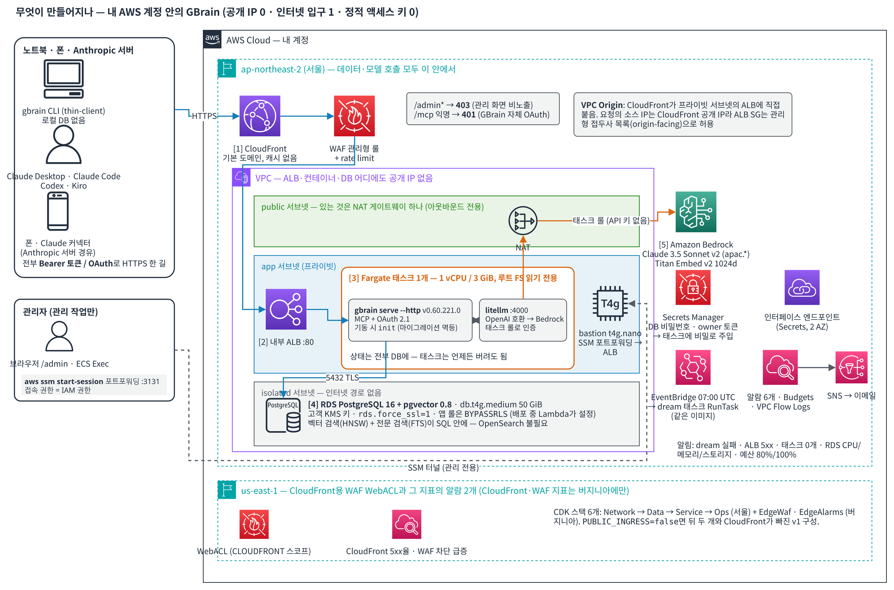
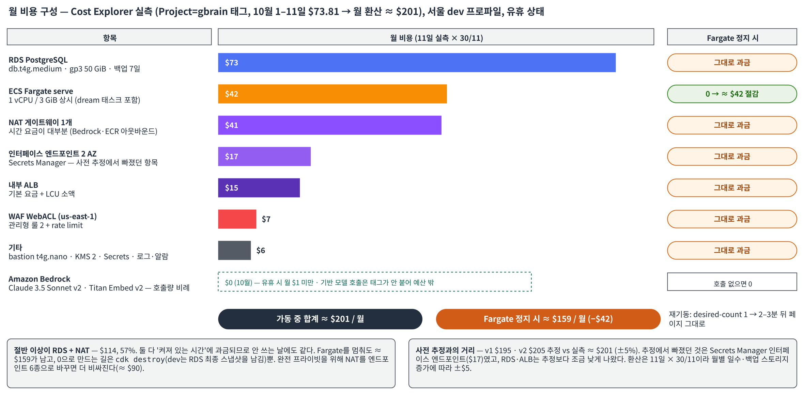
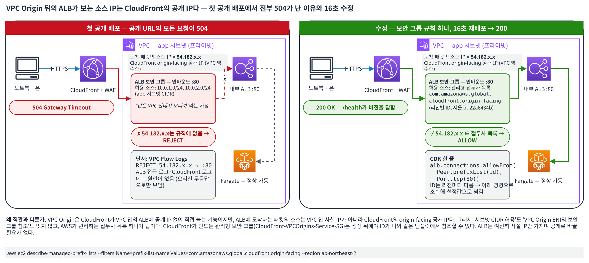
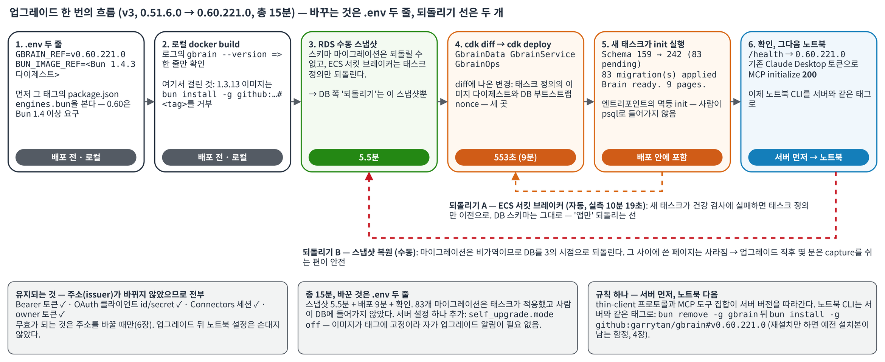

# AI 에이전트에게 "내 기억"을 달아주기 — GBrain을 AWS에 프라이빗하게 배포하고 노트북에서 쓰는 법

> 이 글은 3부로 나뉘어 있습니다: [1부](/ai-agent-memory-on-aws/ai-gbrain-aws/) · [2부](/ai-agent-memory-on-aws/ai-gbrain-notebook-agents/) · [3부](/ai-agent-memory-on-aws/ai-gbrain-operations/)

> 이 글은 [garrytan/gbrain](https://github.com/garrytan/gbrain)을 **코드 수정 없이** AWS CDK만으로 서울 리전에 올리고, 맥북의 CLI와 Claude Desktop·Claude Code·Codex·Kiro에서 실제로 사용하기까지의 기록입니다. 처음 며칠은 SSM 터널로만 접속했고(v1, 09-22), 그다음 CloudFront VPC Origin으로 **공개 URL 하나만** 열었습니다(v2, 09-28). 10-14에는 서버를 v0.51.6.0에서 **v0.60.221.0**으로 제자리 업그레이드했습니다(v3). 모든 수치는 2026-09-22부터 10-15 사이에 직접 측정한 값이고, 명령은 실제로 실행해 동작을 확인한 것입니다. 아직 직접 돌려 보지 않은 것은 본문에 그렇게 적었습니다.

> **갱신 이력** — v1 09-25 초판(터널) · v2 09-28 공개 URL 추가 · v3 10-15 0.60 업그레이드 기록, 노트북 CLI 재설치 함정, Claude Code·Codex·Kiro 연동(5장), 토큰 발급·회수(6장), 첨부파일 PR 결과(8장), 노트북 쪽 증상별 표(9장) 반영.

---

## 1. 왜 이걸 했나

Claude, Kiro, Codex 같은 AI 에이전트를 매일 쓰다 보면 한 가지가 계속 아쉽습니다. **대화가 끝나면 다 잊는다**는 것. 어제 결정한 내용, 지난주 회의 메모, 어떤 고객이 뭘 물어봤는지를 매번 다시 붙여넣어야 합니다.

GBrain은 이 문제를 푸는 오픈소스입니다. 마크다운 페이지를 PostgreSQL + pgvector에 저장하고, 어떤 에이전트든 MCP(Model Context Protocol)로 붙어서 **검색하고, 기억하고, 인용하며 답하게** 해 줍니다. 밤에는 `dream`이라는 배치가 돌아 중복을 정리하고 사실을 추출합니다. Y Combinator의 Garry Tan이 자기 에이전트용으로 만들어 공개했고, 15만 페이지 규모로 운영 중이라고 합니다.

문제는 **어디에 둘 것인가**입니다. 업스트림 문서는 Supabase나 Railway 같은 SaaS, 혹은 Tailscale로 노트북을 공개하는 방법을 안내합니다. 저는 세 가지 조건이 있었습니다.

1. 데이터는 **내 AWS 계정** 안에, 서울 리전에 머물러야 한다.
2. 서버(ALB, 컨테이너, DB)에 **공개 IP가 하나도 없어야** 한다. 인터넷에서 들어오는 길은 없거나, 있다면 WAF 뒤의 CloudFront 하나여야 한다.
3. IAM 사용자 정적 액세스 키를 **하나도 만들지 않아야** 한다.

3번은 회사 계정 정책이지만, 개인 계정에서도 그렇게 하는 것이 맞습니다. 이 글은 그 조건을 전부 만족시키면서 GBrain을 올린 결과물입니다. 처음(v1)에는 2번을 "인터넷 입구 0"으로 잡고 SSM 터널로만 썼는데, 폰이나 Claude 커넥터에서도 쓰고 싶어져서 며칠 뒤 CloudFront **VPC Origin**으로 입구 하나를 열었습니다(v2). 그 과정에서 배운 것이 이 글의 절반입니다.

---

## 2. 무엇이 만들어지나



*그림 1. 무엇이 만들어지나. 인터넷에서 들어오는 길은 CloudFront 하나이고 그 뒤의 ALB·컨테이너·DB는 전부 프라이빗 서브넷에 있습니다. 용어: **VPC Origin**은 CloudFront가 프라이빗 서브넷의 ALB에 공개 IP 없이 직접 붙는 기능, **pgvector**는 PostgreSQL 안에서 벡터(임베딩) 유사도 검색을 해 주는 확장, **태스크 롤**은 컨테이너에 자동으로 주어지는 임시 자격증명(API 키를 둘 필요가 없음)입니다.*

| 구성 요소 | 선택 | 이유 |
|---|---|---|
| 컴퓨트 | ECS Fargate 1태스크 (1 vCPU / 3 GiB), 루트 FS 읽기 전용 | 서버 관리 없음. gbrain은 상태를 전부 DB에 두므로 컨테이너는 언제든 버려도 됨 |
| gbrain | **v0.60.221.0** (10-14 업그레이드, 스키마 v242), Bun 1.4.3 이미지 | 업스트림은 하루에도 여러 번 릴리스. 이미지에 태그를 고정하고 서버 먼저, 노트북 다음 순서로 올림(3장) |
| DB | RDS PostgreSQL 16.13 + pgvector 0.8.1, db.t4g.medium 50 GiB | 업스트림 권장 엔진. isolated 서브넷, `rds.force_ssl=1`, 고객 KMS 키 |
| LLM | LiteLLM 사이드카 -> Amazon Bedrock | gbrain은 OpenAI 호환 API를 기대. LiteLLM이 Bedrock으로 번역하고 **태스크 롤**로 인증 -> API 키 0개 |
| 모델 | 채팅 `apac.anthropic.claude-3-5-sonnet-20241022-v2:0`, 임베딩 `amazon.titan-embed-text-v2:0` (1024차원) | 둘 다 APAC 안에서만 라우팅. 최신 Claude는 서울에서 `global.*` 프로파일만 있어 데이터가 리전 밖으로 나갈 수 있어 제외 |
| 입구 (v1) | 내부 ALB + SSM 포트포워딩 bastion | 공개 IP 없음. 접속 권한 = IAM 권한. v2 이후에도 관리 화면(`/admin`) 전용으로 남김 |
| 입구 (v2) | CloudFront(기본 도메인) → **VPC Origin** → 같은 내부 ALB, 앞에 WAF | ALB를 공개로 바꾸지 않고도 CloudFront가 프라이빗 서브넷의 ALB에 직접 붙음. 인터넷 게이트웨이 경유 인바운드 여전히 0. 도메인·인증서 없이 `*.cloudfront.net`으로 시작 |
| 운영 | dream 스케줄 태스크, 알람 6개(+CloudFront·WAF 2개), Budgets, VPC Flow Logs | 밤에 알아서 돌고, 깨지면 메일 |

CDK 스택은 v1 4개(`Network -> Data -> Service -> Ops`)에 v2에서 us-east-1 2개(`EdgeWaf`, `EdgeAlarms` -- CloudFront용 WAF와 그 지표의 알람은 버지니아에만 만들 수 있습니다)가 붙습니다. 비용은 **v1 추정 $195, 실측 $210/월**이었고, v2(WAF ≈ $10)를 포함한 10월 1–11일 실측은 **≈ $200/월**(유휴 상태, Bedrock 호출 거의 0)입니다. 절반 이상이 RDS(≈ $73)와 NAT 게이트웨이(≈ $41)입니다(그림 2).



*그림 2. 월 비용 구성(Cost Explorer, `Project=gbrain` 태그, 10월 1–11일 실측을 월로 환산). 절반 이상이 RDS와 NAT 게이트웨이이고 둘 다 "켜져 있는 시간"에 과금되므로, Fargate를 멈춰도 ≈ $160는 남습니다. Bedrock은 호출량 비례(유휴 시 월 $1 미만)이고 태그가 붙지 않아 예산 밖입니다. 용어: **NAT 게이트웨이**는 프라이빗 서브넷이 밖으로 나가는(인바운드는 없는) 출구, **인터페이스 엔드포인트**는 NAT를 거치지 않고 AWS 서비스(여기서는 Secrets Manager)에 사설망으로 붙는 접점입니다.*

---

## 3. 배포 — 실제로 걸린 시간

```bash
cp .env.example .env      # 계정 ID, 리전, 모델 ID, 이미지 다이제스트, 알람 이메일
npm ci && npx cdk synth   # 스택 합성 + 단위 테스트(현재 90개)
npx cdk deploy GbrainNetwork GbrainData     # 17분 (RDS 생성이 14분)
npx cdk deploy GbrainService GbrainOps      # 13분 (이미지 빌드·푸시 포함)
```

두 가지 설계 선택이 배포를 단순하게 만들었습니다.

**DB 초기화를 CloudFormation 커스텀 리소스로.** pgvector 확장 설치와 애플리케이션 롤 생성을 Lambda가 배포 중에 수행합니다. 사람이 psql로 들어갈 일이 없고, 로그에 비밀이 남지 않도록 결과만 (`vector extension ok`, `BYPASSRLS ok`) 찍습니다.

**컨테이너 엔트리포인트가 `gbrain init`을 매번 실행.** 첫 태스크는 스키마 마이그레이션을 적용하고, 이후 태스크는 `Brain ready. N pages`만 찍고 지나갑니다. 멱등이라는 것을 실측으로 확인했기 때문에 "초기화 완료 여부"를 어디에 기록할 필요가 없습니다. 이 선택이 3주 뒤 업그레이드를 "이미지 태그 한 줄"로 만들어 줬습니다(아래).

**v2 공개 인그레스(09-28)**는 `.env`에 플래그 하나(`PUBLIC_INGRESS=true`)를 켜고 `cdk deploy` 4스택으로 19분 20초. 대부분이 CloudFront VPC Origin 생성(9분 35초)과 Distribution(2분 48초)이었고, 태스크 정의에 `GBRAIN_PUBLIC_URL`이 들어가면서 서비스가 한 번 롤링 교체됐습니다(4분 25초). 플래그가 꺼져 있으면 v1 템플릿은 바이트 단위로 동일합니다 -- 테스트가 그것을 고정합니다.

### 실제로 부딪힌 것들

문서만 보고 짠 코드가 실제 배포에서 깨진 지점들입니다. 같은 구성을 하실 분들이 시간을 아끼시길 바라며 그대로 적습니다.

| 증상 | 원인 | 해결 |
|---|---|---|
| `self signed certificate in certificate chain` | gbrain 런타임인 Bun은 시스템 CA 저장소를 안 보고, postgres.js는 URL의 `sslrootcert`를 무시 | Dockerfile에 RDS CA 번들을 넣고 `NODE_EXTRA_CA_CERTS`로 지정 |
| `unrecognized configuration parameter "sslrootcert"` | postgres.js가 모르는 URL 파라미터를 그대로 서버 세션 설정으로 넘김 | URL에서 제거, `?sslmode=verify-full`만 남김 |
| ECS Exec `agent STOPPED` | 루트 FS를 읽기 전용으로 잠갔더니 SSM 에이전트가 쓸 곳이 없음 | `/var/lib/amazon`, `/var/log/amazon`에 임시 볼륨 마운트 |
| Bedrock `model_not_found` + "marked by provider as Legacy" | 인퍼런스 프로파일 상태는 ACTIVE인데 실제 호출은 거부 | 프로파일 목록만 믿지 말고 `converse` 1회 호출로 확인. 모델 교체 |
| dream이 `ANTHROPIC_API_KEY` 요구 | 업스트림 기본값이 게이트웨이(LiteLLM)를 안 씀 | `gbrain config set agent.use_gateway_loop true` |
| Budgets 재배포 실패 "same name but a different internalId" | 구독자 변경 = 리소스 교체인데 이름이 고정 | 구독자를 SNS 토픽으로 고정하고 토픽이 이메일로 fan-out |
| (v2) 공개 URL이 전부 **504** | VPC Origin을 거친 요청은 ALB에 **CloudFront의 공개 IP**(54.182.x.x)를 소스로 도착. 서브넷 CIDR로 연 SG 규칙은 무효 -- Flow Logs REJECT로 확인 | ALB SG에 관리형 접두사 목록 `com.amazonaws.global.cloudfront.origin-facing`(리전별 `pl-…`) 허용. 16초 재배포 |
| (v2) 공개 URL 전환 후 모든 클라이언트 401 | 토큰이 `resource=<issuer>/mcp`에 묶여 있어 issuer가 localhost → CloudFront로 바뀌면 전부 무효 | 토큰 재발급. OAuth 클라이언트(id/secret)는 유효해서 `init`만 다시 하면 됨(6장) |
| (v2) CloudFront 지표 알람을 서울 스택에 만들면 지표가 없음 | CloudFront·WAF 지표는 us-east-1, 알람과 SNS 액션은 지표와 같은 리전이어야 함 | us-east-1에 알람 스택 하나 더 |
| (v2) 크로스리전 참조에 Secrets Manager 동적 참조를 얹으면 실패 | `{{resolve:secretsmanager}}`를 SSM 파라미터 경유 토큰과 중첩 불가 | 헤더 검증용 Secret을 ALB와 같은 리전에 |
| (v3) 새 gbrain 이미지 빌드 자체가 실패 | 0.60은 **Bun 1.4.0 이상**을 요구. 기존 1.3.13 이미지로는 `bun install -g github:garrytan/gbrain#<tag>`가 거부됨 | 태그의 `package.json` `engines.bun`을 먼저 보고 `BUN_IMAGE_REF`를 1.4.3 다이제스트로 함께 올림 |
| (v3) `cdk diff`에 없던 bastion 교체 | `latestAmazonLinux2023()`가 배포 시점에 SSM에서 최신 AMI를 조회 → 새 AMI가 나오면 매 배포마다 인스턴스가 바뀜 | 터널 명령은 외우지 말고 매번 스택 Output(`TunnelCommand`)에서 다시 읽기 |

표에서 가장 비직관적인 것은 504 건입니다. 그림으로 보면 이렇습니다.



*그림 3. 첫 공개 배포에서 모든 요청이 504였던 이유. **VPC Origin**으로 들어온 요청은 ALB에 CloudFront의 공개 IP(54.182.x.x)를 소스로 도착하므로, "같은 VPC 안에서 오니까"라고 서브넷 CIDR을 허용한 **보안 그룹**(인스턴스 단위 방화벽) 규칙은 한 건도 맞지 않습니다. 답은 AWS가 관리하는 CloudFront origin-facing **접두사 목록**(IP 대역 묶음, 리전마다 ID가 다름) 하나를 허용하는 것이고, 단서는 ALB 로그가 아니라 VPC Flow Logs의 REJECT 줄이었습니다. ALB는 그대로 사설 IP만 가집니다.*

배포 후 "잘못된 태스크 정의를 배포하면 어떻게 되나"도 확인했습니다. 일부러 DB 포트를 틀리게 넣어 배포하자 ECS 서킷 브레이커가 **10분 19초에 자동 롤백**했고, 브레인의 페이지는 그대로였습니다.

### 업그레이드 (v3, 10-14) — 0.51.6.0에서 0.60.221.0으로

업스트림은 3주 사이에 0.51에서 0.60으로 뛰었고(릴리스가 하루 수 회), 스키마는 **v159에서 v242로 83개 마이그레이션**이 쌓였습니다. 절차는 네 단계였고 총 15분이 걸렸습니다.



*그림 4. 업그레이드 한 번의 흐름과 되돌리기 선 두 개. ECS **서킷 브레이커**는 새 태스크가 건강 검사를 통과하지 못하면 자동으로 이전 태스크 정의로 돌아가는 기능이지만 DB 스키마는 건드리지 않습니다. 그래서 스키마 **마이그레이션**(DB 구조를 새 버전에 맞게 바꾸는 SQL, 되돌릴 수 없음)의 되돌리기는 배포 전 **스냅샷**(RDS가 찍는 DB 전체의 시점 복사본)뿐입니다. 토큰과 OAuth 클라이언트는 주소(issuer)가 바뀌지 않았으므로 전부 그대로입니다.*

1. `.env`의 `GBRAIN_REF`를 `v0.60.221.0`으로, `BUN_IMAGE_REF`를 1.4.3 다이제스트로. 배포 전에 로컬에서 `docker build`해서 로그의 `gbrain --version =>` 줄로 설치가 되는지만 확인(위 표의 Bun 1.4 요구가 여기서 걸렸습니다).
2. **RDS 수동 스냅샷**(5.5분). 스키마 마이그레이션은 되돌릴 수 없고, ECS 서킷 브레이커는 태스크 정의만 되돌리기 때문에 DB 쪽 "되돌리기"는 스냅샷이 유일합니다.
3. `npx cdk deploy GbrainData GbrainService GbrainOps` — 553초. `cdk diff`에 나온 변경은 태스크 정의 이미지 다이제스트와 DB 부트스트랩의 nonce 세 곳뿐이었습니다.
4. 새 태스크 로그 확인: `Schema version 159 → 242 (83 migration(s) pending)` → `83 migration(s) applied` → `Brain ready. 9 pages.` 공개 URL `/health`가 `0.60.221.0`을 답하고, **기존 Claude Desktop 토큰으로 MCP `initialize`가 200** — 업그레이드로는 토큰·OAuth 클라이언트가 무효가 되지 않았습니다(issuer 변경 때만 무효, 6장).

업그레이드에서 바꾼 설정 하나: 0.60은 **자가 업그레이드 체커**(`self_upgrade.mode`, 기본 `notify`)가 생겼습니다. 서버 이미지는 태그에 고정되어 있으므로 엔트리포인트에 `gbrain config set self_upgrade.mode off`를 추가했습니다. 새로 나온 경고 하나(`GBRAIN_HTTP_CORS_ORIGIN unset`)는 브라우저에서 OAuth 엔드포인트를 직접 치는 교차 출처 요청만 거부하는 것이라 그대로 두었습니다. mcp-remote나 Claude Connectors의 서버 간 토큰 교환과는 무관합니다.

규칙은 하나입니다. **서버 먼저, 노트북 다음.** thin-client 프로토콜과 MCP 도구 집합이 서버 버전을 따라가므로 노트북만 올리면 어긋납니다.

---

---

다음: [GBrain 2부: 노트북에서 쓰기와 에이전트에 붙이기](/ai-agent-memory-on-aws/ai-gbrain-notebook-agents/)
