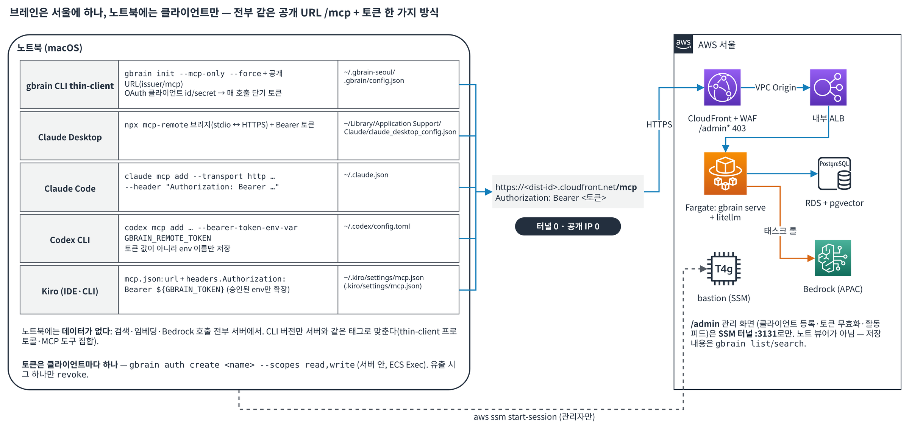

# GBrain 2부: 노트북에서 쓰기와 에이전트에 붙이기

> 이 글은 3부로 나뉘어 있습니다: [1부](/ai-agent-memory-on-aws/ai-gbrain-aws/) · [2부](/ai-agent-memory-on-aws/ai-gbrain-notebook-agents/) · [3부](/ai-agent-memory-on-aws/ai-gbrain-operations/)

## 4. 노트북에서 쓰기

여기서부터가 매일 하는 일입니다. 구조를 먼저 그리면: 데이터·검색·임베딩·Bedrock 호출은 전부 서울 Fargate의 gbrain 서버에서 일어나고, 노트북에 설치한 gbrain은 **thin-client**(`gbrain init --mcp-only`)라 로컬 DB가 없습니다. `capture`/`search`/`think`를 서버 `/mcp`에 위임하는 터미널용 클라이언트입니다. Claude Desktop·Claude Code·Codex·Kiro는 이 CLI를 거치지 않고 **각자 MCP(HTTP)로 같은 `/mcp`에 직접** 붙습니다(5장).



*그림 5. 브레인은 서울에 하나, 노트북에는 클라이언트만. 다섯 클라이언트가 전부 같은 주소에 같은 방식(Bearer 토큰)으로 붙고, 설정이 남는 파일이 각각 다릅니다. 용어: **thin-client**는 로컬 DB 없이 모든 명령을 서버 `/mcp`에 위임하는 CLI 모드, **MCP**는 에이전트가 외부 도구(여기서는 브레인)를 호출하는 표준 프로토콜입니다.*

### 4.1 준비물 (한 번)

- AWS CLI v2 + `session-manager-plugin` (`brew install awscli session-manager-plugin`) -- 토큰 발급(ECS Exec)과 관리 화면(`/admin`) 터널에만
- 그 계정에 `ssm:StartSession`(터널)과 `ecs:ExecuteCommand`(자격증명 발급) 권한
- Bun 1.4.0+ (`curl -fsSL https://bun.sh/install | bash`, 있으면 `bun upgrade`) — 0.60 요구 사항
- Node 18+ (`brew install node`) — Claude Desktop 브리지 `mcp-remote`를 `npx`로 띄울 때만. Claude Code·Codex·Kiro는 필요 없음
- gbrain CLI — **npm에 없습니다.** npm의 `gbrain`은 이름만 같은 무관한 패키지라 설치하면 진짜 바이너리를 가립니다. 서버와 같은 태그로 GitHub에서 설치합니다.

```bash
bun install -g github:garrytan/gbrain#v0.60.221.0
gbrain --version   # gbrain 0.60.221.0
```

이미 `npm install -g gbrain`을 했다면 `npm uninstall -g gbrain` 뒤에 위 명령으로 재설치합니다. `which -a gbrain`에 `~/.bun/bin/gbrain` 외의 경로가 나오면 그쪽이 가리는 것이고, `gbrain doctor`도 가려진 설치를 찾아 알려 줍니다.

**재설치 함정(10-15 실측).** 0.51이 이미 깔린 노트북에서 위 명령을 태그만 바꿔 다시 실행했는데 `gbrain --version`이 계속 `0.51.6.0`이었습니다. `bun install -g`가 전역 `package.json`의 spec은 새 태그로 바꿔 놓고도 `bun.lock`에 잠긴 예전 커밋 해석을 그대로 두어 `node_modules/gbrain`을 교체하지 않은 것입니다. 확인과 해결:

```bash
grep gbrain ~/.bun/install/global/package.json                              # spec은 v0.60.221.0인데
grep '"version"' ~/.bun/install/global/node_modules/gbrain/package.json     # 실제 설치본은 0.51.6.0이면 이 경우

bun remove -g gbrain
bun install -g github:garrytan/gbrain#v0.60.221.0
rehash                                                                      # zsh 명령 캐시 갱신
gbrain --version                                                            # gbrain 0.60.221.0
```

### 4.2 터널 열기 (관리할 때만)

v1에서는 이것이 매일 첫 번째 일이었습니다. v2 이후 터널은 `/admin` 관리 화면과 Claude 커넥터의 OAuth 동의 화면(5.1)에만 필요합니다. 로컬 포트는 **반드시 3131** -- `--public-url`을 설정하지 않은 v1 서버는 OAuth 발급자 주소를 `http://localhost:3131`로 고정해서 돌려주기 때문에, 3132로 열면 토큰 요청이 400으로 실패합니다(직접 확인했습니다).

```bash
aws ssm start-session --target <bastion-instance-id> \
  --document-name AWS-StartPortForwardingSessionToRemoteHost \
  --parameters host=<internal-alb-dns>,portNumber=80,localPortNumber=3131 \
  --region ap-northeast-2

curl -s localhost:3131/health
# {"status":"ok","version":"0.60.221.0","engine":"postgres"}
```

별도 터미널 탭에 띄워 두고 쓰는 동안 닫지 않습니다. `curl`이 빈 응답이면 터널이 닫힌 것이고, 3131을 다른 프로세스(예: 다른 브레인의 터널)가 쓰고 있으면 `lsof -i :3131`로 찾아 먼저 닫아야 합니다.

이 명령은 CDK 스택 Output(`TunnelCommand`)에 완성된 형태로 나오므로 외울 필요는 없고, **외우면 안 됩니다.** 10-14 업그레이드 때 `cdk diff`에 없던 bastion 교체가 일어나 `--target` 인스턴스 ID가 바뀌었습니다. 배포 뒤에는 아래로 다시 읽습니다.

```bash
aws cloudformation describe-stacks --stack-name GbrainService --region ap-northeast-2 \
  --query "Stacks[0].Outputs[?OutputKey=='TunnelCommand'].OutputValue" --output text
```

### 4.3 자격증명 만들기 — 두 종류

| 종류 | 누가 쓰나 | 만드는 명령 | 서버에 남는 것 |
|---|---|---|---|
| **OAuth 클라이언트** (`gbrain_cl_…` id + `gbrain_cs_…` secret) | gbrain CLI thin-client. 매 호출마다 `client_credentials`로 단기 액세스 토큰을 받아 씀 | `gbrain auth register-client <name> --grant-types client_credentials --scopes read,write` | secret의 해시만. 잃으면 복구 불가, 재등록 |
| **Bearer 토큰** (`gbrain_…`) | Claude Desktop·Claude Code·Codex·Kiro 같은 MCP 클라이언트. 만료 없음 | `gbrain auth create <name> --scopes read,write` | 토큰의 해시만. 발급 순간 1회 표시 |

둘 다 서버 안에서 `gbrain auth` 명령을 실행해야 합니다. 컨테이너에 SSH가 없으니 ECS Exec을 씁니다. 노트북 터미널에서 그대로 치면 AWS가 컨테이너 안에서 대신 실행해 결과를 보여 줍니다. 터널은 필요 없습니다.

```bash
aws sts get-caller-identity --query Account --output text       # 배포한 계정인지 먼저 확인

TASK=$(aws ecs list-tasks --cluster gbrain-dev --service-name gbrain-dev-serve \
  --desired-status RUNNING --region ap-northeast-2 --query 'taskArns[0]' --output text | awk -F/ '{print $NF}')
echo "$TASK"                                                     # 32자 hex. 비어 있으면 자격증명/리전 문제

# CLI용 OAuth 클라이언트 (id + secret)
aws ecs execute-command --cluster gbrain-dev --task "$TASK" --container gbrain --interactive --region ap-northeast-2 \
  --command 'gbrain auth register-client laptop --grant-types client_credentials --scopes read,write'

# MCP 클라이언트용 Bearer 토큰 — 에이전트마다 하나씩 (회수 단위를 나누기 위해)
aws ecs execute-command --cluster gbrain-dev --task "$TASK" --container gbrain --interactive --region ap-northeast-2 \
  --command 'gbrain auth create claude-desktop --scopes read,write'
```

출력되는 secret과 토큰은 **그 자리에서만** 보입니다. 서버는 해시만 저장하니 바로 저장하세요. 잃으면 새로 만들면 됩니다(6장). `gbrain remote doctor`(원격 진단)까지 쓰려면 `--scopes read,write,admin` 클라이언트를 따로 하나 더 만드는 쪽을 권합니다. 일상용과 진단용을 분리해 두는 편이 안전합니다.

> 자동화 도구에서 이 명령을 돌리면 TTY가 없어 `script -qec "…" /dev/null` 래퍼가 필요한데, macOS의 BSD `script`에는 `-c`가 없습니다. 사람이 터미널에서 칠 때는 래퍼 없이 위 명령 그대로가 맞습니다.

### 4.4 CLI 초기화

```bash
export GBRAIN_HOME=~/.gbrain-seoul          # 다른 브레인 설정과 분리
gbrain init --mcp-only --force \
  --issuer-url https://<dist-id>.cloudfront.net \
  --mcp-url    https://<dist-id>.cloudfront.net/mcp \
  --oauth-client-id     gbrain_cl_여기에_4.3의_Client_ID \
  --oauth-client-secret gbrain_cs_여기에_4.3의_Client_Secret
# ✓ OAuth discovery  ✓ token  ✓ MCP initialize → Thin-client mode configured
```

세 가지를 알고 실행하면 됩니다.

- **`--force`는 0.60부터 필수**입니다. 홈에 thin-client 설정이 이미 있으면 `Thin-client config already present ... Use --force to overwrite`로 거부합니다. 공개 URL로 처음 init하는 경우라도 09-28 이전에 `localhost:3131`로 init한 홈이 남아 있으면 같은 메시지를 봅니다.
- **secret을 어디에 둘지.** 플래그로 주면 `~/.gbrain-seoul/.gbrain/config.json`(gbrain이 0600으로 씀)에 평문 저장되고 이후 env 없이 동작합니다. 대신 `GBRAIN_REMOTE_CLIENT_ID` / `GBRAIN_REMOTE_CLIENT_SECRET` 환경변수로 주면 파일에는 남지 않지만 **이후 모든 실행에 그 env가 필요**합니다. 저는 09-23에 env 방식을 썼고, 10-15에 `.zshrc`에서 그 줄이 사라진 것을 발견했습니다. 서버에는 해시만 있어 복구가 안 되므로 클라이언트를 새로 등록해 플래그 방식으로 갈아탔습니다(6.3). 셸 히스토리에 secret이 남는 것이 싫으면 실행 후 `history -d`로 지우세요.
- v1(터널)에서 v2(공개 URL)로 넘어갈 때는 한 번 다시 `init`해야 합니다. 토큰은 발급자(issuer) 주소에 묶여 있어 전부 무효가 되지만, 클라이언트 id/secret은 그대로 쓰면 됩니다.

확인은 한 줄입니다. 첫 줄에 어디에 붙었는지가 찍힙니다.

```bash
GBRAIN_HOME=~/.gbrain-seoul gbrain search "예산"
# [thin-client → <dist-id>.cloudfront.net · brain: 9 pages, 12 chunks · v0.60.221.0]
```

이때 함께 뜬 `gbrain 0.60.221.0 -> 0.60.238.0 available. Run: gbrain self-upgrade`는 노트북 CLI의 자가 업그레이드 알림입니다. **노트북에서 `self-upgrade`를 하면 안 됩니다** -- 서버는 이미지에 고정되어 있어 노트북만 올라가면 어긋납니다. 알림은 환경변수 `GBRAIN_SELF_UPGRADE_MODE=off`로 끕니다(0.60은 env > 파일 설정 > 기본 `notify` 순으로 읽습니다). 파일 설정을 바꾸는 `gbrain config set self_upgrade.mode off`는 `config`가 로컬 엔진을 요구하는 명령으로 분류돼 thin-client에서는 `requires_local_engine`으로 거부될 수 있어 쓰지 않습니다.

**`GBRAIN_HOME`을 매번 붙이지 않기.** `GBRAIN_HOME` 없이 `gbrain list`를 치면 CLI가 기본 홈 `~/.gbrain`(비어 있음)을 보고 `Error [no_brain]: No brain configured. Run: gbrain init` 과 함께 `Fix: gbrain init --pglite --no-embedding`을 제안합니다. **그 Fix를 실행하지 마세요.** `~/.gbrain`에 빈 로컬 브레인이 생겨, 이후 env를 빼먹은 명령이 오류 대신 빈 결과를 조용히 돌려줍니다. 대신 셸 설정에 고정합니다(노트북 `~/.gbrain`에 다른 브레인이 없을 때. 있으면 `alias gbs='GBRAIN_HOME=$HOME/.gbrain-seoul gbrain'`처럼 별칭으로).

```bash
cat >> ~/.zshrc <<'EOF'

# gbrain thin-client (Seoul)
export GBRAIN_HOME="$HOME/.gbrain-seoul"
export GBRAIN_SELF_UPGRADE_MODE=off
EOF
source ~/.zshrc
gbrain list --limit 100      # env 없이 바로 동작, self-upgrade 알림 없음
```

### 4.5 일상 명령

```bash
gbrain capture "오늘 회의: 예산 필터를 Project 태그로 바꾸기로 함"
gbrain capture --file ./notes/2026-10-15-meeting.md
gbrain list --limit 100
gbrain search "예산"
gbrain think "예산 관련해서 결정한 게 뭐였지?"
```

`list`는 최근 수정순 페이지 목록(슬러그·제목·시각)이라 "뭐가 들어 있지?"를 훑는 용도입니다. `search`는 관련 페이지 목록을 돌려주고, `think`는 그 페이지들을 근거로 **답변 + 인용 + "브레인이 모르는 부분"**을 써 줍니다. "뭘 결정했었지?"에는 `think`가 맞고, "그 문서 어디 있지?"에는 `search`가 맞습니다.

두 가지 실사용 교훈. 첫째, `capture`는 인자를 **텍스트 그대로** 저장합니다. 파일을 넣으려다 경로를 인자로 넘기면 경로 문자열 한 줄이 페이지가 되어 검색 노이즈만 됩니다(제 브레인에도 그런 페이지가 하나 생겼습니다. 지우는 명령은 `gbrain delete <slug>`입니다). 파일은 `--file`, 파이프는 `--stdin`입니다. 둘째, 페이지가 열 장도 안 되는 상태에서 `search "예산"`을 치면 "예산"과 무관한 유전체 논문이 0.72점으로 1위에 옵니다. 키워드 매칭이 0건이면 벡터 유사도만으로 줄을 세우기 때문입니다. 검색 품질은 실제 메모와 문서를 몇백 장 적재한 뒤에 평가해야 합니다.

---

## 5. 에이전트에 붙이기 — Claude Desktop · Claude Code · Codex · Kiro

GBrain에는 공식 데스크톱 앱이 없습니다. 설계 철학이 "UI는 여러분이 이미 쓰는 에이전트, GBrain은 그 뒤의 기억"이기 때문입니다. 네 가지 클라이언트 모두 같은 원리입니다. **공개 URL `/mcp` + `Authorization: Bearer <토큰>`**, 터널 없음. 토큰은 4.3의 `gbrain auth create <name> --scopes read,write`로 클라이언트마다 하나씩 만듭니다.

업스트림 튜토리얼의 `claude mcp add gbrain -- gbrain serve …` 같은 **로컬 stdio 방식은 이 구성에 해당하지 않습니다.** thin-client는 `gbrain serve`를 띄울 수 없고(엔진이 없음), 브레인은 서버에 있으니 전부 원격 HTTP로 붙어야 합니다.

한 가지 먼저 짚을 것. 브레인을 내 계정 안에 두는 것과, 그 내용을 외부 AI 서비스(Claude Desktop·Connectors·Codex 등)로 보내는 것은 별개의 문제입니다. 에이전트가 `search`를 호출하면 검색 결과 본문이 그 에이전트의 모델 제공자로 올라갑니다. 저는 이 브레인에 업무 데이터를 넣지 않는 것을 전제로 썼고, 회사 데이터를 넣으려면 배포 설계가 아니라 **데이터 취급 정책**을 먼저 확인해야 합니다.

연결 전에 서버 쪽이 정상인지 가르는 한 줄(200이면 서버·토큰 정상, 401이면 토큰 문제):

```bash
curl -sS -o /dev/null -w '%{http_code}\n' -X POST https://<dist-id>.cloudfront.net/mcp \
  -H "Authorization: Bearer <토큰>" -H 'content-type: application/json' -H 'accept: application/json, text/event-stream' \
  -d '{"jsonrpc":"2.0","id":1,"method":"initialize","params":{"protocolVersion":"2025-06-18","capabilities":{},"clientInfo":{"name":"curl","version":"0"}}}'
```

| 클라이언트 | 방법 | 설정이 남는 곳 | 검증 상태 |
|---|---|---|---|
| Claude Desktop | 설정 파일 + `mcp-remote` 브리지 (또는 Connectors) | `claude_desktop_config.json` | 09-28 실측. 10-14 업그레이드 뒤 같은 토큰으로 `initialize` 200 재확인 |
| Claude Code | `claude mcp add --transport http … --header` | `~/.claude.json` | 설정 기준(10-15 작성 시점에 직접 실행 전) |
| Codex CLI | `codex mcp add … --bearer-token-env-var` | `~/.codex/config.toml` | 설정 기준(같음) |
| Kiro (IDE·CLI) | `mcp.json`에 `url` + `headers` | `~/.kiro/settings/mcp.json` | 설정 기준(같음) |

Claude Code와 Codex의 명령은 gbrain 0.60에 들어 있는 `gbrain connect <mcp-url> --token <토큰> --agent claude-code|codex --install`이 내부적으로 생성·실행하는 것과 같은 형태입니다(소스 `src/core/mcp-registration.ts`). `connect`는 등록 뒤 `get_brain_identity` 호출로 스모크 테스트까지 해 주는데, thin-client CLI에서의 동작은 아직 제가 직접 돌려 보지 않아 아래에는 각 도구의 명령을 직접 적었습니다.

### 5.1 Claude Desktop

**v1(터널)에서의 함정.** Claude Desktop의 **Settings > Connectors**(예전 이름 Integrations)에 `http://localhost:3131/mcp`를 넣으면 안 됩니다. 커넥터는 Anthropic 서버를 경유해 접속하므로 노트북에서만 보이는 주소에 닿지 못합니다. 그래서 v1에서는 **로컬 stdio 브리지**(`mcp-remote`)를 썼습니다. Claude Desktop이 노트북에서 작은 프로세스를 띄우고, 그 프로세스가 터널을 타고 서버로 갑니다.

**v2(공개 URL)에서는 셋 다 됩니다.** 실제로 검증한 순서대로:

1. **설정 파일 + `mcp-remote` 브리지** (기본). v1과 같은 방식인데 URL과 토큰만 바뀌고 **터널이 필요 없습니다.** `~/Library/Application Support/Claude/claude_desktop_config.json`에 기존 내용은 그대로 두고 `mcpServers`만 추가합니다. (조직이 배포한 빌드는 `Application Support` 아래 디렉터리 이름이 다를 수 있으니 같은 파일명을 찾으세요.)

```json
{
  "preferences": { "...기존 내용 그대로..." },
  "mcpServers": {
    "gbrain-seoul": {
      "command": "npx",
      "args": [
        "-y", "mcp-remote@latest",
        "https://<dist-id>.cloudfront.net/mcp",
        "--header", "Authorization:Bearer ${GBRAIN_TOKEN}"
      ],
      "env": { "GBRAIN_TOKEN": "4.3에서 받은 토큰" }
    }
  }
}
```

순서: Claude Desktop 완전 종료(Cmd+Q, 실행 중에 고치면 종료 시 덮어쓸 수 있음) -> 원본 백업 후 편집 -> 문법 확인 -> `chmod 600` -> 앱 실행 -> 새 대화에서 "내 브레인에서 배포 검증 찾아줘". 도구 목록에 `gbrain-seoul`이 뜨면 성공입니다.

```bash
CFG="$HOME/Library/Application Support/Claude/claude_desktop_config.json"
cp "$CFG" "$CFG.bak"
python3 -m json.tool "$CFG" > /dev/null && echo OK      # JSON 문법 확인 (쉼표 하나로 전체가 무시됨)
chmod 600 "$CFG"
```

안 보이면 (a) `which npx` 절대경로를 `command`에(Claude Desktop은 로그인 셸 PATH를 물려받지 못함), (b) 조직 정책("disabled by organization")을 확인하고, (c) 로그 `~/Library/Logs/Claude*/mcp*.log`에서 브리지 프로세스가 뭐라고 죽었는지 봅니다. `Authorization:Bearer` 사이에 공백이 없는 것은 인자 분리 문제를 피하는 `mcp-remote` 권장 표기입니다.

2. **Connectors > Add custom connector + Request headers.** URL을 넣고 Authentication을 "No sign-in"으로, Request headers에 `authorization: Bearer <토큰>`(앞의 `Bearer `와 공백 포함). 가장 깔끔하지만 Anthropic이 베타로 일부 조직에만 열어 두어 대화상자에 이 섹션이 없을 수 있습니다.

3. **Connectors + 자체 OAuth 클라이언트.** 서버에 `authorization_code` + PKCE 공개 클라이언트를 등록하고(redirect URI는 `https://claude.ai/api/mcp/auth_callback`과 `https://claude.com/api/mcp/auth_callback` 둘 다) Client ID만 입력합니다.

```bash
aws ecs execute-command --cluster gbrain-dev --task "$TASK" --container gbrain --interactive --region ap-northeast-2 \
  --command 'gbrain auth register-client claude-connector --scopes "read write" --redirect-uri https://claude.ai/api/mcp/auth_callback --redirect-uri https://claude.com/api/mcp/auth_callback --token-endpoint-auth-method none'
```

여기서 재미있는 함정이 하나 나옵니다. GBrain의 `/authorize`는 동의 화면을 **`/admin/?oauth_request=…`로 리다이렉트**하는데, 우리는 CloudFront에서 `/admin*`을 403으로 막아 두었습니다(owner 로그인·magic link를 인터넷에 내지 않기 위해). 그래서 403 페이지가 뜨면 주소창의 호스트만 `localhost:3131`로 바꿔 터널로 열고 승인합니다. 커넥터 등록 때 한 번이고, 이후에는 refresh 토큰으로 알아서 갱신됩니다. `/admin` 비노출을 유지하는 대가로 받아들일 만한 절차라고 판단했습니다.

커넥터 대화상자에서 두 가지는 이 서버에 맞지 않습니다. "Use Claude's published identity"와 "Register automatically"(동적 클라이언트 등록)는 동작하지 않으니 **"Use your own OAuth client"**에 위 Client ID만 넣고 Secret은 비웁니다. 그리고 한 번 추가한 커넥터의 인증 방식은 바꿀 수 없어, 방식 2에서 3으로 옮기려면 커넥터를 지우고 다시 추가해야 합니다.

### 5.2 Claude Code

Claude Code는 원격 HTTP MCP 서버를 직접 지원하므로 브리지 없이 한 줄입니다. `--scope user`를 주면 모든 프로젝트에서 보이고(`~/.claude.json`에 저장), 빼면 현재 프로젝트에만 등록됩니다.

```bash
claude mcp add --transport http --scope user gbrain-seoul https://<dist-id>.cloudfront.net/mcp \
  --header "Authorization: Bearer <토큰>"

claude mcp list                     # gbrain-seoul … ✓ Connected 가 보여야 함
claude mcp get gbrain-seoul
claude mcp remove --scope user gbrain-seoul   # 끊을 때
```

토큰 값이 `~/.claude.json`에 평문으로 들어가므로 파일 권한을 확인하고(`chmod 600 ~/.claude.json`), 노트북을 바꾸거나 유출이 의심되면 6장의 `revoke`로 서버 쪽에서 끊습니다.

### 5.3 Codex CLI

Codex는 토큰 **값**이 아니라 토큰이 들어 있는 **환경변수 이름**을 설정에 저장합니다. 그래서 `~/.codex/config.toml`에는 비밀이 남지 않습니다.

```bash
echo 'export GBRAIN_REMOTE_TOKEN=<토큰>' >> ~/.zshrc && source ~/.zshrc

codex mcp add gbrain-seoul --url https://<dist-id>.cloudfront.net/mcp --bearer-token-env-var GBRAIN_REMOTE_TOKEN

codex mcp list
codex mcp remove gbrain-seoul       # 끊을 때
```

`~/.codex/config.toml`에는 다음 블록이 생깁니다.

```toml
[mcp_servers.gbrain-seoul]
url = "https://<dist-id>.cloudfront.net/mcp"
bearer_token_env_var = "GBRAIN_REMOTE_TOKEN"
```

Codex를 셸이 아닌 곳(IDE 확장 등)에서 띄우면 `.zshrc`의 변수를 못 읽어 인증이 실패할 수 있습니다. 그 경우 `GBRAIN_REMOTE_TOKEN`이 export된 셸에서 Codex를 다시 띄우면 됩니다. 회사에서 배포한 Codex 래퍼가 실행 때 `config.toml`을 다시 쓰는 경우가 있는데, 등록한 블록이 사라지면 `codex --profile <이름>`용 별도 설정 파일에 같은 블록을 두는 방법이 있습니다(이 부분은 아직 확인하지 않았습니다).

### 5.4 Kiro (IDE·CLI 공통)

Kiro는 `mcp.json`에 원격 서버를 `url` + `headers`로 직접 적습니다. 전역은 `~/.kiro/settings/mcp.json`, 프로젝트별은 `.kiro/settings/mcp.json`입니다.

```json
{
  "mcpServers": {
    "gbrain-seoul": {
      "url": "https://<dist-id>.cloudfront.net/mcp",
      "headers": { "Authorization": "Bearer ${GBRAIN_TOKEN}" }
    }
  }
}
```

`${GBRAIN_TOKEN}`은 환경변수에서 확장되는데, Kiro는 **승인한 변수만** 확장합니다. IDE에서는 처음 저장할 때 승인 팝업이 뜨고(설정 "Mcp Approved Env Vars"), CLI에서는 Kiro를 띄운 셸에 `export GBRAIN_TOKEN=<토큰>`이 있어야 합니다. Dock에서 띄운 IDE가 셸 env를 못 받아 안 붙으면 값을 직접 적되 파일 권한을 600으로 둡니다. 파일을 저장하면 서버가 자동으로 재연결되고, 채팅에서 `gbrain-seoul`의 `search`/`think` 도구가 보이면 성공입니다.

---

---

다음: [GBrain 3부: 토큰 관리와 운영](/ai-agent-memory-on-aws/ai-gbrain-operations/)
