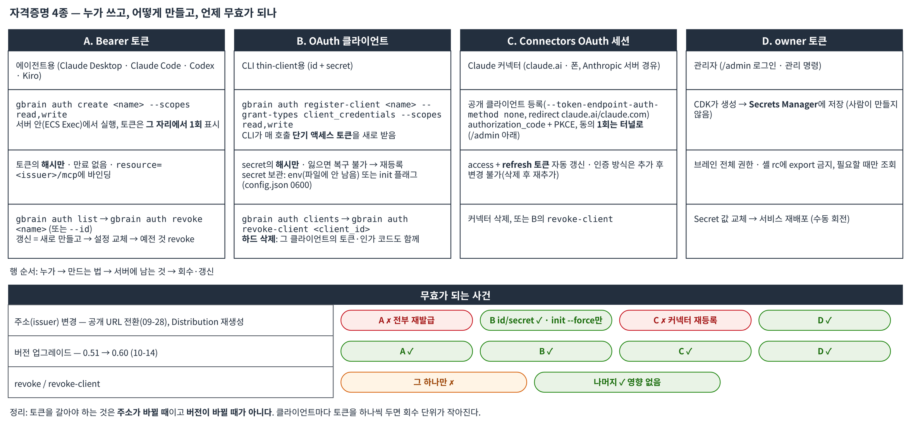

# GBrain 3부: 토큰 관리와 운영

> 이 글은 3부로 나뉘어 있습니다: [1부](/ai-agent-memory-on-aws/ai-gbrain-aws/) · [2부](/ai-agent-memory-on-aws/ai-gbrain-notebook-agents/) · [3부](/ai-agent-memory-on-aws/ai-gbrain-operations/)

## 6. 토큰 발급·갱신·회수

운영 3주 동안 토큰과 관련해 세 번 손을 댔습니다. 그때 정리한 규칙입니다.

### 6.1 무엇이 어디에 묶여 있나



*그림 6. 자격증명 네 가지와 무효가 되는 사건. 서버에는 어느 것도 원문이 남지 않고 해시만 남습니다. 용어: **OAuth 클라이언트**는 프로그램(여기서는 CLI)에 주는 아이디·비밀번호 한 쌍이고 그걸로 매번 짧게 쓰는 토큰을 받아 옵니다. **Bearer 토큰**은 그 자체가 열쇠인 긴 문자열로 에이전트 설정 파일에 들어갑니다. **issuer**는 토큰을 발급한 서버 주소이며 토큰이 그 주소에 묶입니다.*

| 자격증명 | 발급 | 유효 기간 | 무효가 되는 때 |
|---|---|---|---|
| Bearer 토큰 (에이전트용) | `gbrain auth create <name> --scopes read,write` | 만료 없음 | `revoke`, 또는 **issuer(공개 URL) 변경** |
| OAuth 클라이언트 (CLI용) | `gbrain auth register-client <name> --grant-types client_credentials --scopes read,write` | 만료 없음. CLI가 매 호출 단기 액세스 토큰을 새로 받음 | `revoke-client`. issuer가 바뀌어도 **id/secret은 유효**, `init --force`만 다시 |
| Connectors OAuth 세션 (Claude 커넥터) | 커넥터 등록 시 `authorization_code` + PKCE, 동의 1회 | refresh 토큰으로 자동 갱신 | 커넥터 삭제, 클라이언트 `revoke-client`, issuer 변경 |
| owner 토큰 (관리자) | CDK가 생성해 Secrets Manager에 저장 | 회전은 수동 | Secret 값 교체 후 서비스 재배포 |

두 사건을 겪었습니다. **09-28 공개 URL 전환**: 토큰이 `resource=<issuer>/mcp`에 묶여 있어 issuer가 `http://localhost:3131`에서 CloudFront 도메인으로 바뀌자 모든 토큰이 `401 Token is bound to a different resource`가 됐습니다. Bearer 토큰은 전부 재발급, CLI는 `init --force`로 해결(클라이언트 id/secret은 그대로). **10-14 0.60 업그레이드**: 반대로 아무것도 무효가 되지 않았습니다. 기존 토큰으로 `initialize` 200. 즉 토큰을 갈아야 하는 것은 **주소가 바뀔 때**이고, 버전이 바뀔 때가 아닙니다. CloudFront Distribution이 재생성되면(기본 도메인이 바뀌므로) 전환과 같은 일이 다시 일어납니다 -- 켠 채로 두는 이유입니다.

### 6.2 발급과 회수 (Bearer 토큰)

갱신(rotate) 명령은 따로 없습니다. **새로 만들고, 클라이언트 설정을 바꾸고, 예전 것을 끊는** 세 단계입니다. 전부 서버 안에서 실행하므로 4.3의 `TASK` 변수를 그대로 씁니다.

```bash
# 현재 토큰 목록 (이름, id, 스코프, 생성일 — 토큰 값은 보이지 않음)
aws ecs execute-command --cluster gbrain-dev --task "$TASK" --container gbrain --interactive --region ap-northeast-2 \
  --command 'gbrain auth list'

# 1) 새 토큰
aws ecs execute-command --cluster gbrain-dev --task "$TASK" --container gbrain --interactive --region ap-northeast-2 \
  --command 'gbrain auth create kiro-laptop-2 --scopes read,write'

# 2) 5장의 해당 클라이언트 설정에 새 토큰을 넣고 재연결 확인

# 3) 예전 토큰 회수 — 이름으로, 또는 auth list에 나온 id로
aws ecs execute-command --cluster gbrain-dev --task "$TASK" --container gbrain --interactive --region ap-northeast-2 \
  --command 'gbrain auth revoke kiro-laptop'
aws ecs execute-command --cluster gbrain-dev --task "$TASK" --container gbrain --interactive --region ap-northeast-2 \
  --command 'gbrain auth revoke --id <auth list의 uuid>'
```

클라이언트마다 토큰을 하나씩 둔 이유가 여기 있습니다. 노트북 하나가 의심스러우면 그 토큰만 끊고 나머지는 그대로 둘 수 있습니다. 0.60은 `gbrain auth clients --usage --days 30`으로 클라이언트별 호출 사용량도 보여 주므로, 쓰지 않는 토큰을 골라 정리할 수 있습니다.

### 6.3 OAuth 클라이언트 — secret을 잃었을 때

secret은 서버에 해시만 있어 복구할 수 없습니다. 새 클라이언트를 등록하고, 플래그로 `init`한 뒤, 예전 클라이언트를 지웁니다. 10-15에 실제로 밟은 순서입니다.

```bash
# 1) 새 클라이언트 등록 (서버 안)
aws ecs execute-command --cluster gbrain-dev --task "$TASK" --container gbrain --interactive --region ap-northeast-2 \
  --command 'gbrain auth register-client laptop-2 --grant-types client_credentials --scopes read,write'

# 2) 노트북에서 새 id/secret으로 init (4.4의 명령과 동일)
export GBRAIN_HOME=~/.gbrain-seoul
gbrain init --mcp-only --force \
  --issuer-url https://<dist-id>.cloudfront.net \
  --mcp-url    https://<dist-id>.cloudfront.net/mcp \
  --oauth-client-id     <1)의 Client ID> \
  --oauth-client-secret <1)의 Client Secret>
GBRAIN_HOME=~/.gbrain-seoul gbrain search "예산"        # 첫 줄 [thin-client → <dist-id>.cloudfront.net …] 확인

# 3) 예전 클라이언트 삭제 — 하드 삭제이며 그 클라이언트의 토큰·인가 코드도 함께 사라짐
aws ecs execute-command --cluster gbrain-dev --task "$TASK" --container gbrain --interactive --region ap-northeast-2 \
  --command 'gbrain auth clients'
aws ecs execute-command --cluster gbrain-dev --task "$TASK" --container gbrain --interactive --region ap-northeast-2 \
  --command 'gbrain auth revoke-client <예전 Client ID>'
aws ecs execute-command --cluster gbrain-dev --task "$TASK" --container gbrain --interactive --region ap-northeast-2 \
  --command 'gbrain auth clients'
```

`revoke-client`를 Claude Connectors용 공개 클라이언트(5.1의 `claude-connector`)에 실행하면 커넥터 세션도 함께 끊기니 대상을 확인하고 지웁니다.

### 6.4 owner 토큰과 `/admin`

`/admin` 대시보드 로그인과 관리 명령에 쓰는 최상위 자격증명입니다. CDK가 생성해 Secrets Manager에 넣어 두었으므로 읽기만 하고, 셸 rc 파일에 export하지 않습니다.

```bash
aws secretsmanager get-secret-value --secret-id <admin-token-secret-id> --region ap-northeast-2 \
  --query SecretString --output text | jq -r .token
```

`/admin`은 4.2의 터널을 연 상태에서 [http://localhost:3131/admin](http://localhost:3131/admin)으로만 열립니다(공개 URL에서는 CloudFront가 403). 있는 것은 **클라이언트 등록·권한 편집·토큰 무효화·실시간 활동 피드**입니다. 6.2의 `auth list`/`revoke`를 화면으로 하는 곳이라고 보면 되고, 노트를 읽고 쓰는 화면은 아닙니다(8장).

---

## 7. 알아서 돌아가는 것

- **매일 16:00 KST dream.** 페이지 정리, 사실 추출, 임베딩, 중복 제거. 첫 수동 실행은 53초, 리포트 `status: ok`. 파일시스템 브레인 디렉터리가 없는 DB-only 구성이라 lint/sync 단계는 `no_brain_dir`로 건너뛰는데, 이것이 정상입니다.
- **실패하면 메일.** dream 태스크가 exit 0이 아니면 EventBridge -> SNS -> 이메일. 일부러 잘못된 플래그로 돌려 알림이 오는지까지 확인했습니다. ALB 5xx, 태스크 0개, RDS CPU/메모리/스토리지 알람 6개도 같은 토픽으로 옵니다.
- **인터넷 쪽 방어.** WAF 관리형 룰(Common, IP Reputation) + IP당 5분 300요청 rate limit, 그 뒤 GBrain 자체 OAuth. CloudFront 5xx율과 WAF 차단 급증은 별도 알람. 일부러 504를 낸 첫 배포 직후 `CloudFront5xx` 알람이 정확히 한 번 울었습니다.
- **예산.** `Project=gbrain` 태그가 붙은 리소스만 집계하는 월 $300 예산(실사용 80%, 예측 100%에 알림). 계정 전체 예산으로 시작했다가 다른 워크로드까지 합산돼 첫날부터 알림이 와서 태그 필터로 바꿨습니다. Bedrock 호출분은 기반 모델 ID 호출이라 태그가 붙지 않아 예산 밖입니다(유휴 상태에서 월 $1 미만).
- **비용 멈추기.** `aws ecs update-service --cluster gbrain-dev --service gbrain-dev-serve --desired-count 0 --region ap-northeast-2`으로 Fargate만 내리면 데이터는 그대로 두고 월 ≈ $160(RDS·NAT·인터페이스 엔드포인트·ALB·WAF·bastion, 그림 2)만 남습니다. 줄어드는 것은 Fargate 몫 ≈ $42뿐이고, 나머지는 "켜져 있는 시간"에 과금되는 것들입니다. `--desired-count 1`로 되살리면 2–3분 뒤 페이지가 그대로 나옵니다.
- **전부 지우기.** `npx cdk destroy GbrainOps GbrainService GbrainData GbrainNetwork`(생성의 역순; us-east-1의 `GbrainEdgeAlarms GbrainEdgeWaf`는 그 전에). dev 프로파일은 RDS를 **최종 스냅샷을 남기고** 지우므로 브레인은 복구 가능합니다. 남는 것: 그 스냅샷, CloudWatch 로그 그룹(30일 후 만료), Secrets Manager 비밀(7일 복구 창), CDK 부트스트랩 리포지토리의 컨테이너 이미지.

---

## 8. 안 되는 것과 다음

**첨부파일(`gbrain files upload`)은 여전히 꺼져 있습니다.** GBrain의 S3 저장소 코드가 정적 액세스 키(`accessKeyId`/`secretAccessKey`)만 받고, 없으면 생성자에서 예외를 던집니다. 컨테이너에는 IAM 롤(임시 자격증명)이 있지만 코드가 그걸 쓰려 하지 않습니다. 정적 키를 만들지 않는 것이 조건이므로 파일 기능을 포기했습니다. 노트북에서 시도하면 `not routable … localOnly`(thin-client는 파일 명령을 서버로 넘기지 않음), 서버에서 시도하면 `no storage backend configured`가 나오는데 둘 다 이 구성에서 의도된 동작입니다.

두 키가 없을 때 SDK 기본 자격증명 체인(롤)으로 떨어지게 하는 20줄짜리 변경을 업스트림에 PR로 보냈는데([garrytan/gbrain#5344](https://github.com/garrytan/gbrain/pull/5344)), **10-10에 머지 없이 닫혔습니다.** 메인테이너의 판단은 "두 키를 요구하는 가드는 의도된 것이고, 이것은 버그 수정이 아니라 기능"이라는 것이었고, 대신 `storage.credentials: 'sdk-default'` 같은 **명시적 opt-in 설정 + 문서**라면 받을 수 있다는 방향을 알려 줬습니다. 그 설계로 이슈를 다시 올리는 것이 다음 할 일입니다. 반영된 릴리스가 나오면 `.env`의 `GBRAIN_REF`를 올리고 S3 버킷 + 태스크 롤 권한을 CDK에 추가하는 것으로 정적 키 없이 첨부파일이 켜집니다.

그 외 제한:
- **저장된 내용을 훑어보는 화면이 없습니다.** `/admin`은 클라이언트·토큰·활동 피드를 보는 관리 콘솔이고, 노트를 읽는 UI가 아닙니다. 목록·열람은 CLI `gbrain list` / `search`, 또는 연결한 에이전트(5장)에게 "최근 페이지 보여줘"라고 묻는 것이 업스트림의 설계입니다.
- 공개 URL이 CloudFront **기본 도메인**(`*.cloudfront.net`)이라 뷰어 최소 TLS를 1.0에서 올릴 수 없고, Distribution이 재생성되면 주소와 함께 모든 토큰이 바뀝니다(6.1). 다음 단계는 Route 53 + ACM으로 커스텀 도메인을 붙이는 것인데 구조 변경 없이 `domainNames`와 인증서만 추가하면 됩니다.
- `/admin` 관리 화면은 터널 전용 — 의도한 것이지만 Claude 커넥터 OAuth 동의 때 한 번 번거롭습니다(5.1)
- Fargate 태스크 1개 — 재배포 중 2–3분 끊김 (개인용이라 감수)
- 최신 Claude(Sonnet 4.x)는 서울에서 글로벌 프로파일만 있어 제외 — `.env`의 `CHAT_MODEL_BEDROCK_ID` 한 줄과 `cdk deploy GbrainService`로 바꿀 수 있지만, 데이터가 APAC 밖으로 나갈 수 있다는 점을 알고 바꿔야 함
- 리랭커 미설정 — 서울 리전에는 Bedrock Rerank 모델이 없어(도쿄·오레곤에 있음) 켜려면 교차 리전 호출을 감수해야 합니다. 코퍼스가 작아 평가할 수 없으므로 데이터를 채운 뒤 볼 항목입니다.

---

## 9. 안 될 때 — 노트북에서 보는 증상별

3주 동안 실제로 만난 증상만 모았습니다. 서버 쪽 배포 문제는 3장의 표에, 여기는 노트북에서 보이는 것들입니다.

| 증상 | 원인 | 조치 |
|---|---|---|
| `zsh: command not found: gbrain` | CLI 미설치, 또는 `~/.bun/bin`이 PATH에 없음 | 4.1 설치 후 `exec zsh` |
| `gbrain --version`이 재설치 뒤에도 예전 버전 | `bun install -g`가 전역 lock의 예전 커밋을 유지 | 4.1: `bun remove -g gbrain` 후 재설치, `rehash` |
| CLI 첫 줄 `gbrain 0.60.x -> 0.60.y available. Run: gbrain self-upgrade` | 노트북 CLI의 자가 업그레이드 알림. 서버는 이미지에 고정 | 노트북 단독 업그레이드 금지. `~/.zshrc`에 `export GBRAIN_SELF_UPGRADE_MODE=off` (4.4) |
| `Error [no_brain]: No brain configured. Run: gbrain init` (`Fix: gbrain init --pglite --no-embedding`) | 그 셸에 `GBRAIN_HOME`이 없어 빈 기본 홈 `~/.gbrain`을 봄 | Fix 명령 실행 금지(빈 로컬 브레인이 생김). `~/.zshrc`에 `export GBRAIN_HOME="$HOME/.gbrain-seoul"` (4.4) |
| `init --mcp-only`가 `Thin-client config already present ... Use --force to overwrite` | 0.60부터 기존 설정은 `--force` 없이 덮어쓰지 않음 | `gbrain init --mcp-only --force …` (4.4) |
| `init`이 `--oauth-client-secret is required (or set GBRAIN_REMOTE_CLIENT_SECRET)` | secret이 셸 env에서 사라짐. 서버에는 해시만 있어 복구 불가 | 6.3: 클라이언트 재등록 → 플래그 init → 예전 클라이언트 삭제 |
| 터널 없이 CLI가 `OAuth discovery … network` 오류, `config.json`의 `issuer_url`이 `http://localhost:3131` | 터널 전용으로 init한 예전 설정이 남아 있음 | 공개 URL로 `init --mcp-only --force` 재실행 (4.4) |
| `/mcp` 401 `Token is bound to a different resource`, 갑자기 모든 클라이언트 실패 | issuer(주소)가 바뀜 — 공개 URL 전환 또는 Distribution 재생성 | Bearer 토큰 재발급(6.2), CLI는 `init --force`(4.4). 클라이언트 id/secret은 그대로 |
| `insufficient_scope` (`gbrain remote doctor`) | write 스코프 클라이언트로 admin API 호출 | `--scopes read,write,admin` 클라이언트를 따로 등록 (4.3) |
| `execute-command`의 `TASK`가 비어서 실패 | 노트북 자격증명이 다른 계정/리전 | `aws sts get-caller-identity`로 계정 확인, `--region ap-northeast-2` 명시 |
| `script: illegal option -- c` | macOS BSD `script`에 `-c` 없음 | 터미널에서는 래퍼 없이 `aws ecs execute-command … --interactive` 직접 실행 |
| `TargetNotConnectedException` (터널) | `session-manager-plugin` 미설치, 또는 bastion이 SSM에 등록되지 않음(교체 직후) | `brew install --cask session-manager-plugin`; `aws ssm describe-instance-information --region ap-northeast-2`로 bastion 상태 확인 |
| `curl localhost:3131/health` 빈 응답 | 터널이 닫혀 있음, 또는 3131을 다른 프로세스가 점유 | 터널 재실행, `lsof -i :3131` (4.2) |
| 공개 URL `/health`가 504 | CloudFront → ALB 경로. ALB SG가 CloudFront origin-facing 접두사 목록을 허용하지 않음 | 3장 표와 그림 3: `aws ec2 describe-security-group-rules --filters Name=group-id,Values=<ALB SG ID> --region ap-northeast-2`로 규칙 확인 |
| 공개 URL `/admin`이 403 | 의도된 동작 | 터널로 `http://localhost:3131/admin` (6.4) |
| Connectors OAuth 로그인 중 403 페이지 | 동의 화면이 `/admin/` 아래에 있음 | 5.1 방식 3: 호스트를 `localhost:3131`로 바꿔 터널로 승인 |
| Claude Desktop에 도구가 안 보임 | `npx` PATH, JSON 문법, 조직 정책 중 하나 | 5.1 순서대로. 로그 `~/Library/Logs/Claude*/mcp*.log` |
| `files upload` 실패 | 의도된 동작 (8장) | — |
| `search` 결과가 비어 있음 | dream 전 새 페이지는 임베딩이 늦을 수 있음 | 잠시 후 재시도, 또는 admin 클라이언트로 `gbrain remote doctor`에서 큐 상태 확인 |

---

## 10. 정리

| | |
|---|---|
| 배포 시간 | v1 약 30분 (RDS 14분이 대부분) + v2 약 20분 (VPC Origin 10분) + v3 업그레이드 15분 (스냅샷 5.5분 + 배포 9분) |
| 월 비용 | v1 ≈ $210 실측, v2 포함 10월 실측 ≈ $200 (Fargate 정지 시 ≈ $160) |
| 인터넷 인바운드 | v1: 0 (SSM 터널). v2: CloudFront 하나 (WAF, VPC Origin, `/admin` 차단). ALB·컨테이너·DB 공개 IP는 여전히 0 |
| 정적 AWS 키 | 0 (Bedrock·Secrets·로그 전부 태스크 롤) |
| 데이터 리전 | 서울 유지 (APAC 내 라우팅 모델만 선택, CloudFront는 캐시 없이 전달만) |
| 잘못된 배포 | 서킷 브레이커 10분 자동 롤백, 데이터 무손실 확인 |
| 업그레이드 | 이미지 태그 한 줄 + 스냅샷. 83개 마이그레이션 자동 적용, 토큰·클라이언트 유지 |
| 연결한 클라이언트 | CLI(thin-client) · Claude Desktop · Claude Code · Codex · Kiro — 전부 공개 URL + Bearer, 터널 0 |
| 토큰 관리 | 클라이언트당 토큰 1개, `auth list` / `auth revoke`. 주소가 바뀔 때만 전부 재발급 |
| 매일 하는 일 | v1: 터널 1개 열기. v2 이후: 없음 |

GBrain을 "내 계정 안에, 문 닫고, 키 없이" 올리는 것은 가능했고, 나중에 문을 하나 여는 것도 ALB를 공개로 바꾸지 않고 할 수 있었습니다. 3주 뒤 83개 마이그레이션이 든 업그레이드도 스냅샷 하나와 태그 한 줄로 끝났습니다. 실제로 부딪힌 문제는 GBrain보다 **Bun의 TLS 처리와 버전 요구, 읽기 전용 FS와 SSM 에이전트, Bedrock 레거시 모델, VPC Origin의 소스 IP, 패키지 매니저의 전역 설치 캐시**처럼 주변에서 나왔습니다. CDK 코드와 상세 운영 문서(배포 절차, 리스크 표, 사용 가이드)는 정리 후 공개할 예정입니다.
