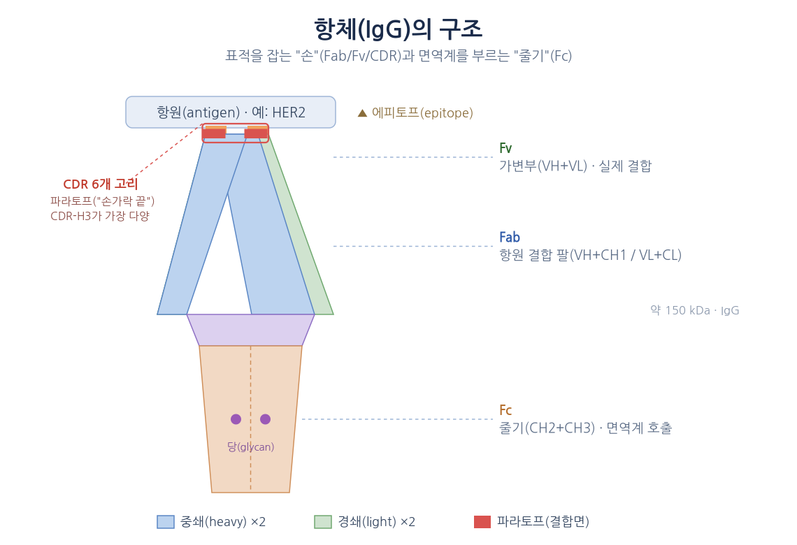
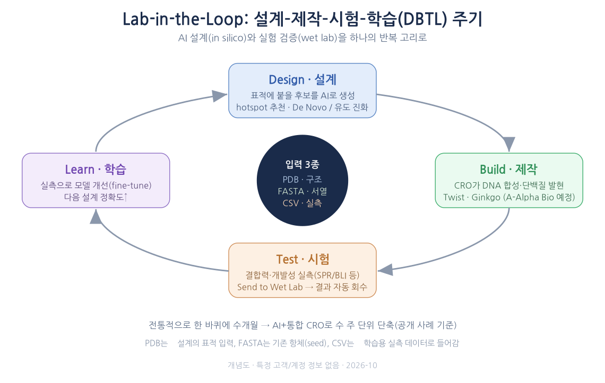

# AI 항체 개발 입문 — HER2·trastuzumab 사례로 이해하는 Amazon Bio Discovery (20분 발표 요약)

## 1. 네 가지 질문으로 따라가기
*오늘의 20분*

1. **항체와 HER2** — 항체란 무엇이고, HER2·trastuzumab은 왜 'AI 설계 교과서'인가
2. **왜 지금 AI인가** — 신약 개발의 비용·기간·성공률이 만드는 경제적 압력
3. **Amazon Bio Discovery** — 설계(AI)와 실험(CRO)을 한 고리로: Lab-in-the-Loop
4. **직접 해보기** — 공개 구조(PDB)로 데이터를 준비하고 네 가지 시나리오로 활용

## 2. 오늘 기억할 단 한 장
*한 장 요약*

항체는 특정 표적에만 달라붙는 '맞춤 열쇠' 단백질이고, 제약사는 이 성질로 약을 만듭니다. AI는 그 설계를 극적으로 빠르게 합니다.

| 숫자 | 의미 |
|---|---|
| **$29.5B** | 세계 매출 1위 의약품(Keytruda)도 항체 — 가장 큰 시장 |
| **7.9%** | 임상 1상→승인 확률. 비용의 75%가 3상에 집중 |
| **10–15년** | 신약 1개 개발 기간 · R&D 비용 약 $1B–$2.9B |
| **수 주** | MSK 공개 사례: 약 30만 설계 → 46개 결합체(전통 방식 최대 1년) |

**핵심 메시지** — Amazon Bio Discovery는 '설계–제작–시험–학습(DBTL)' 주기에서 설계·평가를 AI 모델로, 제작·시험을 통합 실험실 파트너로 연결해 코드 없이 웹 콘솔에서 수행하게 합니다.

## 3. 항체란 무엇인가 — Y자 모양의 '맞춤 열쇠'
*1 · 항체와 HER2*

- **Y자 단백질**: 두 팔(항원 결합부) + 하나의 줄기(Fc)
- **CDR = 6개의 고리**: 팔 끝에서 표적을 실제로 '붙잡는' 손가락
- **항원·에피토프·파라토프**: 표적 / 표적 위의 접점 / 항체의 접점
- **친화도(KD)**: 숫자가 작을수록 강하게 붙음 (nM < µM)
- **Fc 효과 기능**: 붙는 것으로 끝이 아니라 면역세포 동원(ADCC)·반감기 결정

> 한 문장 — 항체는 '어디에(에피토프) 얼마나 세게(KD) 붙고, 붙은 뒤 무엇을 하는가(Fc)'로 설명된다.

## 4. HER2와 trastuzumab — 표적과 그에 맞춘 열쇠
*1 · 항체와 HER2*

- **HER2** = 세포 증식 신호를 켜는 수용체. 일부 유방암의 약 15–30%에서 과발현
- **trastuzumab(허셉틴)** = HER2 도메인 IV에 붙는 인간화 IgG1 항체. 1998년 FDA 승인, 생존율을 바꾼 대표 성공 사례
- 마우스 항체(4D5) → 인간화 과정에서 **프레임워크 소수 잔기가 친화도를 좌우**(250배 회복)
- **표적·항체·결합 구조가 모두 공개** → AI 항체 설계를 배우기에 가장 좋은 교재

**결합 구조 공개: PDB 1N8Z** — HER2 세포외 영역 + Herceptin Fab 복합체(X-ray 2.52 Å, 2003). 체인 C=HER2 세포외 영역, 체인 A·B=Herceptin Fab, 결합 부위=도메인 IV. 한 파일에 표적과 항체가 결합한 좌표가 있어 실습 데이터의 원천이 됩니다.

## 5. 하나의 표적 위에 세워진 약물 가족
*1 · 항체와 HER2*

HER2 하나를 겨냥해 항체 공학의 거의 모든 포맷이 FDA 승인을 받았습니다 — "어디에 붙느냐가 기능을 바꾼다".

| 약 | FDA 승인 | 포맷 | 무엇이 다른가 |
|---|---|---|---|
| Herceptin | 1998 | 인간화 IgG1 | 도메인 IV 결합 · 원형 |
| Perjeta | 2012 | 인간화 IgG1 | 도메인 II 결합 · 병용 시 효과 증대 |
| Kadcyla | 2013 | ADC | 항체 + 세포독성 약물 '유도 미사일' |
| Enhertu | 2019 | ADC | 차세대 링커·payload |
| Ziihera | 2024 | 이중특이 | 도메인 II·IV 동시 결합 |
| 바이오시밀러 | 2017년 | IgG1 | 특허 만료 후 가격 경쟁(Ogivri 등) |

**AI 설계 관점** — "어느 에피토프(hotspot)를 겨냥하느냐"가 설계의 첫 결정이라는 것을 보여주는 교과서적 예.

## 6. 항체는 어떻게 만들어 왔나 — 생쥐에서 AI까지
*1 · 항체와 HER2*

**모양(포맷)**: 전장 IgG(반감기·기능 완전), Fab/scFv(작아 침투↑), 나노바디 VHH(약 15 kDa·안정), 이중특이(T세포 engager), ADC(항체+독성 payload).

**찾는 방법(발굴)의 역사**: 1975 하이브리도마(노벨 1984) → 1985–90 파지 디스플레이(노벨 2018) → 2000s 형질전환 인간화 마우스·단일 B세포 → 2021년 AI(AlphaFold2·ProteinMPNN·RFdiffusion) → 2024년 de novo 생성(Chai-2 등).

**AI 계산 작업 3가지**(ABD 레시피와 1:1 대응): ① De novo 설계(표적만) · ② 기존 항체 최적화(seed 개선) · ③ 성질 예측(결합력·개발성).

## 7. 신약 개발은 느리고, 비싸고, 대부분 실패한다
*2 · 왜 지금 AI인가*

| 숫자 | 의미 |
|---|---|
| **$1B–$2.9B** | 신약 1개 R&D 비용(추정) |
| **10–15년** | 표적 선정부터 승인까지 |
| **7.9%** | 임상 1상 → 승인 확률 |
| **75%** | 임상 비용 중 3상 비중 |

- 늦게 실패할수록 손실이 큼 → **'앞 단계에서 좋은 후보를 고르고 나쁜 후보를 거르는 일'의 가치가 가장 크다**
- **특허 절벽**: Humira $21.2B(2022) → $9.0B(2024) · Herceptin도 바이오시밀러 진입 후 급감

> 경쟁력은 "더 좋은 후보를, 더 빨리, 더 앞 단계에서" 찾는 데서 나온다 — AI가 DBTL의 Design·Learn을 빠르고 예측 가능하게.

## 8. 개발 파이프라인: 넓게 설계하고 좁게 검증한다
*2 · 왜 지금 AI인가*

**깔때기**: 10⁹–10¹¹ 후보(파지 라이브러리/de novo 설계) → 수백–수천(1차 스크리닝) → 한 줌(리드 후보, 결합력·개발성 평가) → 1–2개(IND 최종 후보).

- 단계마다 묻는 질문: 붙는가 → 세게 붙는가 → '약이 될 몸'인가(개발성) → 생체에서 되는가 → 대량 생산되는가
- **개발성**: 잘 붙어도 뭉치거나(응집)·끈적하거나(점도)·쉽게 변질되면 약이 안 됨 → AI가 설계·실험 전에 미리 거름

## 9. 제약사의 자산은 '데이터' — 결국 3가지 형식으로 수렴
*2 · 왜 지금 AI인가*

값진 것은 장비가 아니라 장비가 쌓은 데이터(서열·구조·측정값). AI에 넣으려면 PDB·FASTA·CSV로 정리·전처리.

| 데이터 종류 | 장비/출처 | 형식 |
|---|---|---|
| 결합 속도·친화도 | SPR · BLI · AlphaSeq | CSV |
| 결합 유무·농도 | ELISA · 유세포 | CSV |
| 열·콜로이드 안정성 | DSF · DLS · SEC | CSV |
| 화학적 변형 | 질량분석(MS) | CSV+FASTA |
| 3D 구조 | X-ray · cryo-EM · AlphaFold | PDB |
| 서열 | NGS · 10x BCR · 디스플레이 | FASTA |

**ABD 입력 3형식**: PDB(표적·항체 구조) · FASTA(항체 서열) · CSV(실측 데이터). 가장 손이 많이 가는 PDB 전처리가 '업로드 거부'를 막는 관문.

## 10. PDB란 무엇인가 — 공개 구조와 그 '함정'
*4 · 직접 해보기*

- **PDB(Protein Data Bank)** = 1971년 이후의 공개·무료(CC0) 생체분자 3D 구조 저장소
- 파일은 칸 위치가 정해진 텍스트 — 'Legacy PDB Format(.pdb)'
- 공개 구조 = '연구용 사진' → 설계 도구가 바로 삼키지 못하는 군더더기가 많음

**흔한 함정**: altLoc(한 원자에 여러 좌표 → 업로드 거부 원인), HETATM(물·당·완충액), 여분 체인(보조단백질 오인), 번호 혼선(UniProt vs 성숙체), 결손·NMR 다중모델. 해결: 체인 선택 + altloc 제거 + HETATM 제거 + 체인 라벨 정리.

> "PDB contains alternate locations" 오류로 업로드가 거부되는 대표 원인이 altloc.

## 11. 설계(AI)와 실험(CRO)을 한 고리로: Lab-in-the-Loop
*3 · Amazon Bio Discovery*

- **DBTL 주기**를 하나의 애플리케이션으로: 설계·평가는 40종 이상의 AI 생물학 모델로, 제작·시험은 통합 실험실 파트너로
- **Build** · 모델 카탈로그로 파이프라인(Recipe) 구성
- **Design** · 표적 PDB 업로드 → hotspot·파라미터 추천, 후보 생성
- **Test** · 다목적 최적화로 후보 선별 → CRO 제출
- **Learn** · 결과 자동 회수 → 예측 vs 실측 비교 → 모델 개선

> 두 AI 에이전트가 hotspot 추천과 후보 선별을 근거와 함께 제시 — 코드 없이 웹 콘솔에서.

## 12. 설계로 끝나지 않는다 — Send to Wet Lab
*3 · Amazon Bio Discovery*

**문제는 '데이터 사일로'**: CRO 계약·조달·데이터 교환을 수작업으로 조율해야 하고 결과가 흩어짐. ABD는 설계→실험→회수를 앱 안에서 3단계로 연결.

1. **분석·선별** — 수십만 후보를 결합 친화도·개발성·열안정성 기준으로 AI 랭킹·필터링
2. **제출** — 파트너별 assay·가격·소요기간을 나란히 비교, 선택 후보 서열만 전송
3. **결과 회수** — 실험 결과 자동 반환 → 예측 vs 실측 비교 → 모델 개선

| 파트너 | 하는 일 |
|---|---|
| Twist Bioscience | DNA 합성→발현→생물물리 assay 패널 · IgG·VHH·scFv·bispecific·Fab |
| Ginkgo (Datapoints) | 배치당 20–5,000+ 항체, 최대 14종 assay · 개발성 패널 |
| A-Alpha Bio (연동 예정) | AlphaSeq 고처리량 정량 결합 측정(on/off-target) |

**데이터·IP는 고객 소유** · 선택 후보 서열만 CRO로 전송 · 고객 데이터는 공용 모델 학습에 미사용.

## 13. 증거: 공개 레퍼런스와 벤치마크
*3 · Amazon Bio Discovery*

**MSK — 희귀 소아암 표적 de novo 나노바디 설계**: 약 288,000개 설계 → 10만 개 스크리닝 → 46개 강한 결합체 · 최고 KD 0.66 nM · 수 주(전통 방식 최대 1년 규모).

**그 외 공개 레퍼런스**: Novo Nordisk(AWS 전략 AI 파트너, 2026-08), Sanofi(보완적 통합·SWEL), Voyager·Broad(제품 페이지 인용), Bayer·Fred Hutch(초기 도입 기관).

**AWS 항체 설계 벤치마킹**: Antibody Developability Benchmark(JHU Gray Lab 공동, seed 50·항원 42·속성 6·zero-shot), MochiBind(결합 친화도 예측, 평가에 HER2 포함), CA-MAP(876,898 서열 다속성 예측).

과금: "Pay for science, not seats" · Academic 무료 5 EU/월로 시작.

## 14. 공개 구조(1N8Z)로 데이터 준비 + 네 가지 시나리오
*4 · 직접 해보기*

**데이터 준비 5단계**: ① 다운로드(RCSB Legacy PDB) → ② 체인 선택(타겟=체인 C / Fv=체인 A·B 가변부) → ③ altloc 제거(단일 conformer, 업로드 거부 방지) → ④ HETATM·여분 정리 → ⑤ 검증·업로드(altloc 0·HETATM 0·체인 라벨 H/L/T).

| 시나리오 | 출발점 | 작업 유형 | ABD 레시피 |
|---|---|---|---|
| A · 핸즈온 | 표적 구조(교재) | de novo | De Novo 생성 |
| B · 신규 표적 | 표적만 있음 | de novo | De Novo 생성 |
| C · 리드 개량 | 기존 항체 있음 | 최적화 | 유도 진화 |
| D · 데이터 미세조정 | 실측 데이터 있음 | 성질예측+개선 | Score/fine-tune |

**핵심** — 표적만 있으면 de novo(B) · 항체가 있으면 최적화(C) · 데이터가 있으면 미세조정(D). 핸즈온(A)은 정답(trastuzumab)이 있는 HER2로 de novo를 체험.

## 15. 한계를 알고, 오늘 바로 시작하기
*맺음말*

**균형 잡힌 이해 — AI는 만능이 아니다**
- **AI 예측 ≠ 실험 검증** — de novo 항체도 wet-lab 검증 필요(ABD가 CRO를 통합한 이유)
- **입력 품질이 결과를 좌우** — 전처리 안 하면 업로드 거부·오인식
- **데이터·IP 거버넌스** — 고객 소유 · US East 리전 · 도입 전 조건 확인 권장
- **수치는 시점과 함께** — 2026-10 기준·얼리액세스 할인 포함, 최신값은 콘솔 확인

**오늘 바로 시작하기**: 신용카드 불필요(Academic 무료 5 EU/월) · 공개 구조로 연습(1N8Z에서 타겟·Fv) · 핸즈온 A(De Novo 생성, 통상 30–60분) · 실패 실험엔 과금 없음·결과 조회·협업 무료.

> HER2·trastuzumab은 표적·에피토프·포맷·발굴·개발성·특허 절벽이 한 사례에 담긴 교과서. ABD는 그 설계·평가를 AI로, 제작·시험을 CRO로 묶어 DBTL을 코드 없이 돌린다.