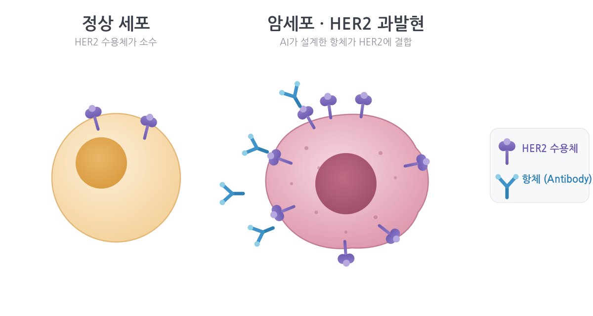

# Amazon Bio Discovery로 AI 항체 설계 시작하기: 생명과학 연구자를 위한 안내

> 이 글은 클라우드가 익숙하지 않은 생명과학 연구자도 처음부터 끝까지 따라올 수 있도록 전문 용어를 풀어 설명합니다. 코드를 작성하지 않고 웹 콘솔의 클릭만으로 AI 항체 설계 과정을 살펴봅니다. 영문 버전은 [Getting Started with AI Antibody Design on Amazon Bio Discovery](/amazon-bio-discovery-ai/getting-started-with-ai-antibody-design-on-amazon-bio-discovery-a-guide-for-life-science-researchers/)에서 볼 수 있습니다.

## 개요

항체 신약 개발은 일반적으로 후보를 설계하고, 실험실에서 합성·검증한 뒤, 그 결과로 설계를 다시 다듬는 과정을 반복합니다. 전통적인 방식에서는 이 한 주기에 수개월이 걸립니다.

Amazon Bio Discovery(이하 ABD)는 이 반복 과정을 AI와 클라우드로 통합해, 연구자가 코드 없이 웹 콘솔에서 수행할 수 있도록 설계된 애플리케이션입니다. 이 글에서는 ABD의 구조와 개념을 살펴본 뒤, 유방암 표적으로 잘 알려진 HER2 단백질에 결합하는 항체 후보 10개를 설계하는 과정을 단계별로 따라갑니다. 이번 실습의 소요 시간은 약 2시간, 비용은 1 EU(아래에서 설명)였습니다.

---

## 1. Amazon Bio Discovery란?

ABD는 AI 기반 바이오 연구 애플리케이션입니다. 생물학 데이터로 학습한 수십 종의 AI 모델(biological foundation model, 이하 bioFM)에 접근해 항체와 같은 분자 후보를 생성(generate)하고 평가(evaluate)할 수 있습니다.

ABD의 핵심은 Lab-in-the-Loop 방식입니다. AI가 설계한 후보를 실험실(wet lab)에서 검증하고, 그 결과를 다시 AI에 반영해 다음 설계를 개선하는 반복 구조로, 컴퓨터 상의 설계(in silico)와 실험실 검증(wet lab)이 하나의 연속된 주기로 이어집니다. 연구자는 모델을 직접 설치하거나 서버를 관리하지 않고, 웹 콘솔에서 입력을 올리고 실행하면 됩니다.

### 적용 사례

ABD는 다음과 같이 실제 연구에 적용되었습니다.

- **Memorial Sloan Kettering(MSK) 공동연구**: ABD로 약 30만 개의 항체 후보를 설계하고 그중 상위 10만 개를 실험실 검증으로 보내는 과정을 수 주 만에 완료했습니다. 전통적인 방식으로는 최대 1년이 소요되던 규모입니다(출처: [AWS 소개 블로그, 2026-04-14](https://aws.amazon.com/blogs/industries/introducing-amazon-bio-discovery/)).
- **엔터프라이즈 도입**: Novo Nordisk는 ABD를 R&D 전략 파트너십의 핵심 요소로 선정했으며([AWS, 2026-08-10](https://aws.amazon.com/blogs/industries/novo-nordisk-selects-aws-as-strategic-partner-to-accelerate-drug-discovery-with-ai/)), Sanofi는 자사의 lab-in-the-loop 플랫폼에 ABD를 통합한 사례를 공개했습니다([AWS, 2026-08-19](https://aws.amazon.com/blogs/industries/enterprise-lab-in-the-loop-on-aws-how-sanofi-is-compressing-drug-discovery-from-years-to-weeks/)).

이 글의 HER2 실습은 이러한 실제 신약 설계 캠페인과 동일한 구조의 파이프라인을 축소한 것입니다.

---

## 2. 시작하기 전에: 두 가지 가입 방법

ABD는 사용 환경에 따라 두 가지 경로로 시작할 수 있습니다.

**(A) 개인 연구자 및 소규모 팀.** 기존 AWS 계정이 없어도 됩니다. [Amazon Bio Discovery 페이지](https://aws.amazon.com/biodiscovery/)의 Start free trial에서 소셜 로그인 또는 이메일로 가입하면 애플리케이션에 바로 접근할 수 있으며, AWS 계정은 이 과정에서 자동으로 생성됩니다. 신용카드 없이 첫 달 5 EU 무료 체험이 제공됩니다.

**(B) 조직(기업·연구소).** 이미 AWS 계정과 IAM Identity Center를 운영 중이라면, 아래 네 단계 설정으로 구성원 계정을 연동해 사용합니다. 이 글은 (B) 조직 경로를 기준으로 진행합니다.

> **참고.** 위 내용은 공식 [Pricing FAQ](https://aws.amazon.com/biodiscovery/pricing/)(2026년 10월 기준)를 따릅니다. 서비스는 US East(버지니아 북부) 리전에서 제공됩니다.

---

## 3. ABD의 개념과 구조

ABD는 몇 가지 고유한 구성 요소로 작업을 조직합니다. 이해를 돕기 위해 요리 과정에 빗대어 정리하면 다음과 같습니다.

| 개념 | 비유 | 설명 |
|---|---|---|
| **Project** | 작업 공간 | 하나의 연구 주제를 담는 공간. 업로드한 구조 파일, 실험, 결과가 이 안에 모입니다. |
| **Model(bioFM)** | 재료·도구 | 생물학 데이터로 학습한 AI 모델. 서열·구조를 예측하거나 새 후보를 생성합니다. ABD에는 40종 이상이 기본 제공됩니다. |
| **Module** | 하나의 처리 단계 | 모델을 특정 용도로 감싼 실행 단위. ① Design 모듈(새 분자 생성) ② Score 모듈(결합력·접힘 가능성 등 지표 예측·평가)의 두 종류가 있습니다. |
| **Recipe** | 조리법 | 어떤 모듈을 어떤 순서로 조합해 실험을 수행할지 정의한 설정. 한 번 만들면 재사용·공유할 수 있어 조직의 표준 파이프라인이 됩니다. |
| **Experiment** | 실행 1회 | Recipe에 입력 파일과 파라미터를 넣어 한 번 실행한 것. 과금 단위인 EU는 Experiment 단위로 계산됩니다. |
| **Experiment Unit(EU)** | 사용량 단위 | 실험의 계산량을 나타내는 과금 단위. 실행 전 예상 EU가 표시됩니다. |

전체 흐름은 다음과 같이 이어집니다. **Project**를 만들고, 그 안에서 **Experiment**를 생성하면서 사용할 **Recipe**(여러 **Model**을 **Module** 단위로 조합한 설정)를 선택하고 입력 데이터와 파라미터를 지정해 실행한 뒤, 결과를 **Wet Lab**으로 보내 검증합니다. Recipe를 준비하는 시점은 두 경로가 다릅니다. **Hosted Recipe를 쓰는 경우**에는 Recipe를 별도로 만들 필요 없이 Experiment 생성 과정에서 바로 선택합니다. **사용자 정의 Recipe를 쓰는 경우**에는 Project를 만든 뒤 Recipes 메뉴(캔버스)에서 Recipe를 먼저 구성하고, 그다음 Experiment 생성 단계에서 그 Recipe를 선택합니다. 이 글의 실습은 Hosted Recipe 경로를 따릅니다.

### Hosted Recipe와 사용자 정의 Recipe

Recipe는 두 가지 형태로 제공됩니다.

| 구분 | Hosted Recipe(기본 제공) | 사용자 정의 Recipe · 캔버스 |
|---|---|---|
| 구성 주체 | AWS가 미리 구성·관리 | 사용자가 모듈을 직접 연결 |
| 모델 선택 | 검증된 조합을 시스템이 자동 선택 | 원하는 모듈을 직접 배치 |
| 특징 | 입력만 넣고 실행 | 자유도가 높고 단계 간 데이터 흐름을 직접 구성 |
| 적합한 사용자 | 처음 사용하는 연구자, 표준 설계 | 비표준 워크플로가 필요한 숙련 사용자 |

Hosted Recipe는 검증된 모델 조합을 추상화한 것으로, 사용자가 어떤 모델을 어떤 순서로 사용할지 결정하지 않아도 AWS가 구성한 파이프라인에 입력(타겟 구조 등)만 넣어 실행할 수 있습니다. 이 글의 실습도 Hosted Recipe를 사용합니다.

### 콘솔에서 제공되는 대표 Hosted Recipe

작성 시점(2026년 10월) 콘솔 기준으로 대표적인 생성형 Hosted Recipe는 다음과 같습니다.

**De Novo 항체/나노바디 생성(De Novo Antibody Generation).** 타겟 구조를 입력하면 처음부터(de novo) 새로운 항체·나노바디 후보를 생성합니다. 이 글의 HER2 실습이 이 레시피에 해당하며, 실행 시 다음과 같은 옵션을 선택할 수 있습니다.

- **Framework**: Auto, Nanobody, Antibody 중 선택
- **Generate hotspot recommendations**: AI 에이전트가 타겟 표면에서 결합에 유리한 핵심 잔기(hotspot)를 추천
- **생성 후보 수**: 한 번에 수십 개부터 1,000개까지 지정할 수 있으며(기본값은 수십 개 수준), 후보 수가 많을수록 계산량과 EU 소비가 증가
- 결합력·접힘 가능성 등 Score 모듈을 함께 실행해 후보를 평가

**ML 기반 유도 진화(ML-Guided Directed Evolution).** 이미 보유한 항체를 출발점으로 서열을 점진적으로 변경하며 결합력 등 특성을 향상(affinity maturation)하는 레시피입니다. 새 후보를 처음부터 만드는 대신 기존 후보를 개선하는 데 사용합니다.

두 레시피는 다음 기준으로 구분해 선택합니다. 결합 타겟 구조만 있고 아직 항체가 없는 경우에는 De Novo 생성을, 이미 결합하는 항체를 보유하고 특성을 개선하려는 경우에는 ML 기반 유도 진화를 사용합니다.

이 외에 결합력·구조 예측·개발성(developability) 평가와 같은 Score·예측 모듈은 레시피의 단계로 사용되거나 단독으로 실행할 수 있습니다. 제공되는 레시피와 모듈 목록은 지속적으로 업데이트되므로, 최신 구성은 콘솔에서 확인하는 것이 정확합니다.

> **참고.** Hosted Recipe는 내부적으로 수십 종의 검증된 AI 모델과 두 가지 AI 에이전트(핫스팟 추천, 후보 선별)를 조합해 동작합니다. 이 기술은 MSK 공동연구와 같은 실제 캠페인에서 검증된 뒤 코드 없이 사용할 수 있는 레시피로 제품화되었습니다.

---

## 4. 실습: HER2 항체 후보 10개 설계



정상 세포에는 HER2 수용체가 소수만 존재하지만, 유방암을 포함한 일부 암세포에서는 HER2가 과발현됩니다. 따라서 HER2에 특이적으로 결합하는 항체는 유력한 치료 후보가 됩니다. 이번 실습에서는 HER2에 결합하는 항체 후보를 AI로 설계합니다.

실습은 다음 순서로 진행합니다. 콘솔의 실제 화면 흐름(Project를 만들면 바로 Experiments 탭이 열리고, Experiment를 만드는 과정에서 Recipe 선택과 데이터 업로드가 이어짐)에 맞추어 구성했습니다.

1. 초기 설정(조직 경로)
2. Project 생성
3. 테스트 데이터 준비(공개 데이터 다운로드)
4. Experiment 생성: Recipe 선택, 데이터 업로드, 파라미터 설정, 실행
5. Experiment 결과 확인
6. Wet Lab 의뢰

### 4-1. 초기 설정(조직 경로)

콘솔에서 Amazon Bio Discovery에 접속하면 초기 설정 화면이 나타나며, 다음 네 단계로 진행합니다.

1. **IAM Identity Center 활성화** — 구성원이 로그인할 수 있도록 조직의 사용자 디렉터리를 연결합니다.
2. 애플리케이션 생성
3. 사용자·그룹 할당
4. 접속 확인

> **참고.** 각 단계의 화면과 세부 항목은 콘솔의 Amazon Bio Discovery → Documentation에서 제공하는 Console Guide(PDF)에 그림과 함께 안내되어 있습니다. 개인 경로(소셜 로그인·이메일)로 가입한 경우에는 이 단계가 없으며, 가입 직후 애플리케이션 홈 화면이 바로 열립니다.

<!-- SCREENSHOT-01: 애플리케이션 홈(로그인 직후) 화면 -->

### 4-2. Project 생성

작업을 담을 공간인 Project를 먼저 생성합니다. 홈 또는 Projects 메뉴에서 Create project를 선택하고 이름(예: HER2 Antibody Design)과 설명을 입력합니다. 하나의 연구 주제를 하나의 Project로 구성합니다.

<!-- SCREENSHOT-02: Create project 입력 화면 -->

Project가 생성되면 "Project … was successfully created" 메시지와 함께 Project 개요 화면이 열립니다. 이 화면은 세 개의 탭으로 구성됩니다.

- **Experiments**: 이 Project에서 실행한 실험 목록. 생성 직후에는 비어 있으며 Create experiment 버튼이 표시됩니다.
- **Files**: Project에 업로드한 구조·서열 파일
- **Collaborators**: 공동 작업자(Share 버튼으로 초대)

<!-- SCREENSHOT-03: Project 개요(Experiments 탭, No experiments 상태) 화면 -->

화면의 안내 문구에 나타나듯, Experiment는 "Recipe를 선택하고, 데이터를 가져오고, 파라미터를 설정하여 실행"하는 단위입니다. Hosted Recipe를 사용하는 이 실습에서는 Recipe를 따로 만들지 않고 Experiment 생성 과정에서 바로 선택하므로, 다음 단계에서 입력 데이터를 준비한 뒤 Create experiment로 진행합니다.

> **참고. 사용자 정의 Recipe를 쓰려면 Recipe를 먼저 만듭니다.** 모듈을 직접 조합한 Recipe가 필요한 경우에는 Create experiment 전에 Recipes 메뉴에서 캔버스로 Recipe를 먼저 구성해 저장해야 합니다. Experiment 생성 화면의 Recipe 선택 목록에는 Hosted Recipe와 이렇게 미리 저장한 사용자 정의 Recipe가 함께 표시됩니다.

### 4-3. 테스트 데이터 준비(공개 데이터 다운로드)

이번 실습에는 두 개의 단백질 구조 파일(PDB 형식)이 필요합니다.

- **타겟 구조**: HER2 단백질의 domain IV(trastuzumab이 결합하는 부위)
- **항체 프레임워크 구조**: trastuzumab(허셉틴)의 Fv 영역(중쇄·경쇄의 가변 영역)으로, 새 항체 설계의 기준 틀

두 파일은 모두 공개 데이터베이스에서 직접 준비할 수 있습니다. 미리 가공된 파일을 받는 대신 아래 절차로 스스로 준비하면, 이후 다른 타겟으로 확장할 때 같은 방법을 적용할 수 있습니다.

**1) 원본 구조 다운로드.** RCSB Protein Data Bank에서 trastuzumab Fab–HER2 세포외 도메인 복합체 결정 구조인 [PDB 1N8Z](https://www.rcsb.org/structure/1N8Z)(Cho et al., *Nature*, 2003)를 PDB 형식으로 다운로드합니다. 이 한 개의 구조 안에 타겟과 항체가 함께 들어 있습니다.

- Chain A: trastuzumab 경쇄(light chain)
- Chain B: trastuzumab 중쇄(heavy chain)
- Chain C: HER2 세포외 도메인(domain I–IV)

**2) 타겟 파일 만들기.** Chain C에서 domain IV에 해당하는 잔기만 남겨 `her2_domain4.pdb`로 저장합니다. 도메인 경계는 1N8Z 논문의 도메인 구분을 따르며(domain IV는 세포외 도메인의 C-말단 쪽, 대략 489번 이후 잔기), 정확한 범위는 RCSB 항목의 구조 설명과 논문을 확인합니다. 예를 들어 PyMOL에서는 다음과 같이 처리합니다.

```
fetch 1N8Z
select target, chain C and resi 489-607
save her2_domain4.pdb, target
```

**3) 항체 프레임워크 파일 만들기.** Chain A와 B에서 가변 영역(Fv: 경쇄 VL, 중쇄 VH)만 남겨 `trastuzumab_fv.pdb`로 저장합니다. Fab에서 불변 영역(CL, CH1)을 제외한 앞쪽 약 110–120개 잔기가 가변 영역입니다.

```
select fv, (chain A and resi 1-107) or (chain B and resi 1-120)
save trastuzumab_fv.pdb, fv
```

> **참고.** 항체 프레임워크 파일의 체인 라벨 요건(중쇄·경쇄 구분 방식)과 입력 형식의 세부 사항은 콘솔의 Console Guide(PDF)와 Experiment 생성 화면의 안내를 따르십시오. 잔기 범위는 참고용 예시이며, 사용하는 번호 체계(PDB 원본 번호 또는 Kabat/IMGT)에 따라 조정이 필요할 수 있습니다.

**4) 업로드 전 정리(altloc 제거).** RCSB와 같은 공개 데이터베이스의 원본 PDB에는 한 원자에 여러 좌표가 기록된 alternate location(altloc, 다중 입체구조)이 포함된 경우가 많습니다. 이 상태로 업로드하면 "PDB contains alternate locations" 오류로 거부됩니다. 두 파일 모두 저장 전에 단일 conformer로 정리하십시오. PyMOL에서는 `remove not alt ''+A` 후 `alter all, alt=''`를 실행하고, Biopython에서는 각 잔기의 대표 altloc만 남기는 방식을 사용합니다.

> **참고.** 1N8Z는 실습용으로 널리 쓰이는 공개 구조이며, 동일한 절차를 다른 공개 복합체 구조(예: 다른 표적 항원–항체 복합체)에 적용해 실습을 확장할 수 있습니다. 공개 데이터의 이용 조건은 RCSB PDB 정책(CC0 1.0)을 따릅니다.

파일은 Experiment 생성 단계에서 직접 업로드할 수 있으며, Project의 Files 탭에 미리 올려 두면 여러 실험에서 재사용할 수 있습니다.

### 4-4. Experiment 생성: Recipe 선택, 데이터 업로드, 파라미터 설정, 실행

Project 개요의 Create experiment 버튼을 선택하면 Experiment 생성 마법사가 열립니다. 다음 순서로 진행합니다.

**① Experiment 이름 입력.** 예: HER2-denovo-10.

**② Recipe 선택.** Hosted Recipe 목록에서 De Novo 항체 생성(Antibody generation / De Novo Antibody Generation)을 선택합니다. 이 레시피에는 다음 모듈이 조합되어 있습니다.

- **Design**: 타겟에 결합할 새 항체 후보를 생성
- **Binding Affinity**: 생성된 후보의 결합 정도를 예측
- **Folding Likelihood**: 후보 서열이 안정적인 단백질로 접힐 가능성을 평가

Recipes 메뉴에서 미리 저장해 둔 사용자 정의 Recipe(캔버스에서 모듈을 직접 연결한 레시피)가 있으면 이 목록에서 함께 선택할 수 있습니다. 사용자 정의 Recipe는 Experiment 생성 전에 먼저 만들어 두어야 하며, 처음에는 Hosted Recipe를 권장합니다.

<!-- SCREENSHOT-04: Create experiment – Recipe 선택 화면 -->

**③ 데이터 업로드.** 4-3에서 준비한 두 파일을 각각 Target Structure(`her2_domain4.pdb`)와 Antibody Framework Structure(`trastuzumab_fv.pdb`)로 지정합니다. Files 탭에 이미 올려 둔 파일이 있으면 목록에서 선택합니다.

<!-- SCREENSHOT-05: Create experiment – 데이터 업로드/선택 화면 -->

**④ 파라미터 설정.** Framework는 Antibody, 생성 후보 수는 10으로 설정합니다. Generate hotspot recommendations를 켜면 AI 에이전트가 타겟 표면에서 결합에 유리한 잔기(hotspot)를 추천합니다.

<!-- SCREENSHOT-06: Create experiment – 파라미터 설정 화면(후보 수 10) -->

**⑤ 예상 EU 확인 후 실행.** ABD는 실행 전에 해당 실험의 예상 EU(Experiment Unit)를 표시하므로, 예상치 못한 비용이 발생하지 않도록 사전에 비용을 확인할 수 있습니다. 이번 실습의 예상 소요 시간은 2–4시간으로 안내되었고, 실제로는 약 2시간이 소요되었으며 1 EU가 사용되었습니다. 실행 후에는 Experiments 탭에서 상태(Status)와 소요 시간(Duration)을 확인할 수 있습니다.

<!-- SCREENSHOT-07: 예상 EU 표시 및 실행 확인 화면 -->
<!-- SCREENSHOT-08: Experiments 탭에서 실행 중/완료 상태 목록 -->

### 4-5. Experiment 결과 확인

실행이 완료되면 결과 화면에서 세 가지 관점으로 후보를 검토할 수 있습니다.

- **Overview / In silico results**: 생성된 10개 후보의 전반적인 지표
- **Functional Clustering**: 단백질 특성을 기준으로 유사한 후보를 그룹화하여 분포를 파악
- **Sequences & CDR Analysis**: 각 후보의 아미노산 서열과 항원 결합의 핵심 영역인 CDR(상보성 결정 부위) 분석

화면 왼쪽에서 결합력, 접힘 가능성 등 조건으로 필터링하면 해당 조건에 맞는 후보의 분석 결과가 오른쪽에 표시됩니다.

<!-- SCREENSHOT-09: 결과 Overview / In silico results 화면 -->
<!-- SCREENSHOT-10: Functional Clustering 또는 Sequences & CDR Analysis 화면 -->

> **AI 에이전트의 역할.** ABD는 결과 수치와 함께 판단 근거를 제시합니다. 설정 보조 에이전트는 타겟 표면에서 결합에 유리한 hotspot 잔기를 표면 접근성·소수성 등을 고려해 추천하고 그 근거를 제공합니다. 후보 선별 에이전트는 여러 속성을 동시에 최적화하고 잠재적 결함(liability)을 평가한 뒤, 사전 선별된 후보와 선택 근거를 함께 제시합니다. 이를 통해 결과를 단순히 확인하는 데 그치지 않고 선택의 이유를 함께 파악할 수 있습니다.

### 4-6. Wet Lab 의뢰

in silico 분석으로 후보를 선별한 뒤, 유망한 후보를 선택해 Send to Wet Lab으로 실제 실험을 의뢰할 수 있습니다.

- **실험실 파트너(CRO)**: 현재 선택 가능한 파트너는 Twist Bioscience와 Ginkgo Bioworks입니다. 공식 발표에 따르면 A-Alpha Bio도 결합 분석(binding assay) 파트너로 연동될 예정입니다.
- Assay(분석 방법)와 Expression Host(발현 숙주)를 선택하면 ABD가 예상 비용과 소요 시간을 거의 실시간으로 표시합니다.
- 실험 결과는 애플리케이션으로 자동 회수되어 in silico 예측값과 실측값을 비교할 수 있습니다. 이 결과로 모델을 다시 학습(fine-tuning)하면 다음 설계 주기의 예측 정확도가 향상되며, 이 지점에서 Lab-in-the-Loop 주기가 완성됩니다.

<!-- SCREENSHOT-11: Send to Wet Lab – 파트너/Assay 선택 및 예상 비용 화면 -->

이로써 항체 후보 설계(in silico), 실험실 검증(wet lab), 모델 개선으로 이어지는 전체 과정을 하나의 애플리케이션에서 수행할 수 있습니다.

---
## 5. 주요 특징

Amazon Bio Discovery는 설계부터 실험, 모델 개선까지의 과정을 하나의 애플리케이션으로 통합합니다. 이번 실습에서 확인한 주요 특징은 다음과 같습니다.

**코드 없이 전체 워크플로를 하나의 환경에서 수행합니다.** 모델을 직접 설치하거나 인프라를 운영할 필요 없이 웹 콘솔에서 후보 설계부터 실험 의뢰까지 이어집니다. 각 모델의 파라미터는 검증된 기본값으로 제공되어 처음 사용하는 연구자도 바로 시작할 수 있으며, 세부 파라미터의 의미와 조정 방법은 콘솔 문서와 신규 기능을 통해 지속적으로 보강되고 있습니다.

**설계 결과가 실제 실험으로 연결됩니다.** Twist Bioscience, Ginkgo Bioworks 등 통합 CRO 파트너와 연계해 in silico로 선별한 후보를 실험실 검증까지 이어갈 수 있으며, 실험 결과는 애플리케이션으로 자동 회수되어 예측값과 비교·활용됩니다.

**실측 데이터로 모델 성능을 검증합니다.** 실제 wet lab 실험으로 검증된 벤치마크를 기준으로 AI 모델의 성능을 비교·평가할 수 있습니다. 이 기능은 AWS와 Johns Hopkins Gray Lab이 공개한 [Antibody Developability Benchmark](https://www.amazon.science/news/aws-gray-lab-johns-hopkins-announce-groundbreaking-database-for-ai-ml-antibody-design)를 기반으로 합니다.

**비용을 예측 가능하게 관리합니다.** 모든 실험은 실행 전에 예상 EU가 표시되며, 실패한 실험에는 EU가 부과되지 않습니다. 실험 실행 상태와 로그는 콘솔에서 확인할 수 있고, 진단·디버깅 환경 또한 신규 기능으로 지속적으로 개선되고 있습니다.

---

## 6. 기본 모델 활용과 사용자 모델·데이터 학습

ABD는 40종 이상의 기본 AI 모델(bioFM)을 제공하며, 연구가 심화되면 사용자 데이터와 사용자 모델을 활용하려는 요구가 발생합니다. ABD는 이를 위한 세 가지 방식을 제공하며, 세 가지 모두 현재 정식 출시 전 단계(Beta 또는 Gated Beta)입니다.

**(1) 기본 bioFM 미세 조정(Model Fine-tuning).** 기본 제공 bioFM은 몇 번의 클릭으로 미세 조정할 수 있습니다. wet lab 결과로 모델을 재학습하는 과정(데이터 분할, 품질 검증, 재학습)을 ABD가 자동으로 처리하므로 별도의 학습 파이프라인을 구성할 필요가 없습니다. 이는 Lab-in-the-Loop의 되먹임 단계에 해당합니다.

**(2) 사용자 모델 가져오기(Bring Your Own Model/Module, BYOM).** 자체 개발했거나 외부에서 라이선스한 모델을 Docker 컨테이너로 패키징해 업로드하면 ABD에서 사용할 수 있습니다. 업로드한 모델은 검증 절차(메타데이터 확인, 입출력 형식 확인, 격리 환경에서의 테스트 실행)를 거친 뒤 기본 모델과 함께 카탈로그에 등록되며, 이후 기본 모델과 동일하게 Recipe에 조합하고 조직 내에서 공유할 수 있습니다. 실행 시에는 격리된 컨테이너에서 동작하여 다른 고객의 데이터나 내부 서비스, 외부 네트워크에 접근하지 않습니다. 현재 업로드한 모델은 ABD 내에서 추론(inference) 용도로 동작하며, 추가 학습이 필요한 경우 외부(예: Amazon SageMaker)에서 재학습한 뒤 다시 업로드합니다.

> **주의.** BYOM은 Gated Beta로, 셀프서비스로 제공되지 않으며 AWS 담당자(계정 SA 또는 ABD 제품팀)를 통해 참여 신청과 적격성 확인을 거쳐 온보딩됩니다. 컨테이너 입출력 규격과 스키마 등 상세 개발 요건은 베타 참여 시 제공되는 Module Developer Guide를 따릅니다. 참여를 원하는 경우 담당 AWS SA에게 문의하시기 바랍니다.

**(3) 사용자 데이터로 모델 학습(Train Your Own Model).** 자사의 독자 데이터로 모델을 학습하는 기능도 Beta로 제공되며, 커스텀 구현 지원이 필요한 단계로 담당 AWS 팀과 함께 진행합니다.

**데이터 자동 회수 범위.** 통합 CRO(Twist, Ginkgo)를 통한 실험 결과는 애플리케이션으로 자동 회수되어 품질 검증을 거쳐 미세 조정에 사용할 수 있습니다. 통합되지 않은 CRO나 자체 실험실 데이터는 형식을 자동으로 변환하는 어댑터가 아직 제공되지 않으므로, ABD가 요구하는 형식(PDB, FASTA, 표준 열 구조의 CSV)으로 사전에 정리해 업로드해야 합니다.

| 기능 | 상태 | 시작 방법 |
|---|---|---|
| 기본 bioFM 사용 | 정식 | 가입 후 바로 사용 |
| 기본 bioFM 미세 조정 | 사용 가능(관리형) | 콘솔에서 실행 |
| BYOM(모델 가져오기) | Gated Beta | AWS 담당자에게 참여 신청 |
| Train Your Own Model(데이터 학습) | Beta | AWS 담당자와 함께 온보딩 |

> **참고.** 기능 상태는 2026년 10월 기준이며 변경될 수 있습니다. 최신 상태는 콘솔과 AWS 담당자를 통해 확인하시기 바랍니다.

---

## 7. 과금 방식: Experiment Unit(EU)

ABD는 좌석(seat) 수가 아니라 실제 수행한 실험량을 기준으로 과금하며("Pay for science, not seats"), 그 단위가 EU(Experiment Unit)입니다.

- EU 소비량은 후보 수, 서열 길이, 선택한 모델에 따라 달라지며 실행 전에 예상치가 표시됩니다.
- 실험 규모별 대략적인 소비량: 간단한 속성 점검(후보 수 개)은 약 0.5 EU, 구조 예측을 포함한 표준 분석(후보 10–50개)은 약 1.0 EU, 수백 개 대상 대규모 스크리닝은 약 1.5 EU 이상입니다.
- 실패한 Experiment에는 EU가 부과되지 않습니다.
- 플랜의 월 EU를 모두 사용하면 플랜의 per-EU 요금으로 계속 실행할 수 있으며, 패널티나 추가 마크업이 없습니다. 미사용 EU는 이월되지 않고 매월 초기화됩니다.
- 협업자 수에는 제한이 없으며 1인당 추가 과금이 없습니다.
- wet lab 실험 비용은 EU와 별도로 부과됩니다.

예를 들어 Pro 플랜(월 $486, 15 EU 포함)에서 5 EU를 초과 사용하면 초과분은 per-EU 요금 $32.40 × 5 = $162가 부과되어 월 합계는 $648입니다.

학술(Academic) 플랜은 월 5 EU를 무료로 제공하며 .edu 또는 .org 인증 이메일이 필요합니다. 국내 대학의 `.ac.kr` 도메인은 현재 기준으로 해당하지 않을 수 있으므로 가입 시 확인이 필요합니다.

> **참고.** 요금은 2026년 10월 기준이며 출시 할인(Early Access)이 적용된 금액일 수 있습니다. 최신 금액은 공식 [Pricing 페이지](https://aws.amazon.com/biodiscovery/pricing/)에서 확인하시기 바랍니다.

---

## 8. 데이터 및 모델 보안

데이터 보안은 제약·바이오 연구자가 가장 먼저 확인하는 사항입니다.

- 자사 데이터로 모델을 미세 조정하더라도, 공식 안내에 따르면 해당 데이터는 호스팅된 공용 모델의 학습에 사용되지 않습니다("your data is never used for hosted model training").
- 사용자 모델을 가져오는 BYOM과 사용자 데이터로 학습하는 Train Your Own Model이 제공됩니다(현재 Beta).

지식재산(IP) 보호가 중요한 조직은 도입 전에 데이터 거버넌스 조건을 공식 문서와 담당자를 통해 확인하는 것을 권장합니다.

---

## 9. 추가 자료

- **AWS Skill Builder 입문 과정**: [Getting Started with Amazon Bio Discovery](https://skillbuilder.aws/learn/BQKQUC8A8M). 무료 디지털 과정으로, 이 글에서 다룬 Project·Recipe·Module 개념과 설계·분석·wet lab 흐름을 영상과 실습으로 학습할 수 있습니다. 콘솔을 사용하기 전에 먼저 수강하는 것을 권장합니다.
- **공식 소개 블로그**: [Introducing Amazon Bio Discovery(AWS, 2026-04-14)](https://aws.amazon.com/blogs/industries/introducing-amazon-bio-discovery/). 서비스 출시 배경, 4단계 워크플로, MSK 사례가 정리된 1차 자료입니다.
- **콘솔 가이드**: 콘솔의 Amazon Bio Discovery → Documentation에서 Console Guide(PDF)를 다운로드할 수 있습니다.
- **리소스 허브**: [aws.amazon.com/biodiscovery/resources](https://aws.amazon.com/biodiscovery/resources/). 설계·제작·테스트·학습(DBTL) 인포그래픽, 파트너 블로그, 소개 영상이 제공됩니다.
- **연구 자료**: [Advancing AI for biology: teaching models to design and characterize antibodies](https://www.amazon.science/blog/advancing-ai-for-biology-teaching-models-to-design-and-characterize-antibodies). ABD 연구팀의 공개 연구로, 평가 데이터셋에 HER2가 포함되어 본 실습의 타겟 선택과 연결됩니다.

---

## 맺음말

Amazon Bio Discovery는 in silico 설계와 wet lab 검증을 하나의 주기로 통합해 코드 없이 항체 설계 파이프라인을 수행할 수 있도록 지원합니다. 이 글에서는 HER2 타겟으로 후보 10개를 약 2시간, 1 EU에 설계하고 실험 의뢰까지 이어지는 전체 과정을 살펴보았습니다. AI 기반 연구 플랫폼이 실제 연구 과정에 어떻게 연결되는지 확인하는 출발점으로 활용할 수 있으며, 개인 연구자는 신용카드 없이 5 EU 무료 체험으로 시작할 수 있습니다.

---

## 자주 묻는 질문(FAQ)

**Q. Amazon Bio Discovery는 무엇인가요?**
A. AI 모델로 항체·단백질 후보를 설계·평가하는 AWS의 바이오 연구 애플리케이션입니다. 40종 이상의 AI 모델을 Recipe로 조합해 실험을 실행하고, 결과를 wet lab 실험과 모델 개선으로 다시 연결하는 Lab-in-the-Loop 방식을 지원합니다.

**Q. AWS 계정이 반드시 필요한가요?**
A. 그렇지 않습니다. 소셜 로그인 또는 이메일로 가입할 수 있으며 이 과정에서 AWS 계정이 자동으로 생성됩니다. 무료 체험 시작에 신용카드가 필요하지 않습니다. 서비스는 US East(버지니아 북부) 리전에서 제공됩니다.

**Q. 비용은 어떻게 계산되나요?**
A. EU(Experiment Unit) 단위로 과금되며 실험 규모에 따라 필요한 EU가 달라집니다. 신규 사용자는 첫 달 5 EU가 무료이며, 실패한 Experiment에는 EU가 부과되지 않습니다. wet lab 실험 비용은 별도로 부과됩니다(2026년 10월 기준).

**Q. 코딩 없이 사용할 수 있나요?**
A. 사용할 수 있습니다. 모든 과정이 웹 콘솔의 클릭 기반으로 진행됩니다. 특히 Hosted Recipe는 모델 조합이 미리 구성되어 있어 입력만 넣고 실행하면 됩니다.

**Q. 실습용 테스트 데이터는 어디서 구하나요?**
A. 공개 데이터베이스인 RCSB Protein Data Bank에서 직접 준비할 수 있습니다. 이 글의 HER2 실습은 trastuzumab–HER2 복합체 구조(PDB 1N8Z)에서 타겟(HER2 domain IV)과 항체 프레임워크(trastuzumab Fv)를 분리해 사용합니다(4-3 참조). 업로드 전에 alternate location을 제거해야 합니다.

**Q. 어떤 Hosted Recipe가 제공되나요?**
A. 콘솔 기준 대표 레시피는 De Novo 항체/나노바디 생성(타겟 구조로 새 후보 생성)과 ML 기반 유도 진화(기존 항체의 결합력 개선)입니다. 결합력·구조·개발성 예측은 Score·예측 모듈로 함께 또는 단독 실행합니다. 사용자 정의가 필요한 경우 캔버스에서 직접 Recipe를 구성할 수 있습니다. 목록은 업데이트되므로 콘솔에서 최신 구성을 확인하시기 바랍니다.

**Q. 연구 데이터가 공용 모델 학습에 사용되나요?**
A. 공식 안내에 따르면 자사 데이터로 미세 조정하더라도 해당 데이터는 호스팅된 공용 모델의 학습에 사용되지 않습니다.

**Q. 기본 제공 모델 외에 자체 모델도 사용할 수 있나요?**
A. 사용할 수 있습니다. 자체 모델이나 외부 라이선스 모델을 Docker 컨테이너로 업로드하는 BYOM 기능이 제공됩니다. 다만 현재 Gated Beta로, AWS 담당자를 통해 참여 신청 후 온보딩됩니다. 기본 bioFM은 콘솔에서 바로 미세 조정할 수 있습니다.

**Q. BYOM과 자체 학습 기능을 바로 사용할 수 있나요?**
A. BYOM은 Gated Beta, Train Your Own Model은 Beta 단계입니다(2026년 10월 기준). 정식 기능이 아니므로 담당 AWS SA 또는 제품팀과 함께 진행하며, 가용 여부와 요건은 변경될 수 있습니다.
