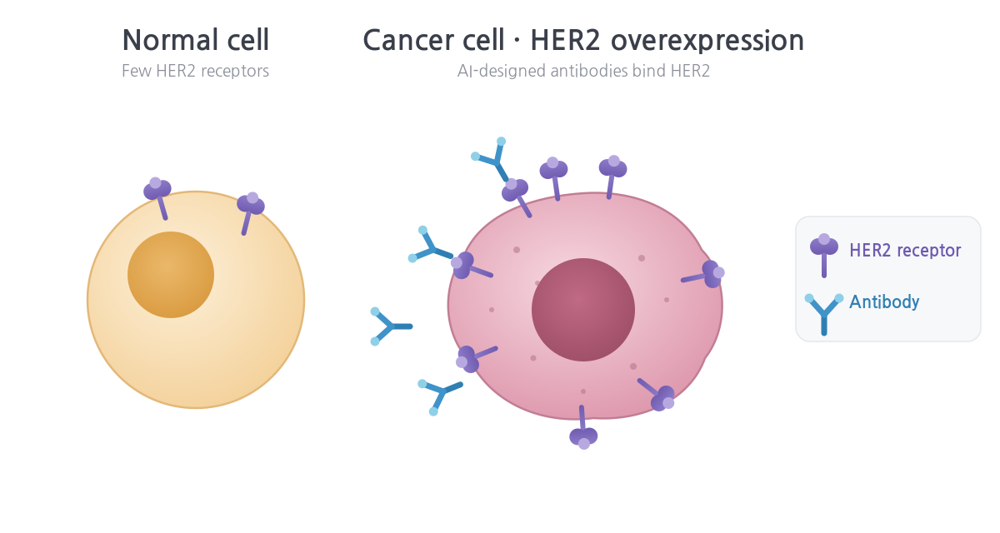

# Getting Started with AI Antibody Design on Amazon Bio Discovery: A Guide for Life Science Researchers

> This article is written for life science researchers who are not yet familiar with the cloud. Every technical term is explained in plain language, and the entire AI antibody design workflow is carried out with clicks in the web console, without writing any code. A Korean version is available at [Amazon Bio Discovery로 AI 항체 설계 시작하기](/amazon-bio-discovery-ai/amazon-bio-discovery-ai/).

## Overview

Antibody drug discovery typically repeats a cycle: design candidates, synthesize and test them in the laboratory, and refine the design based on the results. In the traditional approach, one cycle takes months.

Amazon Bio Discovery (ABD) is an application that integrates this iterative process with AI and the cloud so that researchers can run it from a web console, with no code. This article first explains how ABD is structured, and then walks step by step through designing ten antibody candidates that bind HER2, a well-known breast cancer target. The exercise took about two hours and consumed 1 EU (explained below).

---

## 1. What is Amazon Bio Discovery?

ABD is an AI-powered application for biological research. It provides access to dozens of AI models trained on biological data (biological foundation models, or bioFMs) to generate and evaluate molecular candidates such as antibodies.

At the core of ABD is the Lab-in-the-Loop approach: candidates designed by AI are validated in the wet lab, and the results are fed back into the AI to improve the next round of design. Computational design (in silico) and laboratory validation (wet lab) are connected in a single continuous cycle. Researchers do not install models or manage servers; they upload inputs and run experiments in the web console.

### Real-world applications

ABD has already been applied in research settings.

- **Collaboration with Memorial Sloan Kettering (MSK)**: Using ABD, roughly 300,000 antibody candidates were designed and the top 100,000 were sent to wet lab validation in a matter of weeks—a scale that traditionally took up to a year (source: [AWS launch blog, 2026-04-14](https://aws.amazon.com/blogs/industries/introducing-amazon-bio-discovery/)).
- **Enterprise adoption**: Novo Nordisk selected ABD as a core element of its R&D strategic partnership ([AWS, 2026-08-10](https://aws.amazon.com/blogs/industries/novo-nordisk-selects-aws-as-strategic-partner-to-accelerate-drug-discovery-with-ai/)), and Sanofi published how it integrated ABD into its lab-in-the-loop platform ([AWS, 2026-08-19](https://aws.amazon.com/blogs/industries/enterprise-lab-in-the-loop-on-aws-how-sanofi-is-compressing-drug-discovery-from-years-to-weeks/)).

The HER2 exercise in this article is a scaled-down version of the same pipeline used in these real drug design campaigns.

---

## 2. Before You Start: Two Ways to Sign Up

ABD can be started in two ways, depending on your environment.

**(A) Individual researchers and small teams.** No existing AWS account is required. Choose Start free trial on the [Amazon Bio Discovery page](https://aws.amazon.com/biodiscovery/) and sign up with a social login or an email address to access the application directly; an AWS account is created automatically during this process. The first month includes a free trial of 5 EUs, and no credit card is required.

**(B) Organizations (companies and research institutes).** If you already operate an AWS account with IAM Identity Center, connect your members' accounts through the four-step setup described below. This article follows path (B).

> **Note.** The information above follows the official [Pricing FAQ](https://aws.amazon.com/biodiscovery/pricing/) (as of October 2026). The service is offered in the US East (N. Virginia) Region.

---

## 3. ABD Concepts and Structure

ABD organizes work around a few components of its own. A cooking analogy helps to keep them straight.

| Concept | Analogy | Description |
|---|---|---|
| **Project** | Workspace | A space for one research topic. Uploaded structure files, experiments, and results are gathered here. |
| **Model (bioFM)** | Ingredients and tools | AI models trained on biological data that predict sequences and structures or generate new candidates. More than 40 are provided out of the box. |
| **Module** | One processing step | A unit of execution that wraps a model for a specific purpose. There are two kinds: Design modules (generate new molecules) and Score modules (predict and evaluate metrics such as binding affinity and foldability). |
| **Recipe** | Recipe | A configuration that defines which modules run in what order. Once created, it can be reused and shared, becoming an organization's standard pipeline. |
| **Experiment** | One run | A single run of a Recipe with input files and parameters. EUs, the billing unit, are calculated per Experiment. |
| **Experiment Unit (EU)** | Unit of usage | The billing unit representing the compute of an experiment. The estimated EU is shown before you run. |

The overall flow is as follows. You create a **Project**; inside it you create an **Experiment**, choosing the **Recipe** to use (a configuration that combines several **Models** as **Modules**), specifying the input data and parameters, and running it; then you send the results to the **Wet Lab** for validation. When the Recipe is prepared depends on which path you take. **With a Hosted Recipe**, there is no Recipe to build: you select it directly while creating the Experiment. **With a custom Recipe**, you first compose and save the Recipe in the Recipes menu (canvas) after creating the Project, and then select that Recipe when creating the Experiment. The exercise in this article follows the Hosted Recipe path.

### Hosted Recipes and custom Recipes

Recipes come in two forms.

| | Hosted Recipe (built in) | Custom Recipe / canvas |
|---|---|---|
| Built by | Preconfigured and managed by AWS | The user connects modules directly |
| Model selection | A validated combination is selected automatically | The user places the desired modules |
| Characteristics | Provide inputs and run | High flexibility; the user defines data flow between steps |
| Best for | First-time users and standard designs | Experienced users who need non-standard workflows |

A Hosted Recipe abstracts a validated combination of models: you do not need to decide which models to use in which order, and you simply provide inputs (such as a target structure) to a pipeline AWS has configured. The exercise in this article uses a Hosted Recipe.

### Representative Hosted Recipes in the console

As of this writing (October 2026), the representative generative Hosted Recipes in the console are as follows.

**De Novo Antibody/Nanobody Generation (De Novo Antibody Generation).** Given a target structure, generates new antibody or nanobody candidates from scratch (de novo). The HER2 exercise in this article uses this recipe. The following options are available when running it:

- **Framework**: Auto, Nanobody, or Antibody
- **Generate hotspot recommendations**: An AI agent recommends key residues (hotspots) on the target surface that favor binding
- **Number of candidates**: From a few dozen up to 1,000 per run (the default is on the order of tens). More candidates mean more compute and higher EU consumption
- Score modules such as binding affinity and foldability run alongside to evaluate the candidates

**ML-Guided Directed Evolution.** Starting from an antibody you already have, this recipe progressively modifies the sequence to improve properties such as binding affinity (affinity maturation). It is used to improve existing candidates rather than create new ones from scratch.

Choose between them as follows: if you only have a target structure and no antibody yet, use De Novo Generation; if you already have a binding antibody and want to improve its properties, use ML-Guided Directed Evolution.

In addition, Score and prediction modules such as binding affinity, structure prediction, and developability assessment can be used as recipe steps or run on their own. The list of recipes and modules is updated continuously, so check the console for the latest configuration.

> **Note.** Internally, Hosted Recipes combine dozens of validated AI models and two AI agents (hotspot recommendation and candidate selection). This technology was validated in real campaigns such as the MSK collaboration before being productized as no-code recipes.

---

## 4. Hands-on: Designing 10 HER2 Antibody Candidates



Normal cells carry only a few HER2 receptors, whereas some cancer cells, including breast cancer cells, overexpress HER2. An antibody that binds HER2 specifically is therefore a strong therapeutic candidate. In this exercise, we design HER2-binding antibody candidates with AI.

The exercise proceeds in the following order, matching the actual screen flow of the console: creating a Project opens the Experiments tab directly, and selecting a Recipe and uploading data happen while creating the Experiment.

1. Initial setup (organization path)
2. Create a Project
3. Prepare test data (download public data)
4. Create an Experiment: select a Recipe, upload data, set parameters, run
5. Review Experiment results
6. Send to Wet Lab

### 4-1. Initial setup (organization path)

When you open Amazon Bio Discovery in the console, the initial setup screen appears, and you proceed through four steps.

1. **Enable IAM Identity Center** — connect your organization's user directory so members can sign in.
2. Create the application
3. Assign users and groups
4. Verify access

> **Note.** The screens and details of each step are illustrated in the Console Guide (PDF) available under Amazon Bio Discovery → Documentation in the console. If you signed up through the individual path (social login or email), this step does not apply; the application home opens right after sign-up.

<!-- SCREENSHOT-01: Application home right after sign-in -->

### 4-2. Create a Project

First create a Project, the space that holds your work. From Home or the Projects menu, choose Create project and enter a name (for example, HER2 Antibody Design) and a description. Use one Project per research topic.

<!-- SCREENSHOT-02: Create project form -->

Once created, the message "Project … was successfully created" appears along with the Project overview, which has three tabs.

- **Experiments**: The list of experiments run in this Project. Right after creation it is empty and shows a Create experiment button.
- **Files**: Structure and sequence files uploaded to the Project
- **Collaborators**: Co-workers (invite them with the Share button)

<!-- SCREENSHOT-03: Project overview (Experiments tab, No experiments) -->

As the on-screen guidance states, an Experiment is the unit in which you "choose recipes, import data, and configure parameters" to run. Because this exercise uses a Hosted Recipe, no Recipe needs to be created separately; it is selected while creating the Experiment. In the next step we prepare the input data, then proceed with Create experiment.

> **Note. A custom Recipe must be created first.** If you need a Recipe that combines modules of your own choosing, compose and save it on the canvas in the Recipes menu before choosing Create experiment. The Recipe selection list in the Experiment wizard shows both Hosted Recipes and the custom Recipes you have saved.

### 4-3. Prepare test data (download public data)

This exercise needs two protein structure files in PDB format.

- **Target structure**: Domain IV of the HER2 protein (the region trastuzumab binds)
- **Antibody framework structure**: The Fv region (variable domains of the heavy and light chains) of trastuzumab (Herceptin), used as the scaffold for new designs

Both files can be prepared directly from a public database. Preparing them yourself, rather than receiving preprocessed files, lets you apply the same method when you later extend the exercise to other targets.

**1) Download the original structure.** From the RCSB Protein Data Bank, download [PDB 1N8Z](https://www.rcsb.org/structure/1N8Z) (Cho et al., *Nature*, 2003), the crystal structure of the trastuzumab Fab in complex with the HER2 extracellular domain, in PDB format. This single structure contains both the target and the antibody.

- Chain A: trastuzumab light chain
- Chain B: trastuzumab heavy chain
- Chain C: HER2 extracellular domain (domains I–IV)

**2) Build the target file.** Keep only the residues of domain IV from chain C and save them as `her2_domain4.pdb`. Domain boundaries follow the domain assignment in the 1N8Z paper (domain IV is the C-terminal part of the extracellular domain, roughly residue 489 onward); confirm the exact range in the RCSB entry's structure description and the paper. In PyMOL, for example:

```
fetch 1N8Z
select target, chain C and resi 489-607
save her2_domain4.pdb, target
```

**3) Build the antibody framework file.** Keep only the variable domains (Fv: VL from the light chain, VH from the heavy chain) from chains A and B and save them as `trastuzumab_fv.pdb`. The first roughly 110–120 residues of each Fab chain, excluding the constant domains (CL, CH1), are the variable domains.

```
select fv, (chain A and resi 1-107) or (chain B and resi 1-120)
save trastuzumab_fv.pdb, fv
```

> **Note.** For chain labeling requirements of the antibody framework file (how heavy and light chains are distinguished) and other input format details, follow the Console Guide (PDF) and the guidance on the Create experiment screen. The residue ranges above are illustrative and may need adjustment depending on the numbering scheme (original PDB numbering or Kabat/IMGT).

**4) Clean up before upload (remove altlocs).** Original PDB files from public databases such as RCSB often contain alternate locations (altlocs, multiple conformations) in which one atom has several coordinates. Uploading such a file is rejected with the error "PDB contains alternate locations". Reduce both files to a single conformer before saving. In PyMOL, run `remove not alt ''+A` followed by `alter all, alt=''`; in Biopython, keep only the representative altloc for each residue.

> **Note.** 1N8Z is a widely used public structure for exercises, and the same procedure can be applied to other public complex structures (for example, other antigen–antibody complexes) to extend the exercise. Use of public data follows the RCSB PDB policy (CC0 1.0).

Files can be uploaded directly while creating the Experiment, or uploaded in advance to the Project's Files tab so they can be reused across experiments.

### 4-4. Create an Experiment: select a Recipe, upload data, set parameters, run

Choose the Create experiment button on the Project overview to open the Experiment creation wizard, and proceed in this order.

**① Enter an Experiment name.** For example, HER2-denovo-10.

**② Select a Recipe.** From the Hosted Recipe list, choose De Novo antibody generation (Antibody generation / De Novo Antibody Generation). This recipe combines the following modules.

- **Design**: Generates new antibody candidates that bind the target
- **Binding Affinity**: Predicts how strongly each candidate binds
- **Folding Likelihood**: Evaluates how likely each candidate sequence is to fold into a stable protein

If you have saved a custom Recipe in the Recipes menu (one composed by connecting modules on the canvas), it appears in this list as well. A custom Recipe must be created before the Experiment; a Hosted Recipe is recommended for a first run.

<!-- SCREENSHOT-04: Create experiment – Recipe selection -->

**③ Upload data.** Assign the two files prepared in 4-3 as Target Structure (`her2_domain4.pdb`) and Antibody Framework Structure (`trastuzumab_fv.pdb`). If the files are already in the Files tab, select them from the list.

<!-- SCREENSHOT-05: Create experiment – data upload/selection -->

**④ Set parameters.** Set Framework to Antibody and the number of candidates to 10. Turning on Generate hotspot recommendations lets an AI agent recommend residues (hotspots) on the target surface that favor binding.

<!-- SCREENSHOT-06: Create experiment – parameters (10 candidates) -->

**⑤ Check the estimated EU and run.** ABD shows the estimated EU (Experiment Unit) for the experiment before it runs, so you can confirm the cost in advance and avoid unexpected charges. The estimated duration for this exercise was 2–4 hours; it actually took about two hours and consumed 1 EU. After launching, you can follow the Status and Duration in the Experiments tab.

<!-- SCREENSHOT-07: Estimated EU and run confirmation -->
<!-- SCREENSHOT-08: Experiments tab showing running/completed status -->

### 4-5. Review Experiment results

When the run completes, the results screen lets you review candidates from three perspectives.

- **Overview / In silico results**: Overall metrics for the ten generated candidates
- **Functional Clustering**: Groups similar candidates by protein properties to show their distribution
- **Sequences & CDR Analysis**: The amino acid sequence of each candidate and an analysis of the CDRs (complementarity-determining regions), the key regions for antigen binding

Filtering on the left by conditions such as binding affinity and foldability shows the analysis for the matching candidates on the right.

<!-- SCREENSHOT-09: Results Overview / In silico results -->
<!-- SCREENSHOT-10: Functional Clustering or Sequences & CDR Analysis -->

> **The role of AI agents.** ABD presents the reasoning behind its numbers. A setup-assistance agent recommends hotspot residues on the target surface that favor binding, taking surface accessibility, hydrophobicity, and other factors into account, and explains its reasoning. A candidate-selection agent optimizes several properties simultaneously, assesses potential liabilities, and presents pre-selected candidates together with the rationale for the selection. This lets you understand why a candidate was chosen rather than merely reading the results.

### 4-6. Send to Wet Lab

After selecting candidates through in silico analysis, you can choose the promising ones and request real experiments with Send to Wet Lab.

- **Laboratory partners (CROs)**: The partners currently available are Twist Bioscience and Ginkgo Bioworks. According to the official announcement, A-Alpha Bio will also be integrated as a binding assay partner.
- When you choose an Assay and an Expression Host, ABD displays the estimated cost and turnaround time almost in real time.
- Experimental results are returned automatically to the application, where in silico predictions can be compared with measured values. Fine-tuning the models on these results improves prediction accuracy in the next design cycle—and this is where the Lab-in-the-Loop cycle closes.

<!-- SCREENSHOT-11: Send to Wet Lab – partner/assay selection and cost estimate -->

The entire process—antibody candidate design (in silico), laboratory validation (wet lab), and model improvement—can thus be carried out in a single application.

---

## 5. Key Features

Amazon Bio Discovery integrates design, experiment, and model improvement into one application. The key features confirmed in this exercise are as follows.

**The complete workflow runs in one environment without code.** There is no need to install models or operate infrastructure; the web console carries you from candidate design to experiment ordering. Each model ships with validated default parameters so first-time researchers can begin immediately, and the meaning and tuning of detailed parameters are continuously being documented through the console documentation and new features.

**Designs connect to real experiments.** Through integrated CRO partners such as Twist Bioscience and Ginkgo Bioworks, candidates selected in silico can be carried through to laboratory validation, and the results are returned automatically to the application for comparison with predictions.

**Model performance is validated against measured data.** AI model performance can be compared and evaluated against benchmarks validated by real wet lab experiments. This capability is based on the [Antibody Developability Benchmark](https://www.amazon.science/news/aws-gray-lab-johns-hopkins-announce-groundbreaking-database-for-ai-ml-antibody-design) published by AWS and the Gray Lab at Johns Hopkins.

**Costs are predictable.** Every experiment shows its estimated EU before it runs, and failed experiments are not charged. Run status and logs are available in the console, and the diagnostic and debugging experience is continuously being improved through new features.

---

## 6. Using Built-in Models and Training with Your Own Models and Data

ABD provides more than 40 built-in AI models (bioFMs). As research deepens, the need arises to use your own data and your own models. ABD offers three approaches for this, all of which are currently pre-GA (Beta or Gated Beta).

**(1) Fine-tuning built-in bioFMs (Model Fine-tuning).** Built-in bioFMs can be fine-tuned with a few clicks. ABD automates the retraining process on wet lab results (data splitting, quality validation, retraining), so no separate training pipeline is required. This corresponds to the feedback step of Lab-in-the-Loop.

**(2) Bring Your Own Model/Module (BYOM).** A model you developed or licensed externally can be packaged as a Docker container and uploaded for use in ABD. After validation (metadata check, input/output format check, and a test run in an isolated environment), the uploaded model appears in the catalog alongside the built-in models, where it can be combined into Recipes and shared within your organization just like a built-in model. At run time it executes in an isolated container with no access to other customers' data, internal services, or external networks. Uploaded models currently run for inference within ABD; if further training is needed, retrain externally (for example, on Amazon SageMaker) and upload again.

> **Caution.** BYOM is a Gated Beta. It is not self-service: onboarding requires an enrollment request and eligibility review through your AWS representative (account SA or the ABD product team). Detailed development requirements such as container I/O specifications and schemas follow the Module Developer Guide provided to beta participants. Contact your AWS SA if you would like to participate.

**(3) Training on your own data (Train Your Own Model).** Training models on your proprietary data is also offered in Beta. It currently requires custom implementation support and proceeds together with your AWS team.

**Scope of automatic data return.** Results from experiments run through integrated CROs (Twist, Ginkgo) are returned to the application automatically, pass quality validation, and can be used for fine-tuning. For non-integrated CROs or your own laboratory, an adapter that converts formats automatically is not yet available, so prepare the data in the formats ABD requires (PDB, FASTA, CSV with a standard column layout) before uploading.

| Capability | Status | How to start |
|---|---|---|
| Use built-in bioFMs | Generally available | Available immediately after sign-up |
| Fine-tune built-in bioFMs | Available (managed) | Run from the console |
| BYOM (bring your own model) | Gated Beta | Request enrollment through your AWS representative |
| Train Your Own Model (train on your data) | Beta | Onboard together with your AWS representative |

> **Note.** Capability status is as of October 2026 and may change. Check the console and your AWS representative for the latest status.

---

## 7. Billing: Experiment Units (EUs)

ABD bills by the amount of experimentation actually performed, not by the number of seats ("Pay for science, not seats"), and the unit is the EU (Experiment Unit).

- EU consumption depends on the number of candidates, sequence length, and the models selected; an estimate is shown before you run.
- Approximate consumption by experiment size: a simple property check on a few candidates is about 0.5 EU, a standard analysis including structure prediction on 10–50 candidates is about 1.0 EU, and large-scale screening of hundreds of candidates is about 1.5 EU or more.
- Failed Experiments are not charged.
- When a plan's monthly EUs are used up, you can keep running at the plan's per-EU rate with no penalty or markup. Unused EUs do not roll over and reset monthly.
- There is no limit on the number of collaborators and no per-user charge.
- Wet lab experiment costs are billed separately from EUs.

For example, on the Pro plan ($486 per month, 15 EUs included), using 5 EUs beyond the allowance is billed at the per-EU rate of $32.40 × 5 = $162, for a monthly total of $648.

The Academic plan provides 5 EUs per month free of charge and requires a verified .edu or .org email address. Domains such as `.ac.kr` used by Korean universities may not currently qualify, so confirm at sign-up.

> **Note.** Prices are as of October 2026 and may reflect the launch (Early Access) discount. Check the official [Pricing page](https://aws.amazon.com/biodiscovery/pricing/) for current prices.

---

## 8. Data and Model Security

Data security is the first thing pharmaceutical and biotech researchers check.

- Even when you fine-tune models with your own data, the official guidance states that your data is never used for hosted model training.
- BYOM for bringing your own models and Train Your Own Model for training on your own data are available (currently Beta).

Organizations for which intellectual property protection is critical are advised to confirm the data governance terms through the official documentation and their AWS representative before adoption.

---

## 9. Additional Resources

- **AWS Skill Builder introductory course**: [Getting Started with Amazon Bio Discovery](https://skillbuilder.aws/learn/BQKQUC8A8M). A free digital course covering the Project, Recipe, and Module concepts in this article and the design, analysis, and wet lab flow through videos and exercises. Taking it before using the console is recommended.
- **Official launch blog**: [Introducing Amazon Bio Discovery (AWS, 2026-04-14)](https://aws.amazon.com/blogs/industries/introducing-amazon-bio-discovery/). The primary source covering the background of the launch, the four-step workflow, and the MSK case.
- **Console Guide**: Download the Console Guide (PDF) from Amazon Bio Discovery → Documentation in the console.
- **Resource hub**: [aws.amazon.com/biodiscovery/resources](https://aws.amazon.com/biodiscovery/resources/). Design-build-test-learn (DBTL) infographics, partner blogs, and introductory videos.
- **Research**: [Advancing AI for biology: teaching models to design and characterize antibodies](https://www.amazon.science/blog/advancing-ai-for-biology-teaching-models-to-design-and-characterize-antibodies). Published research from the ABD team; HER2 is included in the evaluation dataset, connecting to the target choice in this exercise.
- **Test data**: [RCSB PDB 1N8Z](https://www.rcsb.org/structure/1N8Z), the trastuzumab Fab–HER2 complex structure used in this exercise (public data, CC0 1.0).

---

## Conclusion

Amazon Bio Discovery integrates in silico design and wet lab validation into a single cycle, enabling an antibody design pipeline without code. This article walked through the complete process of designing ten candidates for the HER2 target in about two hours and 1 EU, through to ordering experiments. It can serve as a starting point for seeing how an AI-based research platform connects to real research, and individual researchers can begin with the free 5 EU trial without a credit card.

---

## Frequently Asked Questions (FAQ)

**Q. What is Amazon Bio Discovery?**
A. An AWS application for biological research that designs and evaluates antibody and protein candidates with AI models. It combines more than 40 AI models into Recipes to run experiments and supports the Lab-in-the-Loop approach, which connects results back to wet lab experiments and model improvement.

**Q. Do I need an AWS account?**
A. No. You can sign up with a social login or an email address, and an AWS account is created automatically in the process. No credit card is required to start the free trial. The service is offered in the US East (N. Virginia) Region.

**Q. How is cost calculated?**
A. Billing is in EUs (Experiment Units), and the EUs required depend on the size of the experiment. New users receive 5 EUs free in the first month, and failed Experiments are not charged. Wet lab experiment costs are billed separately (as of October 2026).

**Q. Can I use it without coding?**
A. Yes. The entire process is click-based in the web console. Hosted Recipes in particular come with model combinations preconfigured, so you only provide inputs and run.

**Q. Where do I get test data for the exercise?**
A. You can prepare it yourself from the public RCSB Protein Data Bank. The HER2 exercise in this article separates the target (HER2 domain IV) and the antibody framework (trastuzumab Fv) from the trastuzumab–HER2 complex structure (PDB 1N8Z); see 4-3. Remove alternate locations before uploading.

**Q. Which Hosted Recipes are available?**
A. The representative recipes in the console are De Novo Antibody/Nanobody Generation (new candidates from a target structure) and ML-Guided Directed Evolution (improving the binding of an existing antibody). Binding affinity, structure, and developability prediction run as Score and prediction modules, together or on their own. When customization is needed, you can compose your own Recipe on the canvas. The list is updated, so check the console for the latest configuration.

**Q. Is my research data used to train shared models?**
A. According to the official guidance, even when you fine-tune with your own data, that data is never used for hosted model training.

**Q. Can I use my own models in addition to the built-in ones?**
A. Yes. The BYOM capability lets you upload your own or externally licensed models as Docker containers. It is currently a Gated Beta, so onboarding follows an enrollment request through your AWS representative. Built-in bioFMs can be fine-tuned directly in the console.

**Q. Are BYOM and training on my own data available right away?**
A. BYOM is a Gated Beta and Train Your Own Model is in Beta (as of October 2026). As they are not yet generally available, they proceed together with your AWS SA or the product team, and availability and requirements may change.
