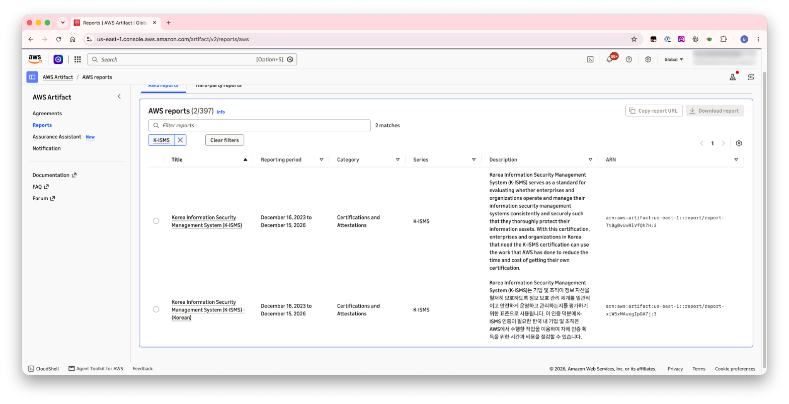

# AWS Artifact로 AWS K-ISMS 인증서 받기

이 페이지는 [AWS에서 처음 준비하는 ISMS-P: 5단계 로드맵](/draft-isms-p-on-aws/aws-isms-p-5/)의 2단계를 자세히 설명합니다. 다 읽고 나면 AWS의 K-ISMS 인증서를 직접 내려받고, 심사에서 어떻게 쓰고 어디까지 공유할 수 있는지 판단할 수 있습니다.

---

## 한눈에 보기

- AWS는 서울 리전(ap-northeast-2) 인프라를 대상으로 K-ISMS 인증을 받았습니다. 인증서는 AWS Artifact에서 영문판과 한글판으로 받을 수 있습니다.
- 이 인증서는 고객 심사에서 클라우드 인프라 영역의 근거로 씁니다. 내려받는다고 고객이 인증을 받는 것은 아닙니다.
- 보고서는 사내, 규제기관, 감사인에게만 공유할 수 있습니다.
- 다운로드 기록은 AWS CloudTrail에 남고, 다운로드 권한은 AWS IAM으로 제어합니다.

---

## 1. AWS Artifact란

AWS Artifact는 AWS의 규정 준수 보고서와 인증서를 셀프서비스로 내려받는 포털입니다. AWS Management Console에서 별도 비용 없이 사용합니다. K-ISMS 외에도 SOC, ISO, CSAP 같은 보고서가 함께 게시되어 있습니다.

---

## 2. 인증서 내려받기

### 준비할 것

- AWS Artifact 보고서를 조회하고 내려받을 IAM 권한. AWS 관리형 정책 `AWSArtifactReportsReadOnlyAccess`가 보고서 목록 조회, 보기, 다운로드 권한을 제공합니다.
- 관리형 정책은 모든 AWS 고객이 공통으로 쓰도록 만든 것이라 최소 권한이 아닐 수 있습니다. 필요하면 이 정책을 참고해 조직에 맞는 고객 관리형 정책을 만듭니다.
- 여러 사람이 받는다면 누가 받을 수 있는지 IAM 정책으로 미리 정해 둡니다.

### 이렇게 하세요

1. AWS Management Console에 로그인하고 서비스 검색창에서 **AWS Artifact**를 엽니다.
2. 왼쪽 메뉴에서 **Reports**를 선택합니다.
3. 검색창에 **K-ISMS**를 입력합니다. 영문판 `Korea Information Security Management System (K-ISMS)`과 한글판 `Korea Information Security Management System (K-ISMS) - (Korean)` 두 건이 나옵니다.
4. 받을 보고서의 행을 선택합니다. 행을 선택해야 상단의 **Download report** 버튼이 활성화됩니다.
5. **Download report**를 누릅니다. 약관(Terms and conditions) 수락 화면이 나오면 내용을 확인하고 수락합니다.

*AWS Artifact > Reports에서 "K-ISMS"로 검색한 화면. 영문판과 한글판 두 건이 표시됩니다.*

### 내려받은 뒤 확인할 것

| 확인 항목 | 어디서 보나 | 왜 확인하나 |
|---|---|---|
| 보고서 유효기간 (Reporting period) | Artifact 목록의 Reporting period 열 | 우리 심사 시점을 포함해야 합니다. 포함하지 않으면 심사 직전에 갱신본을 다시 받습니다. |
| 우리가 쓰는 서비스가 인증 범위에 있는지 | [AWS Services in Scope - K-ISMS](https://aws.amazon.com/compliance/services-in-scope/K-ISMS/) | 범위 밖 서비스는 이 인증서로 근거를 댈 수 없습니다. |
| 서비스별 예외 표기 | 같은 페이지의 서비스 이름 옆 표기 | 일부 서비스는 특정 기능이 범위에서 빠져 있습니다. |
| 리전 | 인증서 본문 | 인증 범위는 서울 리전 인프라입니다. 다른 리전을 함께 쓴다면 범위를 따로 정리합니다. |

---

## 3. 심사에서 인증서를 쓰는 방법

AWS 공동 책임 모델에 따라 AWS가 운영하는 영역(데이터센터, 물리 보안, 하드웨어, 가상화 계층)은 AWS 인증서를 근거로 제시합니다. 고객이 구성하고 운영하는 영역은 고객이 따로 증적을 준비합니다.

| 심사에서 이렇게 쓰세요 | 이렇게는 쓸 수 없습니다 |
|---|---|
| 클라우드 인프라 영역(특히 데이터센터 물리 보안)의 근거로 제출 | 고객 서비스 전체가 인증받았다는 근거로 사용 |
| 외부자 보안(클라우드 서비스 제공자 관리) 항목에서 공급자 평가 자료로 활용 | 고객의 계정, 네트워크, 애플리케이션 설정에 대한 근거로 사용 |
| 내부 위험평가에서 인프라 위험을 평가하는 자료로 활용 | 3영역(개인정보 처리단계)의 근거로 사용 |

인증서를 어느 항목의 증적으로 인정할지는 심사기관이 판단합니다.

---

## 4. 공유와 보관 시 주의할 점

AWS Artifact 문서에 명시된 내용입니다.

- **공유 범위:** 내려받은 보고서는 사내, 규제기관, 감사인에게만 공유할 수 있습니다. 고객사의 고객에게 전달하거나 웹사이트에 게시하면 안 됩니다.
- **전달 방법:** 이메일 첨부보다 접근 권한을 통제할 수 있는 보안 공유 방식을 권장합니다.
- **워터마크:** 다운로드마다 고유하고 추적 가능한 워터마크가 들어갑니다.
- **다운로드 기록:** 다운로드는 AWS CloudTrail에 `GetReport` 같은 이벤트로 기록됩니다. 요청한 사용자, IP, 시각이 남습니다.
- **권한 제어:** IAM 정책으로 보고서를 내려받을 수 있는 사용자를 제한할 수 있습니다.

### 이렇게 운영하세요

1. 인증서를 받을 담당자를 정하고 그 사람에게만 Artifact 권한을 줍니다.
2. 내려받은 인증서는 심사 증적 저장소에 보관하고, 열람 권한을 심사 관련자로 제한합니다.
3. 심사 준비를 시작할 때와 심사 직전에 Artifact에서 유효기간을 다시 확인합니다.

---

## 5. 자주 묻는 질문

**Q. 한글판과 영문판 중 무엇을 제출하나요?**
두 보고서의 유효기간은 같습니다. 심사기관이 한국어 자료를 요청하면 한글판을, 해외 본사나 글로벌 감사인에게 제출할 때는 영문판을 씁니다.

**Q. 다운로드에 비용이 드나요?**
AWS Artifact는 추가 비용 없이 사용할 수 있습니다.

**Q. AWS CLI로도 받을 수 있나요?**
받을 수 있습니다. `aws artifact list-reports`로 보고서 목록을 조회하고, `aws artifact get-report`로 내려받을 수 있는 주소를 받습니다. 콘솔과 마찬가지로 IAM 권한이 필요하고, 호출 기록이 CloudTrail에 남습니다.

---

## 출처

- [AWS Artifact FAQ](https://aws.amazon.com/artifact/faq/)
- [AWS Artifact: Downloading reports](https://docs.aws.amazon.com/artifact/latest/ug/downloading-documents.html)
- [AWS Artifact: Using AWS managed policies](https://docs.aws.amazon.com/artifact/latest/ug/security-iam-awsmanpol.html)
- [AWS Artifact: Logging API calls with AWS CloudTrail](https://docs.aws.amazon.com/artifact/latest/ug/cloudtrail-logging.html)
- [AWS Services in Scope - K-ISMS](https://aws.amazon.com/compliance/services-in-scope/K-ISMS/)
- [AWS renews K-ISMS certificate for the Asia Pacific (Seoul) Region](https://aws.amazon.com/blogs/security/aws-renews-k-isms-certificate-for-the-asia-pacific/)
- [AWS Shared Responsibility Model](https://aws.amazon.com/compliance/shared-responsibility-model/)
