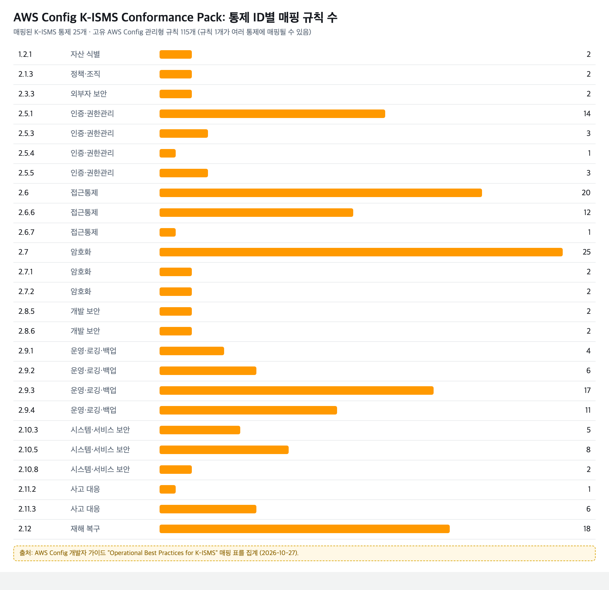

# AWS Config K-ISMS 적합성 팩으로 기술 통제 점검하기

이 페이지는 [AWS에서 처음 준비하는 ISMS-P: 5단계 로드맵](/draft-isms-p-on-aws/aws-isms-p-5/)의 3단계를 자세히 설명합니다. 다 읽고 나면 K-ISMS 적합성 팩을 배포해 AWS 계정의 보안 설정을 자동으로 점검하고, 결과를 심사 준비에 쓸 수 있습니다.

---

## 한눈에 보기

- AWS Config는 AWS 리소스의 설정을 기록하고, 정한 규칙에 맞는지 계속 점검하는 서비스입니다.
- 적합성 팩(Conformance Pack)은 여러 점검 규칙을 하나의 묶음으로 배포하는 기능입니다.
- AWS가 제공하는 K-ISMS 적합성 팩은 K-ISMS 통제 25개에 AWS Config 관리형 규칙 약 115개를 연결한 샘플 템플릿입니다.
- 이 팩은 2영역(보호대책)의 기술 통제 일부만 점검합니다. 이 팩만으로 인증 기준을 충족한다는 보장은 없습니다.

---

## 1. 적합성 팩이 점검하는 범위

K-ISMS 적합성 팩은 통제 ID와 규칙을 다대다로 연결합니다. 규칙 하나가 여러 통제에 연결되고, 통제 하나에 여러 규칙이 연결됩니다.

| 통제 영역 | 연결된 통제 ID | 대표 규칙 | 무엇을 점검하나 |
|---|---|---|---|
| 자산 식별·관리 | 1.2.1, 2.1.3 | `ec2-managedinstance-association-compliance-status-check`, `ec2-volume-inuse-check` | 관리 대상 서버의 구성 상태, 사용하지 않는 디스크 |
| 외부자 보안 | 2.3.3 | `cloudtrail-enabled`, `cloud-trail-cloud-watch-logs-enabled` | API 호출 기록 수집 |
| 인증 및 권한 관리 | 2.5.1, 2.5.3, 2.5.4, 2.5.5 | `root-account-mfa-enabled`, `iam-user-mfa-enabled`, `iam-password-policy`, `access-keys-rotated`, `iam-policy-no-statements-with-admin-access` | 다중 인증(MFA), 비밀번호 정책, 액세스 키 교체, 관리자 권한 남용 |
| 접근통제 | 2.6, 2.6.6, 2.6.7 | `restricted-ssh`, `vpc-default-security-group-closed`, `s3-bucket-public-read-prohibited`, `rds-instance-public-access-check`, `ec2-instance-no-public-ip` | SSH 전체 개방, 공개 접근, 퍼블릭 IP |
| 암호화 적용 | 2.7, 2.7.1, 2.7.2 | `rds-storage-encrypted`, `encrypted-volumes`, `s3-bucket-server-side-encryption-enabled`, `s3-bucket-ssl-requests-only`, `cmk-backing-key-rotation-enabled` | 저장 데이터 암호화, 전송 구간 암호화, 키 교체 |
| 개발 보안 | 2.8.5, 2.8.6 | (원문 매핑 표 참고) | 개발·운영 환경 관련 설정 |
| 시스템 및 서비스 운영관리 | 2.9.1 ~ 2.9.4 | `cloudtrail-enabled`, `multi-region-cloudtrail-enabled`, `vpc-flow-logs-enabled`, `cloud-trail-log-file-validation-enabled`, `db-instance-backup-enabled` | 로그 수집과 무결성, 백업 |
| 시스템 및 서비스 보안관리 | 2.10.3, 2.10.5, 2.10.8 | `guardduty-enabled-centralized`, `securityhub-enabled`, `ec2-managedinstance-patch-compliance-status-check` | 위협 탐지 활성화, 패치 상태 |
| 사고 예방 및 대응 | 2.11.2, 2.11.3 | `guardduty-non-archived-findings`, `cloudwatch-alarm-action-check` | 처리하지 않은 위협 탐지 결과, 알림 설정 |
| 재해복구 | 2.12 | `rds-multi-az-support`, `s3-bucket-replication-enabled`, `dynamodb-in-backup-plan`, `elb-cross-zone-load-balancing-enabled` | 다중 가용 영역, 복제, 백업 계획 |



*통제 ID별로 연결된 AWS Config 규칙 수. 암호화(2.7), 접근통제(2.6), 재해복구(2.12), 로그(2.9.3) 영역에 규칙이 많이 몰려 있습니다.*

전체 규칙 목록과 통제별 설명은 [Operational Best Practices for K-ISMS](https://docs.aws.amazon.com/config/latest/developerguide/operational-best-practices-for-k-isms.html) 원문 표에서 확인합니다.

### 점검되지 않는 영역

- **1영역(관리체계)과 3영역(개인정보 처리단계):** 정책, 절차, 운영 기록으로 확인하는 영역이라 설정 점검 규칙으로 다룰 수 없습니다.
- **2영역 중 사람과 절차 중심의 통제:** 인적 보안, 물리 보안, 외부자 계약 관리처럼 문서로 확인하는 통제는 점검 대상이 아닙니다.
- **AWS 밖의 시스템:** 온프레미스 서버, 사무실 PC, SaaS 서비스는 점검되지 않습니다.

---

## 2. 배포 전에 준비할 것

| 준비 항목 | 내용 |
|---|---|
| AWS Config 기록 활성화 | 점검할 계정과 리전에서 AWS Config 레코더(Configuration recorder)가 켜져 있어야 합니다. |
| 점검 대상 리전 결정 | 적합성 팩은 리전 단위로 배포됩니다. 서비스를 운영하는 리전마다 배포합니다. |
| 기준값 확인 | 일부 규칙은 기준값을 받습니다. 예를 들어 `access-keys-rotated`의 기본값은 90일입니다. AWS 문서도 실제 값은 조직 정책에 맞추라고 안내합니다. |
| 비용 확인 | AWS Config 규칙 평가와 적합성 팩 평가에는 사용량에 따른 비용이 발생합니다. 리소스가 많은 계정은 [AWS Config 요금](https://aws.amazon.com/config/pricing/)을 미리 확인합니다. |

---

## 3. 배포하기

### 계정 하나에 배포할 때

1. AWS Management Console에서 **AWS Config**를 엽니다.
2. 왼쪽 메뉴에서 **Conformance packs**를 선택하고 **Deploy conformance pack**을 누릅니다.
3. **Use sample template**을 선택하고 샘플 목록에서 **Operational Best Practices for K-ISMS**를 고릅니다.
4. 적합성 팩 이름을 입력하고, 필요하면 규칙 기준값(파라미터)을 조직 정책에 맞게 바꿉니다.
5. 배포를 완료하고, 평가가 끝날 때까지 기다립니다. 리소스 수에 따라 시간이 걸립니다.

### 여러 계정에 한꺼번에 배포할 때

AWS Organizations를 쓰는 경우 관리 계정이나 위임된 관리자 계정에서 조직 단위로 배포할 수 있습니다. 템플릿은 [awslabs/aws-config-rules 저장소](https://github.com/awslabs/aws-config-rules/blob/master/aws-config-conformance-packs/Operational-Best-Practices-for-KISMS.yaml)의 YAML 파일을 씁니다.

```bash
aws configservice put-organization-conformance-pack \
  --organization-conformance-pack-name kisms-best-practices \
  --template-body file://Operational-Best-Practices-for-KISMS.yaml
```

조직 단위로 배포하려면 각 멤버 계정에서도 AWS Config 기록이 켜져 있어야 합니다.

---

## 4. 결과 보고 조치하기

### 이렇게 하세요

1. **Conformance packs** 화면에서 적합성 팩을 열고 준수율(Compliance score)과 비준수(Noncompliant) 규칙 목록을 확인합니다.
2. 비준수 규칙을 누르면 해당 리소스 목록이 나옵니다. 리소스별로 원인을 확인하고 조치합니다.
3. 예외로 둬야 하는 리소스가 있으면 사유를 문서로 남깁니다. 심사에서 예외의 근거를 설명해야 합니다.
4. 조치 후 재평가를 실행해 준수 상태로 바뀌었는지 확인합니다.

### 처음 배포했을 때 먼저 볼 항목

처음 배포하면 비준수 항목이 많이 나오는 것이 보통입니다. 아래처럼 위험이 크고 조치가 간단한 항목부터 처리하면 준비 기간을 줄일 수 있습니다.

| 우선순위 | 규칙 | 조치 |
|---|---|---|
| 1 | `root-account-mfa-enabled`, `iam-root-access-key-check` | 루트 계정 MFA 적용, 루트 액세스 키 삭제 |
| 2 | `restricted-ssh`, `vpc-default-security-group-closed` | SSH(22번 포트) 전체 개방 제거, 기본 보안 그룹 규칙 비우기 |
| 3 | `s3-bucket-public-read-prohibited`, `rds-instance-public-access-check` | 의도하지 않은 공개 접근 차단 |
| 4 | `cloudtrail-enabled`, `multi-region-cloudtrail-enabled`, `vpc-flow-logs-enabled` | 로그 수집 활성화 |
| 5 | `encrypted-volumes`, `rds-storage-encrypted`, `s3-bucket-server-side-encryption-enabled` | 저장 데이터 암호화 |

---

## 5. 심사 증적으로 정리하기

- AWS Config의 적합성 팩 평가 결과는 2영역 기술 통제의 현재 상태를 보여 주는 자료로 쓸 수 있습니다.
- 심사 시점의 결과뿐 아니라, 비준수 항목을 발견하고 조치한 기록도 함께 정리합니다. 관리체계가 실제로 운영되고 있다는 근거가 됩니다.
- 통제 ID별로 "연결된 규칙 → 평가 결과 → 조치 기록" 순서로 정리하면 심사원이 확인하기 쉽습니다.
- 증적으로 인정되는 범위는 심사기관이 판단합니다.

---

## 출처

- [AWS Config: Operational Best Practices for K-ISMS](https://docs.aws.amazon.com/config/latest/developerguide/operational-best-practices-for-k-isms.html)
- [K-ISMS 적합성 팩 템플릿 YAML (awslabs/aws-config-rules)](https://github.com/awslabs/aws-config-rules/blob/master/aws-config-conformance-packs/Operational-Best-Practices-for-KISMS.yaml)
- [AWS Config: Conformance Packs](https://docs.aws.amazon.com/config/latest/developerguide/conformance-packs.html)
- [AWS Config 요금](https://aws.amazon.com/config/pricing/)
