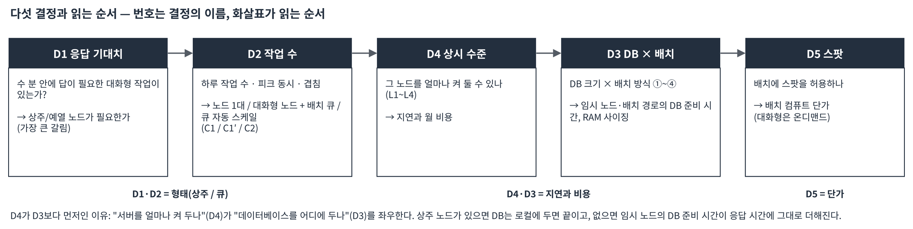
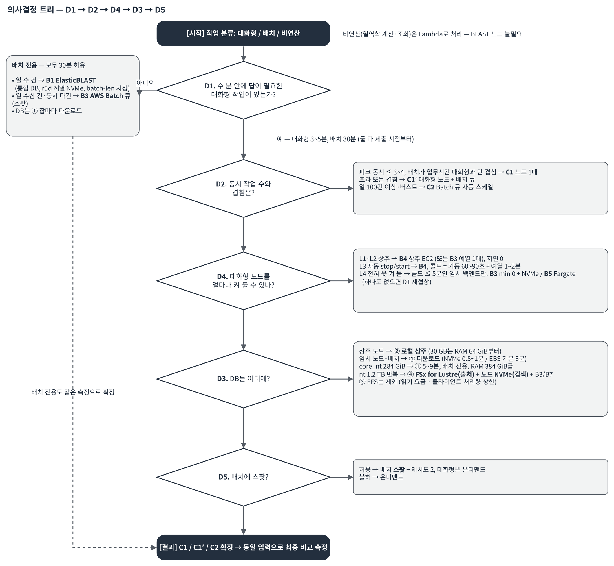

# BLAST 검색 서비스를 AWS에 올리기 전에 답해야 할 5가지 질문: 백엔드 선택 가이드

이 글은 "연구원들이 BLAST 검색을 웹 화면이나 챗봇으로 제출하는 서비스"를 AWS에 만들어야 하는 아키텍트와 바이오인포매틱스 엔지니어를 위해 썼습니다. [1부](/ncbi-blast-on-aws/elasticblast-aws-ncbi-blast/)에서 본 ElasticBLAST를 그대로 쓸지, AWS Batch를 직접 구성할지, Amazon EC2 한 대를 켜 둘지는 데이터베이스 크기만으로는 정해지지 않습니다. 다섯 가지 질문에 순서대로 답하면 백엔드 구성과 월 비용의 자릿수가 정해지도록 정리했고, 결정을 숫자로 뒷받침하는 소규모 측정 계획(약 $35)도 함께 담았습니다.

## 개요

BLAST 검색을 서비스로 만들 때 흔히 하는 실수는 모든 요청을 한 경로로 보내는 것입니다. 연구원이 올리고 50개를 넣고 2분 안에 답을 보고 싶은 요청과, 밤새 1,000개를 1 TB 데이터베이스에 돌리는 요청은 자원 요구가 정반대입니다. 전자는 항상 켜져 있고 예열된 작은 서버가 필요하고, 후자는 필요할 때만 큰 자원을 빌려 쓰고 끄는 편이 싸고 빠릅니다.

이 글에서는 실제 현장에서 반복해 만나는 두 가지 사용 유형을 일반화해 사용합니다.

| 유형 | 쿼리 | 데이터베이스 | 실행 패턴 | 핵심 요건 |
|---|---|---|---|---|
| **유형 Ⅰ. 타깃 데이터베이스 대화형** | 짧은 서열(프라이머·프로브 등) 수십~수천 개 | 특정 목적으로 묶은 수십 GB(사람 참조 유전체 + 대표 세균·바이러스 + 자체 서열 등), 월·주 단위 갱신 | 연구원이 대화형으로 제출·반복, 1,000개 기준 30분 이내, 나중에 챗봇(LLM 에이전트)에서 제출·조회 | 서열을 특정 리전 밖으로 보내지 않음, 결과 재현성, 소규모 예산 |
| **유형 Ⅱ. 초대형 데이터베이스 배치** | 미매핑 리드 수백 개/건 | nt 약 1.2 TB(또는 core_nt 약 300 GB) | 하루 수천 건 반복 | 건당 비용 구조, 상시 공유 스토리지 여부, 기존 파이프라인과의 연동 |

용어는 1부와 같습니다. **콜드 스타트**는 제출 뒤 실제 blastn이 시작되기까지의 고정 대기(인스턴스 기동 + 컨테이너 이미지 받기 + 데이터베이스 준비)이고, **스테이징**은 데이터베이스를 Amazon S3에서 노드 디스크로 내려받는 일, **예열**은 디스크의 데이터베이스가 RAM(페이지 캐시)에 올라오는 일입니다. **상주 노드**는 켜 둔 서버, **임시 노드**는 작업 때만 만들고 지우는 서버이며, **스팟 인스턴스**는 할인가로 쓰되 2분 전 통보로 회수될 수 있는 EC2입니다.

## 솔루션 개요

어느 백엔드를 고르더라도 바뀌지 않아야 하는 부분부터 고정합니다. 화면·챗봇·후처리는 BLAST를 직접 호출하지 않고 **Job API**라는 얇은 경계만 호출합니다.

*그림 1. 어느 백엔드를 고르더라도 바뀌지 않는 Job API 경계. 선택 대상은 BLAST 연산 백엔드 상자뿐이다*

Job API는 다섯 동작으로 충분합니다. `submit`은 즉시 `run_id`를 돌려주고 끝나면 이벤트(Amazon EventBridge)로 알립니다. 챗봇은 10~30분 동안 연결을 잡고 기다릴 수 없으므로 동기 호출 대신 `submit` + `status` 비동기 패턴을 씁니다. `compare`는 데이터베이스 갱신 전후의 두 실행을 비교하고, `report`는 저장된 결과를 문서로 만듭니다.

이 경계가 있으면 백엔드를 B4에서 B3으로 바꿔도 화면과 챗봇 코드는 그대로입니다. 바뀌는 것은 백엔드 어댑터 하나와 "서버를 얼마나 켜 둘지"라는 정책입니다. 그러니 지금 정할 것은 두 가지입니다. **백엔드 상자 안을 무엇으로 채울지, 그 서버를 얼마나 켜 둘지.**

## 사전 요구 사항

다섯 질문에 답하려면 다음 정보를 모아 두어야 합니다. 정확한 값이 없어도 자릿수만 알면 됩니다.

- 사용자가 기대하는 응답 시간(3분 / 5분 / 10분 / 30분). "30분"이 제출 시점부터인지 blastn 시작부터인지.
- 하루 작업 수(대화형과 배치 각각), 같은 시각에 겹치는 최대 작업 수, 야간으로 미룰 수 있는 비율.
- 정책·예산상 RAM 64~128 GiB급 서버를 24시간 / 업무시간 / 자동 켜고 끄기 / 전혀 못 켜 둠 중 어디까지 허용하는지.
- 데이터베이스 크기와 로드맵(수십 GB -> core_nt 약 300 GB -> nt 약 1.2 TB), 갱신 주기, 인용 버전 보존 요건.
- 스팟 인스턴스 허용 여부(규제 제출용 실행 포함).
- 데이터가 특정 리전 밖으로 나가면 안 되는지(서열 본문뿐 아니라 LLM 호출 경로까지).

## 연습(Walkthrough): 다섯 질문에 순서대로 답하기

번호 D1~D5는 결정의 이름이고, **읽는 순서는 D1 -> D2 -> D4 -> D3 -> D5**입니다. "서버를 얼마나 켜 두나"(D4)가 "데이터베이스를 어디에 두나"(D3)를 좌우하므로 D4가 먼저입니다.

*그림 2. 다섯 결정을 읽는 순서 D1 → D2 → D4 → D3 → D5. 번호는 결정의 이름이고 화살표가 읽는 순서다*

### 1단계(D1): 몇 분 안에 답이 필요한가

질문: 대화형 요청에 사용자는 몇 분까지 기다리는가?

왜 중요한가: 대화형 요청이 5분 이내라면 콜드 스타트가 5~15분인 백엔드(ElasticBLAST, AWS Fargate)는 **탈락**이고 상주 또는 예열된 노드가 필수입니다. 이 한 답이 아키텍처의 절반을 정합니다. 비유하면 "2분짜리 검색을 위해 15분 예열하는 차를 매번 부를 것인가"입니다.

판정: 예열된 노드에서 대화형 작업의 순수 검색 시간이 3분 이하이고 기대치가 5분 이하면 "대화형 클래스 있음"입니다. 모든 작업이 30분을 허용하면 배치 전용 경로로 바로 갈 수 있습니다.

### 2단계(D2): 하루 몇 건, 동시에 몇 건인가

질문: 일 작업 수(대화형/배치 따로), 피크 동시 작업 수, 작업당 크기(쿼리 수 x 데이터베이스 GB), 야간으로 미룰 수 있는 비율은?

왜 중요한가: 비용은 **사용자 수가 아니라 작업 수 x 작업당 노드-분**입니다. 챗봇은 한 사람이 반복 제출합니다. 16 vCPU 노드 1대는 소형 작업 3~4건 동시까지 지연 없이 처리하고, 그 이상은 대기열이 생깁니다.

| 지표 | 갈림길 |
|---|---|
| 일 노드-시간 | 2시간 이하면 자동 켜고 끄기(L3)가 싸고, 6~8시간 이상이면 업무시간 상주(L2)가 싸고 단순 |
| 피크 동시 작업 | 3~4건 이하면 노드 1대(C1), 초과 또는 배치와 겹치면 클래스 분리(C1'), 수십 건이면 큐(C2) |
| 작업당 크기 | 50개 x 5 GB와 1,000개 x 30 GB는 100배 차이. `submit`이 `job_class`(interactive/batch)를 받아 라우팅 |
| 예약 가능 비율 | 높을수록 스팟·임시 자원 비중을 높이고 상시 노드는 작게 |

답을 모르면 Job API 로그(DynamoDB에 `job_class`, 쿼리 수, 노드-분 기록)로 PoC 기간에 실측해 운영 전환 근거로 씁니다.

### 3단계(D4): BLAST 서버를 얼마나 켜 둘 수 있나

질문: RAM 64~128 GiB급 워커를 어디까지 켜 둘 수 있는가?

| 수준 | 대화형 지연 | 월 컴퓨트 비용 감각 [추정] | 비고 |
|---|---|---|---|
| L1 24/7 상주 | 0 | r6i.4xlarge급 약 $730, r6i.2xlarge급 약 $370 | 소규모 예산 초과 |
| L2 업무시간 상주(10시간 x 22일) | 업무시간 0, 야간 60~90초 | 약 $220 / 약 $110 | 일 노드-시간 6~8시간 이상이면 L3보다 싸고 단순 |
| L3 자동 stop/start(유휴 30분) | 60~90초 + 예열 1~2분 | 쓴 만큼(일 2시간이면 약 $45 / 약 $22) + EBS | 작업이 적을 때 최저. **기본값** |
| L4 완전 임시 | 3~5분(Batch min 0 + NVMe) / 5~10분(Fargate) / 5~15분(ElasticBLAST) | 0 | D1이 5분 이내면 Batch·Fargate만 가능, ElasticBLAST 불가 |

L4를 골랐는데 D1이 5분 이내라면 D1을 다시 협상해야 합니다. 어느 쪽이든 측정 항목은 수준별·백엔드별 "제출 -> blastn 시작" 시간입니다.

### 4단계(D3): 데이터베이스를 어디에 두나

질문: 임시 노드가 잡마다 데이터베이스를 내려받는 시간이 허용되는가? 상주 디스크나 공유 스토리지가 필요한가?

핵심은 데이터베이스 크기 자체보다 **"누가 언제 데이터베이스를 준비하는가"**입니다. 상주 노드(L1~L3)면 스테이징은 0이고 첫 검색의 예열만 남습니다. 임시 노드면 매번 다운로드합니다.

S3에서 노드로 내려받는 시간(약 0.5~1 GB/s 가정) [추정]:

| 디스크 | 30 GB | 60 GB | 284 GiB(core_nt) | 1,142 GiB(nt) |
|---|---|---|---|---|
| 로컬 NVMe(r5d, r6id) 또는 gp3 처리량 상향 | 0.5~1분 | 1~2분 | 5~9분 | 19~37분 |
| gp3 기본 125 MB/s | 4분 | 8분 | 37분 | 사실상 불가 |
| 통째로 RAM에 올릴 수 있는 노드 | r6i.2xlarge(64 GiB) | r6i.4xlarge(128 GiB) | r6i.12xlarge(384 GiB) | 1.2 TiB급 또는 스토리지 대역폭이 성능 결정 |

데이터베이스 배치 방식 네 가지와 제외한 한 가지:

| 방식 | 잡 시작 고정비 | 상시 비용 [추정] | 결론 |
|---|---|---|---|
| ① 잡마다 S3에서 다운로드 | 30 GB 0.5~1분(NVMe), core_nt 약 300 GB 5~9분 | 0 | 배치·임시 노드용. core_nt도 배치에는 허용 |
| ② 노드 로컬 디스크 상주(EBS, stop/start) | 가동 중 0, 재기동 후 예열 1~2분 | EBS 300 GB 약 $24/월(gp3 $0.08/GB-월) | **수십 GB 유형 Ⅰ의 기본** |
| ③ Amazon EFS 공유 | 0 | 저장 $0.30/GB-월 + **읽기 $0.03/GB** | **제외**(아래 설명) |
| ④ Amazon FSx for Lustre 선적재 | 0 | SCRATCH_2 2,400 GiB 약 $336/월($0.14/GB-월), 읽기 무료 | **nt 1 TB급 반복(유형 Ⅱ)의 공유 출처.** 검색은 노드 로컬 NVMe에서(아래 실측). 30 GB에는 과함 |
| ⑤ 데이터베이스를 넣은 AMI/스냅샷 | S3에서 지연 로드되어 실질적으로 ①과 비슷 | 스냅샷 보관 | 비권고 |

**EFS를 TB급에 쓰지 않는 이유**를 숫자로 보겠습니다. EFS는 여러 서버가 동시에 마운트하는 네트워크 공유 드라이브(NFS)이고, 요금은 보관료(GB-월)와 통행료(읽고 쓴 GB당) 두 가지입니다. 이 통행료가 운명을 정합니다. 읽기 요금은 노드의 페이지 캐시에 없어서 EFS까지 내려가 읽은 바이트마다 붙습니다. 데이터베이스가 RAM에 들어가는 수십 GB면 노드 기동 때 한 번만 내지만, nt처럼 RAM(최대 768 GiB급)보다 크면 잡마다 캐시가 밀려 **매 잡이 콜드 패스**가 됩니다. 약 1,200 GB x $0.03/GB = **약 $36가 잡 1건마다** 붙고, 하루 2,000건이면 하루 $72,000입니다. 클라이언트 1대당 처리량 상한(약 1,500 MiB/s) 때문에 패스당 12분 이하로 줄일 수도 없습니다. 같은 1.2 TB를 FSx for Lustre에 두면 월 약 $336에 읽기 요금이 없습니다. 수십 GB 유형 Ⅰ에서도 EFS는 비용은 작지만, S3에서 노드 로컬로 내려받는 방식이 $0으로 같은 효과를 내므로 채택하지 않습니다.

저자 테스트로 수십 GB 규모를 실제로 재 봤습니다. 공개 벤치마크 템플릿([aws-blast-performance](https://github.com/hmkim/aws-blast-performance))으로 `ref_prok_rep_genomes`(약 27 GB, 대표 원핵생물 유전체) 데이터베이스를 세 저장 방식에 올려 두고, 같은 쿼리를 r5d.4xlarge(16 vCPU) AWS Batch 잡으로 두 번씩 돌린 결과입니다. 세 방식의 결과 파일 해시는 같았습니다(22행).

| 저장 방식 | 데이터베이스 준비(1회) | 잡 안에서 준비 | 첫 검색(콜드) | 두 번째 검색(웜) |
|---|---|---|---|---|
| ① S3에서 노드 NVMe로 다운로드 | 없음 | 78초(약 340 MB/s) | 6초 | 5초 |
| ③ EFS에 미리 적재 | 104초 | 0초 | **28초** | 6초 |
| ④ FSx for Lustre에 미리 적재(S3 연결) | 280초(S3 복사) | 158초(첫 접근 시 S3에서 지연 로드) | 12초 | 8초 |

읽는 법은 간단합니다. 웜 검색은 세 방식이 5~8초로 같습니다. 데이터가 페이지 캐시에 올라오면 저장 방식은 보이지 않습니다. 차이는 전부 첫 접근에 있습니다. EFS는 준비 시간이 0이지만 첫 검색이 NVMe의 4~5배 느리고, 읽은 바이트마다 요금이 붙습니다(약 27 GB x $0.03 ≈ $0.8, 콜드 잡마다). FSx for Lustre는 첫 접근 때 S3에서 끌어오는 158초가 지배적이어서, 데이터베이스를 올려 두고 **많은 잡이 공유할 때만** 값어치가 있습니다. 수십 GB에서는 잡마다 78초를 내고 NVMe로 받는 것이 가장 단순했습니다. 이 수치는 서울 리전에서 us-east-1의 NCBI 버킷을 교차 리전으로 읽은 값이라, us-east-1에서 돌리면 준비 시간은 더 짧고 전송 요금은 없습니다.

결론: **30 GB면 어느 방식이든 1~2분**이라 크기는 걱정거리가 아닙니다. 상주(②)가 기본, core_nt는 배치 전용 + ① 다운로드, nt 반복은 ④ FSx for Lustre입니다. 단, 아래에서 보듯 FSx for Lustre는 "데이터베이스를 두는 곳"이고 "검색이 읽는 곳"은 아닙니다.

**1 TB급은 다릅니다.** 같은 템플릿으로 nt(1,223 GB, 1억 3,200만 서열) 라운드를 NCBI 버킷과 같은 리전(us-east-1)에서 돌렸습니다. r5d.12xlarge(48 vCPU, RAM 384 GiB, NVMe 2개 RAID0) AWS Batch 잡 1개씩, 세균 유전체 3개(85 KB)를 쿼리로 두 번씩 검색했고, 두 방식의 결과(19행)는 같았습니다. EFS는 위 요금 구조로 제외했습니다.

| 단계 | ① S3에서 노드 NVMe로 다운로드 | ④ FSx for Lustre(S3 연결, 2,400 GiB) |
|---|---|---|
| NCBI 버킷에서 내 S3 버킷으로 복사(데이터베이스 버전당 1회) | - | 22.5분(서버 측 복사, 0.91 GB/s) |
| 잡 안에서 준비 | **46분**(441 MB/s, `aws s3 sync` 동시 요청 64) | **63분**(첫 접근 시 S3에서 지연 로드, 0.33 GB/s) |
| 첫 검색(콜드) | **15분** | **2시간 19분** |
| 두 번째 검색 | 13분 | 2시간 20분 |
| 잡 합계 | 74분, 컴퓨트 약 $4.3 | 5시간 42분, 컴퓨트 약 $19.7 |

두 라운드의 실제 청구액(AWS Cost Explorer)은 수십 GB 라운드 $8.2, nt 라운드 $28.9였습니다. 수십 GB 라운드에서 가장 큰 항목은 컴퓨트($1.1)가 아니라 **NAT 게이트웨이 데이터 처리 $3.4**였는데, 서울 리전에서 us-east-1의 NCBI 버킷을 세 번 내려받은 57 GB가 전부 NAT를 거쳤기 때문입니다. nt 라운드는 같은 리전의 S3 게이트웨이 엔드포인트를 지나 NAT 요금이 $0.04에 그쳤습니다. 데이터베이스가 있는 리전에서 돌리는 것이 왜 첫 번째 규칙인지 보여 주는 숫자입니다.

두 가지가 보입니다. 첫째, 두 번째 검색이 빨라지지 않습니다. nt는 384 GiB RAM에 들어가지 않아 페이지 캐시가 매번 밀리므로, **RAM보다 큰 데이터베이스에서는 웜 검색이 없습니다**(NVMe 15% 단축, Lustre 0%). 둘째, 같은 콜드 검색이 FSx for Lustre에서 **9배** 걸렸습니다. FSx의 Amazon CloudWatch 지표를 보면 검색 전반 30분은 0.62 GB/s의 순차 읽기(데이터베이스를 한 번 훑는 단계)였고, 나머지 약 110분은 8 KB 크기의 무작위 읽기가 초당 5,000~27,000건 이어졌습니다. CPU 사용률은 7~11%였습니다. 이유는 BLAST가 데이터베이스 파일을 메모리 매핑(`mmap`)으로 읽기 때문입니다. 서열을 확장·정렬하는 단계에서 필요한 페이지가 RAM에 없으면 페이지 폴트가 나고, 그 한 페이지를 저장소에서 가져옵니다. 로컬 NVMe는 이 폴트를 수십 마이크로초에 처리하지만, 네트워크 파일 시스템은 폴트마다 왕복 한 번입니다. Lustre 클라이언트 캐시 기본값(RAM의 50%, 잠금 수명 10분)이 선적재해 둔 페이지를 다시 비우는 것도 확인했습니다.

이 결과가 D3의 결론을 바꾸지는 않지만 역할을 분명히 합니다. **FSx for Lustre는 여러 노드가 S3까지 가지 않고 데이터베이스를 가져오는 공유 "출처"로 쓰고, 검색 자체는 노드 로컬 NVMe(또는 RAM에 들어가는 core_nt)에서 읽는 구성**이 맞습니다. FSx에서 바로 `blastn -db`를 돌리는 구성은 RAM보다 큰 데이터베이스에서는 피해야 합니다. 다운로드 46분은 하드웨어 한계가 아니라 CLI 설정값(동시 요청 수)이 정한 숫자라, `s5cmd`나 병렬 `sync`로 줄일 여지가 있습니다(r5d.12xlarge NIC 12 Gbit/s 기준 상한 약 1.5 GB/s. 2025년 12월 r5d.24xlarge 4대 실행에서는 ElasticBLAST의 병렬 다운로드가 노드당 0.9~1.1 GB/s를 냈습니다). 위 다운로드 시간 표의 "0.5~1 GB/s 가정"은 이 실측으로 "0.44 GB/s(기본 설정) ~ 1~1.5 GB/s(튠, 인스턴스 NIC 상한)"로 읽으면 됩니다.

### 5단계(D5): 스팟을 써도 되나

질문: 배치 작업에 스팟 인스턴스를 허용하는가? 규제 제출용 실행도 가능한가?

왜 중요한가: 컴퓨트 비용이 50~70% 내려갑니다. 배치가 노드-분의 대부분이면 전체 컴퓨트의 40~50%를 아낍니다. 과학적 결과는 인스턴스 종류와 무관하며 결과 파일 해시로 증명할 수 있습니다.

전제: 잡 단위 재시도(Batch attempts 2~3), 중단 시 데이터베이스 다운로드 재지불(30 GB면 1분), **스팟 vCPU 쿼터를 온디맨드와 별도로 신청**, 인스턴스 타입 다변화(ElasticBLAST는 `machine-type` 1종만 지정 가능해 확보 실패 시 대기). 권고는 **배치만 스팟, 대화형 노드는 항상 온디맨드**입니다.

### 의사결정 트리

*그림 3. 백엔드 선택 의사결정 트리. 각 결정의 분기 결과는 오른쪽 카드에 있다*

## 백엔드 선택지: B1~B7과 조합 C1~C3

### 백엔드 일곱 가지

| # | 이름 | 한 줄 설명 | 콜드 스타트 | 상시 비용/월 [추정] | 강점 | 약점 | 맞는 유형 |
|---|---|---|---|---|---|---|---|
| B1 | ElasticBLAST 그대로 | 제출마다 AWS CloudFormation 스택 -> Batch 클러스터 -> 노드마다 DB 다운로드 -> 검색 -> 자동 삭제 | 5~15분 | 0 | 설치 한 줄, 운영 코드 0 | 대화형 불가, 동시 N건 = 클러스터 N개, `.nal` 별칭 불가 | 유형 Ⅱ 중 월 수 회 배치, 유형 Ⅰ의 전체 재스크리닝 |
| B2 | ElasticBLAST 튠 | B1 + `machine-type` NVMe 지정 + `pd-size` 축소 + 스팟 + 태그 + `batch-len` | 5~15분(줄지 않음) | 0 | B1을 쓸 때의 올바른 기본 설정 | 대화형 불가 | B1과 같음 |
| B3 | AWS Batch 직접 구성 | ElasticBLAST가 하는 일을 자체 IaC로. 큐·컴퓨팅 환경이 상시 존재, 잡마다 스택 없음 | min 0대 약 5분 / 예열 1대 수 초 | 0 또는 예열 1대 약 $220 | 큐 1개로 대화형+배치, 동시 다건, 재시도·스팟·배열 잡, FSx for Lustre 마운트 가능 | IaC 수백 줄, 컨테이너 이미지 관리 | **유형 Ⅱ 1순위**, 유형 Ⅰ 서비스 2단계 |
| B4 | 상주 EC2 1대 | r6i 1대, DB를 EBS에 상주. 유휴 30분이면 자동 stop, 요청 오면 start | 가동 중 0 / stop에서 60~90초 + 예열 1~2분 | EBS 약 $24 (+컴퓨트는 쓴 만큼) | 가장 단순, `.nal` 별칭 자유, 운영 1명 | 단일 노드 상한(동시 3~4건), nt는 RAM 초과 | **유형 Ⅰ PoC·소량 운영** |
| B5 | AWS Fargate | 서버리스 컨테이너(최대 16 vCPU / 120 GB RAM / 임시 디스크 200 GB). 태스크마다 DB 다운로드 | 5~10분 | 0 | 운영 0, 노드 없음 | 대화형 불가, DB 100 GB 이하만, core_nt 불가 | 운영 최소화가 최우선이고 콜드 허용인 유형 Ⅰ |
| B6 | AWS HealthOmics | 매니지드 워크플로(Nextflow/WDL). 런마다 스토리지를 프로비저닝하고 해제 | 수 분 | 0 | 이미 HealthOmics로 파이프라인을 돌리는 조직에 자연스러움 | 런마다 DB 스테이징, DB 상주 불가 | 하루 1~4런으로 묶는 배치 파이프라인 |
| B7 | Slurm(AWS ParallelCluster) + FSx for Lustre | HPC 스케줄러. 공유 고속 스토리지에 DB 상주, 계산 노드 자동 확장 | 큐 즉시, 노드 2~5분 | 약 $220 이상(헤드 노드 + FSx) | HPC에 익숙한 조직, `sbatch blastn` 그대로 | 운영 난도, 단일 AZ | **유형 Ⅱ**(B3과 양자택일) |

제외: AWS Lambda(임시 디스크 10 GB, 15분 제한, 소형 DB 즉답 경로로만 가능), S3 위 직접 mmap(성능 미검증), EFS(앞 절).

### 조합 세 가지

하나로 다 되지 않으니 조합입니다. 공통으로 Job API·에이전트·후처리는 같습니다.

| 조합 | 구성 | 언제 | 비유 |
|---|---|---|---|
| **C1** 기본 | B4 상주 EC2 1대(대화형 + 1,000개 배치) + 큰 DB 단계만 B1/B2 | 연구원 소수, 동시 3~4건 이하, 운영 1명 | 내 차 1대 + 가끔 큰 짐은 택시 |
| **C1'** 클래스 분리 | 대화형은 B4(또는 B3 예열 1대, 온디맨드), 배치는 B1/B3 스팟 큐(야간) | 배치가 업무시간 대화형과 겹치거나 동시 건수가 노드 1대를 넘을 때 | 출퇴근차 + 화물은 야간 트럭 |
| **C2** 서비스 지향 | B3 상시 큐, 업무시간 예열 1대 + 스팟 스케일, 큐 1개로 통합 | 챗봇을 조직 전체에 열 때, 일 100건 이상·버스트 | 회사 셔틀 노선 운영 |
| **C3** 완전 매니지드 | B5 Fargate 또는 B6 HealthOmics | 운영 0이 최우선, 콜드 5~10분 허용 | 전부 렌터카 |

권고 기본값은 **C1으로 시작해 사용 패턴(건수·동시성·응답 기대)을 실측한 뒤 C1' 또는 C2 전환 여부를 결정**하는 것입니다. 전환 시 바뀌는 코드는 백엔드 어댑터 하나입니다.

## 성능과 비용

### 트리를 따라가 본 예시 세 가지

모든 금액은 us-east-1 온디맨드 공시가(2026-10 기준)로 계산한 근사치이며 [추정] 표시가 있습니다.¹

**예 A. 연구원 3명, 하루 3~5건, 주 1회 1,000개 배치, 월 예산 $150**

D1 예(대화형 있음) -> D2 동시 2 이하, 배치는 야간 -> **C1** -> D4 일 노드-시간 약 2시간 -> **L3 자동 stop/start** -> D3 상주 노드 -> **② EBS 상주**, 30 GB DB는 r6i.2xlarge(64 GiB) -> D5 배치가 주 1건이라 스팟 이득 작음, 온디맨드도 가능.

결과: B4 r6i.2xlarge + EBS 300 GB. 월 **약 $115~145** [추정](프라이빗 엔드포인트 4개 포함, 퍼블릭 서브넷이면 약 $80~110). 공개 데이터베이스 4종 약 26 GB + 자체 서열 수 GB로 데이터베이스가 30 GB 안에 들어가는 것이 확인되면 RAM 64 GiB 인스턴스로 내려올 수 있어, 128 GiB 인스턴스 대비 컴퓨트가 절반이 됩니다.

**예 B. 챗봇을 부서 전체에 개방, 하루 20~100건, 피크 동시 8**

D1 예 -> D2 동시 8 > 노드 1대 한계, 배치가 업무시간에 겹침 -> **C1'**(100건 이상이면 **C2**) -> D4 일 노드-시간 6시간 이상 -> **L2 업무시간 상주** + 배치는 큐 -> D3 대화형 노드는 ② 상주, 배치 큐는 ① 다운로드(NVMe) -> D5 배치 스팟 허용.

결과: B3 AWS Batch 웜 풀(예열 1대) + 스팟 스케일. 월 **약 $230~400** [추정]. 소규모 예산을 넘으므로 "조직 서비스" 예산을 따로 잡아야 합니다.

**예 C. 대화형 없음, 규제 보고서용 전수 배치만 월 수 회**

D1 아니오 -> **B1/B2 ElasticBLAST 배치 전용** -> D3 ① 다운로드, core_nt도 `machine-type` 지정으로 흡수 -> D5 스팟 허용 시 `use-preemptible = yes`.

결과: 상시 비용 0, 실행 1회당 **약 $1~2**(30 GB DB, r5d.4xlarge 1대 30분) [추정]. nt 전체 500 리드는 1부 저자 테스트처럼 약 $11. 단 1부 "알아야 할 제약" 열 가지(통합 DB, NVMe 타입, `batch-len`, janitor, `BLAST_USAGE_REPORT`)를 모두 반영해야 합니다.

### 운영 전환 후 월 비용 감각 [추정]

공통: EBS 300 GB 약 $24, 프라이빗 엔드포인트 4개 약 $30(퍼블릭이면 0), Lambda·DynamoDB·SQS·S3 약 $5, LLM 호출 약 $20~60.

| 시나리오 | 구성 | 합계 |
|---|---|---|
| S-a 일 3건 대화형 + 주 1회 배치 1,000 | C1, L3, r6i.2xlarge | 약 $115~145 |
| S-b 일 20건 + 주 2회 배치 | C1, L2 r6i.2xlarge 업무시간 상주 + 배치 스팟 | 약 $230~270 |
| S-c 일 100건, 동시 8, 챗봇 전사 | C2, 예열 r6i.2xlarge + 스팟 스케일 | 약 $300~400 |
| S-d + core_nt 월 4회 | B1 또는 B3 r6i.12xlarge 스팟 | +$20~50, 저장 +$7 |
| 유형 Ⅱ: nt 일 2,000건 | FSx for Lustre 2,400 GiB(출처) + B3 상시 워커(로컬 NVMe에 nt 복사; RAM 1.2 TiB급이면 웜 검색, core_nt면 384 GiB급) | FSx 약 $336 + 워커(r6i.12xlarge 8시간/일, 월 22~30일 약 $530~730) [추정] |

유형 Ⅱ를 ElasticBLAST로 2,000회 개별 실행하면 nt 다운로드만 2,000 x 1.2 TB가 되어 성립하지 않습니다. 건당 비용은 (상시 FSx + 상시 또는 탄력 워커) / 일 건수로 계산해야 합니다. 리드 대부분이 숙주 유전체에 매핑되는 데이터라면 minimap2로 숙주를 먼저 걷어 내고 잔여만 BLAST하는 전처리로 건당 비용을 크게 줄일 수 있고, 분류가 목적이면 k-mer 분류기 1차 + BLAST 2차 구성도 검토할 만합니다.

### 결정하기 전에 측정하기: T0~T6 (합계 약 $35, 2주)

사용자 답을 기다리지 않고 먼저 돌릴 수 있는 측정입니다. 결과를 아래 표의 "측정값" 칸에 채우고 사용자 입력과 나란히 보면 결정이 끝납니다.

| 테스트 | 어떤 결정 | 무엇을 재나 | 합격·분기 기준 | 비용·시간 [추정] |
|---|---|---|---|---|
| **T0** 준비 | 전부 | 계정·비용 태그, 쿼터(온디맨드·스팟 vCPU 64 이상), 리전 인스턴스 제공 확인, 공개 DB 복사, 별칭 `.nal`(B4용)과 통합 `makeblastdb`(B1용) 두 벌 생성, 예제 12개 결과 해시 비교 | 두 DB의 결과 해시 동일 | $5, 2일 |
| **T1** 예열 노드 검색 시간 | D1 | 예열된 r6i.4xlarge(이어서 2xlarge)에서 대화형·배치 작업의 순수 검색 시간, 스레드 16x1 대 4x4 | 대화형 3분 이하, 1,000개 30분 이하 | $3, 2~3시간 |
| **T2** 동시 한계 | D2 | 50개 작업을 1/2/4/8 동시 제출(p50·p95), 배치 중 대화형 투입 지연 | D1 목표를 넘기는 N이 노드 1대 한계 | $3, 2시간 |
| **T3** 스테이징·예열 | D3 | 30 GB를 gp3 125 / gp3 500 / r5d NVMe / r6id NVMe에 `aws s3 cp` 대 `s5cmd`로, stop/start 후 첫 검색 대 `vmtouch` 선적재 | 30 GB 2분 이하인 구성, 예열 2분 이하 | $5, 2시간 |
| **T4** 수준별 콜드 | D4 | L3: 큐 -> Lambda start -> 준비까지 5회. L4: B3 min0+NVMe, Fargate 각 2회 | "제출 -> blastn 시작"이 5분 이하인 수준·백엔드만 후보 | $7, 1일 |
| **T5** 스팟 | D5 | 가격 7일 조회, ElasticBLAST·B3 스팟 각 3회, AWS Fault Injection Service로 강제 중단 -> 재시도·추가 시간·해시 동일성 | 확보 3분 이하, 재시도 100%, 해시 동일 | $5, 3시간 |
| **T6** ElasticBLAST 점검 | 배치 경로 | 통합 DB 제출·해시, 자동 선택 대 명시, `batch-len` 기본 대 지정, r5d NVMe 대 r6i EBS의 DB 준비 시간, `BLAST_USAGE_REPORT` off, janitor 60분 내 삭제, 루트 EBS 암호화, 태그 -> Cost Explorer, run-summary 수집 | 10항 합격표 | $6, 2일 |

측정 규약: 모든 실행은 `t_submit / t_instance_running / t_db_ready / t_blast_start / t_blast_done / t_done`을 기록하고, 시간은 **"제출부터"와 "blastn 시작부터" 둘 다** 보고합니다. 비용은 실행 시간 x 단가로 즉시 추정하고 Cost Explorer 태그는 48시간 뒤 대조합니다.

## 알아야 할 제약: 자주 하는 오해

**1. "데이터베이스가 크면 느리다."** 절반만 맞습니다. 상주 노드나 미리 적재된 스토리지면 크기는 RAM 사이징 문제일 뿐입니다. 임시 노드가 잡마다 내려받을 때만 크기에 비례합니다. 30 GB는 어느 경우든 1~2분입니다.

**2. "ElasticBLAST가 NCBI 공식 도구니 다 해결된다."** 배치 도구입니다. 큰 데이터베이스·다노드·일회성에 강하고, 수 분 응답·동시 다건·소형 데이터베이스에는 콜드 스타트 고정비가 지배합니다.

**3. "사용자 수가 규모다."** 작업 수입니다. 챗봇은 한 사람이 반복 제출하고, 비용은 작업 수 x 노드-분입니다.

**4. "EFS에 미리 올려두면 빠르고 싸다."** 수십 GB는 로컬 상주·다운로드가 $0으로 같은 효과라 이득이 없고, 1 TB급은 RAM을 넘어 매 잡 읽기 요금 $0.03/GB x 1.2 TB ≈ $36이 붙습니다. 대형 반복은 FSx for Lustre를 출처로 두고 노드 로컬 NVMe에서 검색합니다. 네트워크 파일 시스템에서 `blastn`을 직접 돌리면 RAM보다 큰 데이터베이스에서는 페이지 폴트 하나하나가 네트워크 왕복이 되어 9배 느렸습니다(D3 실측).

**5. "ElasticBLAST에서 `.nal` 별칭으로 여러 데이터베이스를 묶으면 된다."** AWS 경로는 `<db>.*` 접두어 파일만 받아 별칭이 동작하지 않고, `tar.gz` 자동 해제도 없습니다(GCP 경로에만 있습니다). 통합 `makeblastdb`가 필요합니다. 상주 EC2(B4)에서는 `blastdb_aliastool`로 만든 별칭을 자유롭게 쓸 수 있습니다.

**6. "스팟은 위험하다."** 배치에만, 재시도를 전제로 씁니다. 결과는 인스턴스와 무관하며 해시로 증명합니다. 대화형은 온디맨드입니다.

**7. "RAM 128 GiB 인스턴스가 필요하다."** 데이터베이스가 30 GB면 64 GiB(r6i.2xlarge)에 들어갑니다. 속도 차는 T1에서 숫자로 확인합니다.

**8. "LLM 계층을 같은 리전에 두면 데이터는 리전 안에 머문다."** 서열이 리전 밖으로 나가면 안 되는 요건이 있다면 세 가지를 확인해야 합니다. 첫째, LLM에는 서열 본문이 아니라 run_id·판정·집계치만 보내고, 응답에 `[ACGTN]{15,}` 같은 염기 패턴이 섞이지 않는지 검사합니다. 둘째, Amazon Bedrock의 **교차 리전 추론 프로파일**(`global.`, `apac.` 접두어)은 요청을 다른 리전으로 라우팅할 수 있으므로 리전 고정 모델 ID를 쓰고, AWS CloudTrail의 `inferenceRegion` 필드로 실제 처리 리전을 증적으로 남깁니다. 셋째, 에이전트 프레임워크의 부가 기능(장기 메모리 요약, 평가 등) 중 일부는 기본적으로 교차 리전 또는 글로벌 추론을 쓸 수 있으므로 설정을 하나씩 확인합니다. ElasticBLAST 경로에서는 taxdb(분류 이름 테이블)를 항상 us-east-1 NCBI 버킷에서 읽는다는 점도 기억하십시오. 읽기만 하므로 서열 전송은 아니지만, 네트워크 경로와 CloudTrail 기록에 나타납니다.

## 정리(Clean up)

측정 T0~T6에서 만든 자원은 다음 순서로 정리합니다. ElasticBLAST 실행은 `elastic-blast delete`(1부 10단계), B3 Batch 컴퓨팅 환경은 Desired vCPUs 0 확인 후 스택 삭제, B4 EC2는 stop이 아니라 terminate(EBS 스냅샷을 남기려면 먼저 생성), FSx for Lustre 파일 시스템은 삭제(용량 비례 과금이 즉시 멈춤), S3의 복사한 공개 데이터베이스는 다음 측정에 쓸 것이 아니면 삭제. 마지막으로 Cost Explorer에서 비용 할당 태그 기준으로 48시간 뒤 잔존 과금이 0인지 확인합니다.

## 결론

BLAST 검색 서비스의 백엔드는 데이터베이스 크기 하나로 정해지지 않습니다. **몇 분 안에 답이 필요한가(D1), 하루 몇 건·동시 몇 건인가(D2), 서버를 얼마나 켜 둘 수 있나(D4), 데이터베이스를 어디에 두나(D3), 스팟을 써도 되나(D5)** 순서로 답하면 구성과 월 비용의 자릿수가 정해집니다. 수십 GB 데이터베이스를 소수 연구원이 대화형으로 쓰는 유형 Ⅰ은 상주 EC2 1대에서 시작해 Batch 큐로 자라는 길이 가장 단순하고, 1 TB급 데이터베이스를 하루 수천 건 반복하는 유형 Ⅱ는 FSx for Lustre에 데이터베이스를 상주시키고 노드 로컬 NVMe로 가져와 검색하는 AWS Batch(또는 Slurm)가 답입니다. ElasticBLAST는 두 유형 모두에서 "가끔 돌리는 큰 배치" 경로로 남습니다.

어느 가지를 고르든 Job API 경계를 먼저 세우십시오. 그러면 백엔드를 바꾸는 일이 어댑터 하나를 교체하는 일이 되고, 다섯 결정을 한 번에 완벽하게 내릴 필요가 없어집니다. 약 $35의 측정으로 숫자를 얻고, 숫자로 결정하십시오.

## 참고 자료

- 1부: [ElasticBLAST로 AWS에서 대규모 NCBI BLAST 검색 실행하기: 동작 원리, 비용, 알아야 할 제약](/ncbi-blast-on-aws/elasticblast-aws-ncbi-blast/)(같은 시리즈)
- NCBI ElasticBLAST 문서: [https://blast.ncbi.nlm.nih.gov/doc/elastic-blast/](https://blast.ncbi.nlm.nih.gov/doc/elastic-blast/)
- ElasticBLAST 소스 코드: [https://github.com/ncbi/elastic-blast](https://github.com/ncbi/elastic-blast)
- NCBI BLAST 데이터베이스(Registry of Open Data on AWS): [https://registry.opendata.aws/ncbi-blast-databases/](https://registry.opendata.aws/ncbi-blast-databases/)
- 저자의 ElasticBLAST 실행 가이드: [https://github.com/hmkim/elastic-blast](https://github.com/hmkim/elastic-blast)
- AWS에서 BLAST 백엔드별 성능 비교 실험: [https://github.com/hmkim/aws-blast-performance](https://github.com/hmkim/aws-blast-performance)
- AWS Batch에서 FSx for Lustre 마운트: [https://repost.aws/knowledge-center/batch-fsx-lustre-file-system-mount](https://repost.aws/knowledge-center/batch-fsx-lustre-file-system-mount)
- NCBI core_nt 소개(NCBI Insights, 2024-07): [https://ncbiinsights.ncbi.nlm.nih.gov/2024/07/18/new-blast-core-nucleotide-database/](https://ncbiinsights.ncbi.nlm.nih.gov/2024/07/18/new-blast-core-nucleotide-database/)

---

¹ 이 글의 가격은 모두 us-east-1 리전 온디맨드 공시가(2026-10 기준)이며 변동될 수 있습니다. "약", "대략", [추정]으로 표시한 금액은 공시가와 가정(가동 시간, 작업 수, 데이터베이스 크기)에 기반한 근사치이므로, 실제 도입 전에는 [AWS Pricing Calculator](https://calculator.aws/)와 T0~T6 측정으로 확인하십시오.
