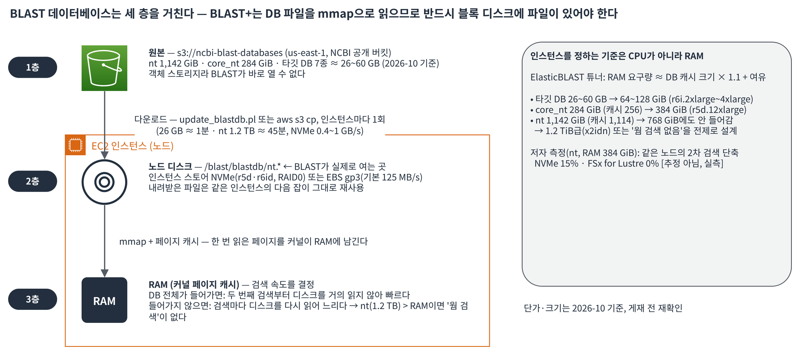

# ElasticBLAST로 AWS에서 대규모 NCBI BLAST 검색 실행하기: 동작 원리, 비용, 알아야 할 제약

이 글은 BLAST를 AWS에서 한 번도 돌려 본 적이 없는 연구자와 엔지니어를 위해 썼습니다. NCBI가 만든 ElasticBLAST가 AWS 안에서 무엇을 만들고 어떻게 움직이는지 그림으로 이해한 뒤, 명령어를 그대로 복사해 1 TB급 공개 데이터베이스 검색을 직접 실행하고, 결과를 내려받고, 자원을 정리할 수 있게 됩니다. 마지막에는 비용 계산식과 운영 전에 꼭 알아야 할 제약을 정리합니다.

## 개요

**BLAST**(Basic Local Alignment Search Tool)는 짧은 DNA·단백질 서열(쿼리)이 큰 서열 모음(데이터베이스) 어디에 비슷하게 붙는지 찾는 프로그램입니다. 검색 엔진에 비유하면 쿼리는 검색어, 데이터베이스는 색인입니다. 연구실에서는 보통 서버 한 대에 데이터베이스를 내려받아 `blastn` 같은 명령을 직접 실행합니다.

문제는 데이터베이스 크기입니다. NCBI의 대표 핵산 데이터베이스 **nt**는 2026년 10월 기준 약 1,142 GiB(4.77조 염기)로, 서버 한 대의 메모리에 다 올리기 어려운 크기가 되었습니다. 한 달에 수십 GiB씩 커지므로 이 글의 수치는 게재 시점의 스냅숏이고, 현재 값은 공개 버킷의 `nt-nucl-metadata.json`에서 확인할 수 있습니다(연습 6단계). 진핵생물 염색체 서열을 뺀 **core_nt**는 약 284 GiB로 훨씬 작지만 그래도 노트북 수준은 아닙니다. 쿼리가 수천 건을 넘어가면 한 대로는 며칠이 걸립니다.

**ElasticBLAST**는 이 문제를 풀기 위해 NCBI가 만든 명령줄 도구입니다. `elastic-blast submit` 한 줄로 AWS에 계산 클러스터를 만들고, 데이터베이스를 내려받고, 쿼리를 쪼개 여러 인스턴스에서 병렬로 BLAST를 돌린 뒤, 결과를 Amazon S3에 모아 두고 클러스터를 지웁니다. 쿠버네티스를 몰라도 되고, AWS 쪽 추가 요금도 없습니다. Amazon EC2·Amazon EBS·S3 사용량만 냅니다.

클라우드가 맞는 상황은 분명합니다. 데이터베이스가 서버 메모리보다 크거나, 쿼리가 수만 건 이상이거나, 한 달에 몇 번만 큰 검색을 돌리고 평소에는 서버가 놀 때입니다. 반대로 하루에 수백 번 작은 검색을 반복하는 서비스에는 ElasticBLAST가 맞지 않습니다. 그 이유는 이 글의 "알아야 할 제약"과 [2부](/ncbi-blast-on-aws/blast-aws-5/)에서 다룹니다.

## 솔루션 개요

ElasticBLAST는 AWS에서 다음 자원을 만들고 움직입니다.


*그림 1. ElasticBLAST가 검색 1건(submit)마다 AWS 계정 안에 만드는 자원과 데이터 흐름 [1]~[6]*

단계별로 풀어 보겠습니다.

**AWS CloudFormation**은 인프라를 템플릿 한 장으로 만들고 지우는 서비스입니다. ElasticBLAST는 검색 1건마다 스택 1개를 만듭니다. 스택 이름은 `elasticblast-<사용자명>-<해시>`이고, 해시는 결과 경로(S3 URI)에서 계산합니다. 즉 **결과 경로가 검색의 고유 식별자**입니다.

**AWS Batch**는 "큐에 작업을 넣으면 EC2를 알아서 늘리고 줄여 주는" 서비스입니다. 컴퓨팅 환경은 몇 대까지 띄울지(MaxvCpus), 잡 큐는 작업 줄, 잡 정의는 어떤 컨테이너를 어떤 명령으로 돌릴지입니다. 컴퓨팅 환경의 최소 vCPU가 0이므로 잡이 없으면 인스턴스도 없습니다.

**쿼리 분할**이 병렬화의 단위입니다. 쿼리 파일을 염기 수 기준으로 자릅니다(blastn 기본 500만 염기). 잘린 파일 하나가 Batch 잡 하나가 됩니다. 쿼리가 작으면 ElasticBLAST가 노드 수와 vCPU에 맞춰 더 잘게 자릅니다.

**데이터베이스 다운로드**는 인스턴스마다 한 번씩 일어납니다. 인스턴스에 처음 도착한 잡이 NCBI의 공개 S3 버킷에서 데이터베이스를 로컬 디스크로 내려받고 `.done` 파일을 남깁니다. 같은 인스턴스의 다음 잡은 그대로 재사용합니다. 노드가 4대면 다운로드도 4번입니다.

**janitor**는 청소부라는 뜻입니다. 5분마다 잡 큐를 보고 모든 잡이 끝났으면 스택을 지우는 AWS Lambda 함수입니다. 자동 종료가 있으니 밤에 제출하고 자도 됩니다. 단, 사전 조건이 있습니다(연습 2단계).

### 데이터베이스는 세 층을 거칩니다

BLAST+는 데이터베이스 파일을 운영체제의 `mmap`으로 읽습니다. 그래서 S3 같은 객체 스토리지에서 바로 읽을 수 없고, 반드시 블록 디스크에 파일이 있어야 합니다.



*그림 2. BLAST 데이터베이스가 거치는 세 층: S3 원본, 노드 디스크(mmap), RAM 페이지 캐시*

**페이지 캐시**는 디스크에서 한 번 읽은 내용을 커널이 RAM에 남겨 두는 영역입니다. 데이터베이스 전체가 RAM에 들어가면 두 번째 검색부터 디스크를 거의 읽지 않아 빠릅니다. 들어가지 않으면 검색마다 디스크를 다시 읽어 느려집니다. 그래서 **인스턴스를 정하는 기준은 CPU가 아니라 RAM**입니다. ElasticBLAST의 자동 튜너도 "데이터베이스 캐시 크기 x 1.1 + 여유"를 RAM 요구량으로 계산합니다.

여기서 2026년의 현실이 나옵니다. nt의 캐시 대상 바이트는 약 1,114 GiB이고, ElasticBLAST 1.5.0이 계산한 요구 RAM은 약 1,176 GiB입니다(캐시 대상 + 작업 메모리 상한 60 GiB + 시스템 예약 2 GiB). 2025년까지 nt 검색의 표준이던 r5d.24xlarge(RAM 768 GiB)에는 **더 이상 들어가지 않습니다**. `machine-type`을 비워 두면 "An AWS machine type with memory 1176.xGB and 16 CPUs could not be found" 형태의 오류가 납니다(숫자는 데이터베이스 갱신마다 바뀝니다). 지금 nt 전체를 캐시에 올리려면 x1.32xlarge(RAM 1,952 GiB) 같은 대용량 메모리 인스턴스가 필요하고, 그렇지 않으면 **core_nt로 바꾸는 것이 현실적인 선택**입니다. core_nt는 캐시 대상 약 256 GiB로 r5d.12xlarge(RAM 384 GiB)에 들어갑니다.

### 로컬 NVMe와 EBS, 어느 쪽에 받히나

2층 디스크는 인스턴스 종류에 따라 달라집니다. ElasticBLAST 소스 코드는 인스턴스 이름이 `[cmr]5a?dn?\.` 정규식에 맞는 5세대 d형(r5d, r5ad, m5d, c5d 등)이거나 `x1`로 시작할 때만 인스턴스에 붙은 **로컬 NVMe SSD**를 RAID0으로 묶어 `/blast`에 마운트합니다. 그 외 인스턴스(r6i, r6id 포함)는 **루트 EBS gp3 볼륨**(기본 1,000 GB)에 그대로 내려받습니다.

| 모드 | 조건 | 처리량 | 1 TB 다운로드 |
|---|---|---|---|
| 로컬 NVMe | 5세대 d형(r5d 등), x1 | 약 1~1.5 GB/s (저자 테스트) | 약 12~18분 |
| 루트 EBS gp3 | 그 외 전부 | 125 MB/s (기본값, 상향 옵션 없음) | 약 2.5시간 [추정] |

이 차이는 문서보다 코드에 더 명확히 드러나는 부분입니다. r6id처럼 NVMe가 있는 6세대 인스턴스를 골라도 ElasticBLAST는 EBS 모드로 동작합니다.

### 자동 인스턴스 선택은 세 패밀리만 봅니다

`machine-type`을 비우면 ElasticBLAST는 해당 리전에서 제공되는 **m5ad, c5ad, r5ad** 중 RAM 조건을 만족하는 가장 작은 인스턴스를 고릅니다. 모두 AMD 프로세서 모델입니다. 저자 테스트에서는 자동 선택된 r5ad.24xlarge가 r5d.24xlarge보다 데이터베이스 다운로드는 약 1.8배, blastn 배치는 약 1.4배 느려 같은 작업이 36분 대 24분이 되었습니다. 단가는 9% 낮았지만 총비용은 더 들었습니다. 그래서 이 글은 **`machine-type`을 명시**하기를 권합니다.

## 사전 요구 사항

- AWS 계정과, 다음 서비스를 다룰 수 있는 IAM 권한: AWS Batch, Amazon EC2, Amazon S3, AWS CloudFormation, IAM(역할 생성), Amazon CloudWatch Logs. 조직 정책으로 IAM 역할 생성이 막혀 있다면 설정 파일의 `aws-*-role` 키로 사전 생성한 역할을 넘길 수 있습니다.
- AWS CLI v2 설치 및 구성. ElasticBLAST는 내부에서 `aws s3` 명령을 호출하므로 사실상 필수입니다.
- **Python 3.11 이상**. 1.5.0은 3.11에서 추가된 표준 라이브러리 기능을 사용하므로 3.9나 3.10에서는 설치는 되지만 실행 시 ImportError가 납니다.
- 리전은 **us-east-1(버지니아 북부)** 을 권장합니다. NCBI 공개 데이터베이스 버킷이 이 리전에 있어 데이터 전송 요금이 없고, 5세대 d형 인스턴스가 모두 제공됩니다. 서울 리전에서 nt를 쓰면 1.2 TB 교차 리전 전송에 노드당 약 $24가 붙고(us-east-1 발신 $0.02/GB 공시가, 2026-10 기준) 인스턴스 단가도 약 20% 높습니다.
- EC2 On-Demand Standard 인스턴스 vCPU 쿼터(쿼터 코드 L-1216C47A)가 `노드 수 x 인스턴스 vCPU` 이상이어야 합니다. 부족하면 **오류 없이 잡이 PENDING 상태로 계속 대기**합니다.

## 연습(Walkthrough)

예제는 500개 미매핑 리드(약 73 kb)를 핵산 데이터베이스에 검색하는 시나리오입니다. 아래 설정은 **core_nt + r5d.12xlarge 1대** 구성으로, 2026년 10월 12일에 이 글의 명령을 그대로 실행해 끝까지 확인했습니다(제출부터 완료까지 24분, 비용 약 $1.3 [추정]; 10단계 뒤의 실측 표 참고). "성능과 비용" 절의 저자 테스트는 2025년 12월 당시 nt가 768 GiB에 들어가던 시점의 **nt + r5d.24xlarge 4대** 구성입니다. 명령어의 `<...>` 부분만 바꾸면 됩니다.

### 1단계: 설치

```bash
mkdir -p blast-project && cd blast-project
python3.11 -m venv .elb-venv
source .elb-venv/bin/activate
pip install --upgrade pip wheel
pip install elastic-blast==1.5.0
elastic-blast --version
# elastic-blast 1.5.0
```

1.4.0 미만 버전은 자원을 해제하지 못해 과금이 이어질 수 있다는 NCBI 공지(2025-03)가 있으니 반드시 1.4.0 이상을 쓰십시오.

### 2단계: janitor 역할 만들기

자동 종료용 Lambda가 쓸 AWS Identity and Access Management(IAM) 역할 `ncbi-elasticblast-janitor-role`을 계정에 한 번만 만듭니다. 스크립트는 ElasticBLAST GitHub 저장소에 있습니다.

```bash
git clone --depth 1 https://github.com/ncbi/elastic-blast.git
bash elastic-blast/bin/aws-create-elastic-blast-janitor-role.sh
bash elastic-blast/bin/aws-describe-elastic-blast-janitor-role.sh
```

이 역할이 없으면 ElasticBLAST는 **아무 오류도 내지 않고 자동 종료를 꺼 버립니다**(디버그 로그에만 남습니다). 그러면 검색이 끝나도 인스턴스와 스택이 남아 과금됩니다. 스크립트는 이 역할에 AWS 관리형 정책 8개(EC2·Batch·S3·IAM·CloudFormation·Lambda·CloudWatch Events의 FullAccess와 VPC ReadOnly)를 붙이므로 권한 범위가 넓습니다. 조직 정책상 검토가 필요하면 생성 전에 확인하십시오.

### 3단계: 쿼터 확인

```bash
aws service-quotas get-service-quota --region us-east-1 \
  --service-code ec2 --quota-code L-1216C47A \
  --query 'Quota.Value' --output text
```

r5d.12xlarge 1대면 48 이상, r5d.24xlarge 4대면 384 이상이어야 합니다. 부족하면 Service Quotas 콘솔에서 상향을 신청하고 승인 후 진행합니다.

### 4단계: S3 버킷과 쿼리 업로드

버킷 이름은 전 세계에서 고유해야 하므로 계정 ID를 붙이는 방식이 편합니다.

```bash
export AWS_REGION=us-east-1
export BUCKET="elasticblast-$(aws sts get-caller-identity --query Account --output text)"
aws s3 mb "s3://${BUCKET}" --region "${AWS_REGION}"
aws s3 cp data/query.fasta "s3://${BUCKET}/queries/query.fasta"
```

쿼리 파일은 FASTA 형식이어야 합니다. `grep -c '^>' data/query.fasta`로 서열 수를 확인해 두면 뒤에서 결과 행 수와 대조할 때 편합니다.

### 5단계: 설정 파일 작성

`elasticblast-config.ini`를 만듭니다. 결과 접두어에는 날짜와 회차를 넣습니다.

```ini
[cloud-provider]
aws-region = us-east-1

[cluster]
num-nodes = 1
machine-type = r5d.12xlarge
labels = Owner=yourname,Project=blast-demo

[blast]
program = blastn
db = core_nt
queries = s3://<BUCKET>/queries/query.fasta
results = s3://<BUCKET>/results/core_nt-20261009-1
options = -evalue 1.0E-3 -max_target_seqs 5 -outfmt '6 qseqid sseqid pident length evalue bitscore staxids sscinames'
```

키별 의미는 다음과 같습니다.

| 키 | 의미 | 이 예제의 값과 이유 |
|---|---|---|
| `aws-region` | 스택을 만들 리전 | us-east-1. NCBI 버킷과 같은 리전 |
| `num-nodes` | 최대 노드 수. 큐 깊이에 따라 그 이하로 기동 | 1. 500개 쿼리는 한 대로 충분하고 다운로드도 1회 |
| `machine-type` | 인스턴스 타입. 비우면 m5ad/c5ad/r5ad 자동 선택 | r5d.12xlarge(48 vCPU, 384 GiB, NVMe 2 x 900 GB). core_nt 캐시 256 GiB가 들어감 |
| `labels` | 모든 자원에 붙는 태그 | 비용 추적용. 기본으로 `billingcode=elastic-blast`도 붙음 |
| `program` | BLAST 프로그램 | blastn(핵산 대 핵산) |
| `db` | NCBI 데이터베이스 이름 또는 `s3://버킷/접두어/<db>` | core_nt. 전체 nt는 아래 참고 |
| `queries` | 쿼리 FASTA의 S3 경로 | 4단계에서 올린 파일 |
| `results` | 결과 S3 경로. **검색의 고유 ID**, 재사용 불가 | 실행마다 새 접두어 |
| `options` | BLAST+ 옵션 그대로 전달 | `-outfmt 6`은 탭 구분 표. `-num_threads`는 넣지 않음(ElasticBLAST가 설정) |

전체 nt를 꼭 써야 한다면 `db = nt`와 함께 `machine-type = x1.32xlarge`(RAM 1,952 GiB, 로컬 SSD, us-east-1 온디맨드 공시가 약 $13.3/시간, 2026-10 기준)를 지정하십시오. 이 조합은 코드상 로컬 SSD 경로를 타지만 저자가 끝까지 실행해 본 구성은 아니므로, 소규모 쿼리로 먼저 확인하기를 권합니다.

### 6단계: 제출 전 환경 변수와 데이터베이스 버전 기록

```bash
# NCBI로 사용 통계를 보내지 않음 (설정 파일 키가 아니라 클라이언트 환경 변수)
export BLAST_USAGE_REPORT=false

# 어느 날짜의 데이터베이스를 썼는지 기록 (재현성)
aws s3 cp s3://ncbi-blast-databases/latest-dir - | tee db-version.txt
aws s3 cp "s3://ncbi-blast-databases/$(cat db-version.txt)/core_nt-nucl-metadata.json" core_nt-metadata.json
python3 -c "import json; d=json.load(open('core_nt-metadata.json')); print(d['last-updated'], round(d['bytes-to-cache']/2**30), 'GiB to cache')"
# 2026-10-03T00:00:00 256 GiB to cache
```

메타데이터 JSON의 `bytes-to-cache` 값(마지막 명령이 GiB로 출력)이 선택한 인스턴스 RAM보다 작은지 이때 확인하면 됩니다. 메타데이터 파일은 50 KB가 넘으므로 `| head`로 잘라 보지 말고 파일로 받은 뒤 읽으십시오. ElasticBLAST는 항상 최신 데이터베이스를 받으므로 이 기록이 없으면 몇 달 뒤 같은 결과를 재현할 수 없습니다.

### 7단계: 제출과 대기

```bash
elastic-blast submit --cfg elasticblast-config.ini
# WARNING: Using gp3 30GB EBS root disk because locally attached SSDs will be used
```

위 경고가 보이면 로컬 NVMe 모드로 잘 들어간 것입니다. 제출 명령은 CloudFormation 스택 생성을 기다리므로 3~4분 뒤에 돌아옵니다. 완료까지는 20초 간격으로 폴링하는 `--wait`로 기다립니다.

```bash
elastic-blast status --cfg elasticblast-config.ini --wait --exit-code
```

`--wait`는 끝날 때까지 **아무것도 출력하지 않고** 종료 코드만 돌려줍니다(저자 실행에서 20분 동안 출력 0줄). 진행 상황을 보려면 다른 터미널에서 `--wait` 없이 `elastic-blast status --cfg elasticblast-config.ini`를 실행하십시오. `Pending N / Running N / Succeeded N / Failed N` 네 줄이 출력되고, 상태 문자열은 `CREATING -> SUBMITTING -> RUNNING -> SUCCESS`(또는 `FAILURE`)로 바뀝니다. `--exit-code`를 주면 성공 시 0으로 끝나므로 스크립트에서 다음 단계로 이어 쓸 수 있습니다.

### 8단계: 실행 요약 저장 (삭제 전에!)

```bash
elastic-blast run-summary --cfg elasticblast-config.ini -o run-summary.json
```

`run-summary`는 인스턴스별 데이터베이스 준비 시간, 잡별 실행 시간과 CPU 사용률, 전체 벽시계 시간을 JSON으로 남깁니다. 비용 계산과 재현성 문서의 1차 자료입니다. 단, AWS에서는 `clusterInfo`의 인스턴스 타입·대수 필드가 비어 있으므로(1.5.0 실측) 설정 파일 `elasticblast-config.ini`를 함께 보관해야 비용을 계산할 수 있습니다. 처음 실행하면 Batch 잡 로그를 결과 경로의 `logs/`에 복사해 두므로 이후에는 클러스터가 없어도 다시 만들 수 있지만, **첫 호출은 반드시 `delete` 전에** 하십시오.

### 9단계: 결과 다운로드

```bash
aws s3 cp "s3://${BUCKET}/results/core_nt-20261009-1/" . \
  --recursive --exclude "*" --include "*.out.gz"
gunzip batch_*.out.gz
wc -l batch_*.out
head -5 batch_000-blastn-core_nt.out
```

결과는 배치별 파일로 나뉘어 있습니다. 한 파일로 합치려면 `cat batch_*.out > all.tsv`로 충분합니다. `-outfmt 6`을 썼으므로 열 순서는 설정 파일의 `options`에 적은 순서와 같습니다.

### 10단계: 삭제와 확인

janitor가 자동으로 지우지만 직접 삭제해도 됩니다.

```bash
elastic-blast delete --cfg elasticblast-config.ini
aws ec2 describe-instances --region us-east-1 \
  --filters Name=tag:billingcode,Values=elastic-blast Name=instance-state-name,Values=running \
  --query 'Reservations[].Instances[].InstanceId' --output text
```

두 번째 명령의 출력이 비어 있으면 인스턴스가 모두 종료된 것입니다.

### 연습 구성 실측 (2026-10-12)

위 10단계를 그대로 실행한 기록입니다. 쿼리는 공개 바이러스 유전체 3개(약 84 kb; 예제의 500 리드 73 kb와 총 길이가 비슷함), 데이터베이스는 core_nt 2026-10-03 빌드(디스크 296 GB), 인스턴스는 r5d.12xlarge 1대입니다.

| 단계 | 소요 시간 |
|---|---|
| `submit` 반환(CloudFormation 스택 생성 대기) | 3분 30초 |
| 인스턴스 기동 -> 첫 잡 시작 | 약 1분 30초 |
| core_nt 다운로드(296 GB, `update_blastdb.pl` 3스레드) | 8분 37초 (약 0.57 GB/s) |
| blastn 배치 2개(콜드, 동시 실행) | 1분 33초 / 3분 44초 |
| blastn 배치 1개(같은 노드, 웜) | 49초 |
| ElasticBLAST wallClock(`run-summary`) | 13분 |
| 제출 -> SUCCESS(`status --wait` 반환) | 24분 |
| `delete` 반환 | 1분 8초 |
| 인스턴스 가동 시간 -> 비용 | 약 21분 -> 약 $1.3 [추정] (r5d.12xlarge $3.456/시간 + EBS 소액) |

노드 한 대라도 3개 배치가 동시에 돌지 않은 이유는 ElasticBLAST가 배치마다 16 vCPU와 메모리 약 127 GiB를 요구해 384 GiB 노드에 두 개까지만 들어가기 때문입니다. 결과는 19행(쿼리 3개 x 상위 5개 대상, 대상당 정렬 구간이 여러 개면 여러 행)이고, 세 배치 파일을 합치면 끝입니다.

## 성능과 비용

### 저자 테스트: nt, 500 리드, r5d.24xlarge 4대

[hmkim/elastic-blast](https://github.com/hmkim/elastic-blast) 저장소에 기록된 2025년 12월 실행입니다(당시 nt는 약 715 GB로 768 GiB RAM에 들어갔습니다).

| 항목 | 값 |
|---|---|
| 데이터베이스 | nt(당시 2.9조 염기) |
| 쿼리 | 500 리드, 약 73 kb |
| 인스턴스 | r5d.24xlarge(96 vCPU, 768 GiB, NVMe 4 x 900 GB) x 4, 온디맨드 |
| 잡 수 | 25개 BLAST 잡 + 제출 잡 1개 |
| 데이터베이스 준비 | 노드당 약 11~13분, 4대 병렬 |
| BLAST 잡 | 콜드 노드의 첫 배치 약 8분, 같은 노드의 이후 배치 1.5~2분 |
| 벽시계(첫 잡 시작~마지막 잡 종료) | **약 24분**(23.9분) |
| 노드-시간 | 4 x 0.41시간 = 1.63 노드-시간 |
| EC2 비용 | 1.63 x $6.912 = **약 $11**(us-east-1 온디맨드 공시가, 2026-10 기준) |

### 노드를 늘려도 빨라지지 않는 이유

같은 작업을 6대로 돌려도 벽시계는 23.9분으로 같았습니다. 노드당 데이터베이스 다운로드 약 12분이 **노드 수와 무관한 고정비**이고, 500개 쿼리 규모에서는 BLAST 자체가 10분 안에 끝나기 때문입니다. 노드를 늘리면 다운로드 횟수만 늘어 비용이 올라갑니다. 반대로 쿼리가 수십만 건이면 BLAST 구간이 길어져 노드 수에 비례해 빨라집니다. ElasticBLAST 논문도 노드 2배에 시간 절반, 비용 동일을 보고합니다.

### 콜드와 웜

같은 노드에서 첫 배치(콜드)는 7~8분, 두 번째 이후(웜)는 1~2분이었습니다. 첫 배치가 데이터베이스를 디스크에서 읽어 페이지 캐시를 채우는 동안 I/O에 묶이기 때문입니다. AWS 경로의 ElasticBLAST는 RAM 선적재를 하지 않으므로(측정만 합니다) 이 콜드 비용은 노드마다 한 번씩 피할 수 없습니다.

### 비용 계산식

```
검색 1건 비용 ≈ 노드 수 x 인스턴스 시간당 단가 x (기동 ~ 삭제 시간)
              + EBS (NVMe 모드 30 GB, EBS 모드 1,000 GB) x 노드 수 x 시간
              + S3 (결과 수 MB, 무시 가능)
              + 교차 리전 전송 (타 리전에서 NCBI 버킷을 읽을 때: 데이터베이스 크기 x 노드 수 x $0.02/GB)
```

관련 단가(us-east-1 Linux 온디맨드 공시가, 2026-10 기준)는 다음과 같습니다.

| 인스턴스 | vCPU | RAM | 로컬 디스크 | 시간당 |
|---|---|---|---|---|
| r5d.4xlarge | 16 | 128 GiB | NVMe 2 x 300 GB | $1.152 |
| r5d.12xlarge | 48 | 384 GiB | NVMe 2 x 900 GB | $3.456 |
| r5d.24xlarge | 96 | 768 GiB | NVMe 4 x 900 GB | $6.912 |
| r5ad.24xlarge | 96 | 768 GiB | NVMe 4 x 900 GB | $6.288 |
| x1.32xlarge | 128 | 1,952 GiB | SSD 2 x 1,920 GB | $13.338 |

스팟 인스턴스(`use-preemptible = yes`)는 남는 용량을 할인가로 쓰되 2분 전 통보로 회수될 수 있는 EC2입니다. 2026-10 조회 시 us-east-1 r5d.24xlarge 스팟은 온디맨드 대비 약 60~70% 저렴했습니다. 회수되면 해당 배치만 다른 인스턴스에서 재시작되고 끝난 결과는 남으므로, 수십 분짜리 배치 작업에는 잘 맞습니다. 단, 스팟 vCPU 쿼터는 온디맨드와 별도로 신청해야 합니다.

서울 리전에서 같은 구성을 돌리면 인스턴스 단가가 약 20% 높고, nt를 NCBI 버킷에서 직접 받으면 노드당 약 $24의 전송 요금이 더 붙습니다. 공개 데이터베이스 검색은 us-east-1에서 돌리고 결과만 가져오는 편이 거의 항상 싸고 빠릅니다. 서열을 특정 리전 밖으로 보낼 수 없는 요건이 있다면 [2부](/ncbi-blast-on-aws/blast-aws-5/)의 설계 선택지를 보십시오.

## 알아야 할 제약

운영에 넣기 전에 다음 열 가지를 확인하십시오. 대부분 공식 문서보다 소스 코드에서 더 분명하게 드러나는 항목입니다.

1. **제출 1건 = CloudFormation 스택 1개.** 동시 사용자 10명이 제출하면 스택과 클러스터가 10개 뜹니다. 데이터베이스도 10번 받습니다.
2. **결과 접두어는 재사용할 수 없습니다.** 같은 `results` 경로에 `metadata/job-ids-v2.json`이 있으면 제출이 거부됩니다. 실행마다 새 접두어를 쓰십시오.
3. **커스텀 데이터베이스는 통합 `makeblastdb` 결과물만 됩니다.** AWS 경로는 `<db>.*` 접두어 파일만 내려받습니다. 여러 데이터베이스를 묶는 `.nal` 별칭 파일은 구성 파일 접두어가 달라 받히지 않고, `tar.gz` 자동 해제도 AWS 경로에는 없습니다(GCP 경로에만 있습니다). `makeblastdb -out all`로 하나로 다시 만들어야 합니다.
4. **로컬 NVMe는 5세대 d형과 x1만.** r6i, r6id 등은 루트 EBS gp3(125 MB/s) 모드로 떨어져 1 TB 다운로드가 몇 시간이 됩니다. 어쩔 수 없이 EBS 모드를 쓴다면 `pd-size`를 데이터베이스 크기에 맞게 줄여 디스크 비용을 아끼십시오.
5. **루트 EBS는 `Encrypted: false`로 선언됩니다.** 계정의 EBS 기본 암호화를 켜 두어야 데이터베이스와 쿼리가 암호화된 볼륨에 놓입니다.
6. **janitor 역할이 없으면 자동 종료가 조용히 꺼집니다.** 연습 2단계를 건너뛰지 마십시오. 호출 스크립트에서는 `finally` 블록에서 `delete`를 항상 실행하는 습관이 안전합니다.
7. **`BLAST_USAGE_REPORT`는 클라이언트 환경 변수입니다.** 설정 파일 키가 아니라 `elastic-blast`를 실행하는 셸에서 `export BLAST_USAGE_REPORT=false`로 끕니다. 기본값은 true(NCBI로 사용 통계 전송)입니다.
8. **기본 Amazon VPC가 없으면 새 VPC와 인터넷 게이트웨이, 퍼블릭 서브넷을 만듭니다.** 프라이빗 서브넷을 쓰려면 `aws-vpc`, `aws-subnet`, `aws-security-group`을 지정하고 NAT 게이트웨이가 필요합니다. 컨테이너 이미지는 public ECR에서, 분류 이름 테이블(taxdb)과 janitor 코드는 NCBI 버킷에서 받기 때문입니다. 이미지 경로는 코드 상수여서 설정으로 바꿀 수 없습니다.
9. **쿼리 분할 단위는 염기 수입니다.** blastn 기본 500만 염기이므로 짧은 올리고 수천 개(수십 kb)는 잡 1개가 되어 노드 1대만 일합니다. 다노드를 쓰려면 `batch-len`을 작게 지정하십시오.
10. **데이터베이스는 실행마다 다시 받습니다.** 검색 간에 캐시가 남지 않습니다. ElasticBLAST는 "수만~수백만 쿼리를 한 번에, 가끔" 돌리는 **배치 도구**이고, 수 분 안에 답을 돌려주는 상시 서비스의 백엔드로는 맞지 않습니다. 5~15분의 기동·다운로드 고정비는 데이터베이스가 30 GB여도 사라지지 않습니다.

## 정리(Clean up)

연습에서 만든 자원은 다음 순서로 정리합니다.

```bash
elastic-blast delete --cfg elasticblast-config.ini
aws cloudformation list-stacks --region us-east-1 \
  --stack-status-filter CREATE_COMPLETE DELETE_IN_PROGRESS DELETE_FAILED \
  --query "StackSummaries[?starts_with(StackName,'elasticblast')].[StackName,StackStatus]" --output table
aws s3 rm "s3://${BUCKET}/results/" --recursive
aws s3 rm "s3://${BUCKET}/queries/" --recursive
aws s3 rb "s3://${BUCKET}"
```

janitor 역할(`ncbi-elasticblast-janitor-role`)은 다음 실행에 다시 쓰이므로 남겨 두어도 비용이 없습니다. 지우려면 `bin/aws-delete-elastic-blast-janitor-role.sh`를 실행합니다(2026-10-12 실행 확인). 스택 삭제 뒤에도 janitor Lambda의 CloudWatch 로그 그룹 2개(`/aws/lambda/elasticblast-<이름>-ElasticBlastJanitorLambda`, `...-CopyZipsFunction-...`)가 남는데 비어 있어(0바이트) 비용은 없고, 지우려면 `aws logs delete-log-group`을 씁니다. 실행 중에 `delete`를 하면 VPC 삭제가 DependencyViolation으로 실패할 수 있는데, 공식 문서는 24시간 뒤 재시도를 안내합니다. 자체 VPC를 지정하면 이 단계가 없어 피할 수 있습니다.

비용 확인은 다음 날 AWS Cost Explorer에서 태그로 합니다. `billingcode` 태그는 비용 할당 태그로 활성화해야 Cost Explorer에 나타나므로(활성화 후 최대 24시간), 첫 실행 전에 `aws ce update-cost-allocation-tags-status --cost-allocation-tags-status TagKey=billingcode,Status=Active`를 실행해 두면 좋습니다.

## 결론

ElasticBLAST는 "데이터베이스가 서버보다 크고, 쿼리가 많고, 가끔 돌린다"는 조건에서 가장 쉬운 선택입니다. pip 설치와 ini 파일 하나로 AWS Batch 클러스터를 만들고 지우며, 500개 리드를 nt 전체에 검색하는 데 약 24분, 약 $11이 들었습니다. 다만 nt가 768 GiB를 넘어선 지금은 core_nt나 대용량 메모리 인스턴스를 골라야 하고, 인스턴스마다 데이터베이스를 다시 받는 구조 때문에 반복 검색 서비스에는 맞지 않습니다.

[2부 "BLAST 검색 서비스를 AWS에 올리기 전에 답해야 할 5가지 질문"](/ncbi-blast-on-aws/blast-aws-5/)에서는 바로 그 질문을 다룹니다. "BLAST 검색을 서비스로 열어야 한다면, ElasticBLAST를 그대로 쓸까, AWS Batch를 직접 구성할까, EC2 한 대를 켜 둘까?" 다섯 가지 질문에 순서대로 답하면 구성이 정해지도록 의사결정 가이드를 정리했습니다.

## 참고 자료

- 2부: [BLAST 검색 서비스를 AWS에 올리기 전에 답해야 할 5가지 질문: 백엔드 선택 가이드](/ncbi-blast-on-aws/blast-aws-5/)(같은 시리즈)
- NCBI ElasticBLAST 문서: [https://blast.ncbi.nlm.nih.gov/doc/elastic-blast/](https://blast.ncbi.nlm.nih.gov/doc/elastic-blast/)
- ElasticBLAST 소스 코드: [https://github.com/ncbi/elastic-blast](https://github.com/ncbi/elastic-blast)
- NCBI BLAST 데이터베이스(Registry of Open Data on AWS): [https://registry.opendata.aws/ncbi-blast-databases/](https://registry.opendata.aws/ncbi-blast-databases/)
- 저자의 실행 가이드와 테스트 기록: [https://github.com/hmkim/elastic-blast](https://github.com/hmkim/elastic-blast)
- AWS에서 BLAST 백엔드별 성능 비교 실험: [https://github.com/hmkim/aws-blast-performance](https://github.com/hmkim/aws-blast-performance)
- Camacho et al., "ElasticBLAST: accelerating sequence search via cloud computing", BMC Bioinformatics 24:117 (2023)

---

*이 글의 가격은 모두 us-east-1 리전 Linux 온디맨드 공시가(2026-10 기준)이며 변동될 수 있습니다. "약", "대략"으로 표시한 수치는 저자 테스트 또는 공시가 기반 추정치이므로, 실제 도입 전에는 [AWS Pricing Calculator](https://calculator.aws/)와 소규모 시험 실행으로 확인하십시오.*
