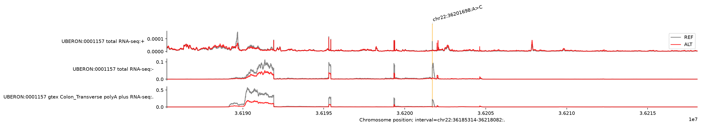
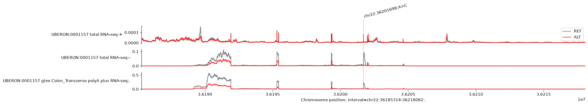

# 2편 · AlphaGenome을 내 AWS 계정의 GPU에서 직접 돌리기 — 그리고 SageMaker로 API까지

<p class="callout warning"><strong>비공개 초안 (2026-09-22)</strong> — 시리즈 2편(AlphaGenome) 자리입니다. 시리즈 형식 초고를 쓰기 전 단계라 PoC 매뉴얼판 <code>test-alphagenome/docs/blog_alphagenome_on_aws.md</code> (git e9f4d36)을 그대로 올렸습니다. 게재용으로는 개요(<code>docs/blog_series_outline.md</code> §2)에 따라 재작성이 필요합니다: 절차형 구조, TAL1 인핸서 indel 예시, AlphaGenome Atlas 대비 셀프호스팅 근거, 표현 규칙(§6: GPU 제품명·타사 클라우드 언급·'오픈소스/무료' 표현·개인 낭비 내역 제거), Public Model 법무 티켓 결과 반영.</p>

**공개 가중치를 EC2의 L40S 한 장에 올려 유전자 변이 효과를 예측하고, 같은 모델을 실시간 엔드포인트로 서빙하기까지, 처음부터 끝까지 따라하기**

> 소요 시간 약 1시간(GPU 확보 대기 제외) · 함정을 피해 재현하면 ≈ $2.5 · 저는 함정 7개에 걸려 ≈ $8.3 · 정리 후 유지 비용 $0

---

## 요약 (TL;DR)

- Google DeepMind의 **AlphaGenome**은 DNA 서열 1Mb를 입력받아 유전자 발현·스플라이싱·크로마틴 상태 같은 수천 개의 기능 트랙을 염기 단위로 예측하는 모델입니다. 코드는 Apache 2.0, **가중치는 비상업 연구 전용**으로 Hugging Face에 공개돼 있습니다.
- 이 가중치를 **내 AWS 계정의 GPU EC2**(`g6e.2xlarge`, NVIDIA L40S 46GB)에 올려 README 예제 변이 `chr22:36201698 A>C`의 REF/ALT RNA-seq 예측을 돌렸습니다. 가중치 로딩 20초, 첫 예측 58초(컴파일 포함), **두 번째 예측 1.65초**.
- 같은 모델을 **SageMaker AI 실시간 엔드포인트**(`ml.g6e.4xlarge`)로 올려 HTTPS로 호출했습니다. 3회 모두 200, 왕복 2.05초(서버 1.61초). 결과는 EC2와 소수 3자리까지 같습니다.
- 스크립트 하나로 기동·설정·예측·정리가 되고, 계정 ID나 버킷 이름은 자격 증명에서 알아내므로 **어느 계정에서든 그대로 실행**됩니다.
- GPU 재고 부족, 알람 오설정으로 8분 만에 꺼진 인스턴스, cuDNN 충돌 segfault, SageMaker의 이미지 거부와 `--preload` 버그 등 **함정 7개**를 겪은 순서대로 정리했습니다. 이 글대로 하면 그 돈($5.8)은 안 내셔도 됩니다.

---

## 1. 왜 이걸 하나

변이 하나를 두고 "이게 이 조직에서 유전자 발현을 바꿀까"를 물을 때, 지금까지는 실험 데이터가 있는 위치만 답할 수 있었습니다. AlphaGenome은 서열만 넣으면 그 답을 예측으로 내놓습니다. 모델은 다음 두 가지 방식으로 쓸 수 있습니다.

1. **DeepMind가 호스팅하는 API**를 호출한다. GPU가 필요 없고 가장 간단합니다. 비상업 연구용이며 호출량 제한이 있고, 서열 데이터가 외부 서버로 나갑니다.
2. **공개 가중치를 내 인프라의 GPU에 올린다.** 데이터가 내 계정 밖으로 나가지 않고, 호출량은 내가 정하며, 다른 파이프라인(VCF 주석, 배치 스코어링)에 붙이기 쉽습니다. 대신 GPU를 확보하고 환경을 맞추는 일이 생깁니다.

이 글은 2번입니다. 목표는 이렇게 잡았습니다.

1. AlphaGenome README의 예제 변이를 **내 AWS 계정의 GPU**에서 60초 안에 예측한다.
2. 같은 모델을 **API 엔드포인트**로 올려, 나 말고 다른 프로그램이 호출할 수 있게 한다.
3. 다른 사람이 **같은 명령을 그대로 실행**하면 같은 결과가 나와야 한다. 계정 ID 같은 값을 손으로 고치는 일이 없어야 한다.
4. 쓴 돈을 항목별로 남기고, 끝나면 **과금 항목이 0**이어야 한다.

이 글이 가정하는 독자는 "AWS 계정이 있고 터미널에서 명령을 복사해 붙일 수 있는 사람"입니다. 유전학은 몰라도 됩니다. 필요한 용어는 그 자리에서 설명합니다.

---

## 2. 그림 한 장

```
                Hugging Face  google/alphagenome-all-folds  (모델 약관 수락 + 읽기 토큰)
                                        │ 가중치 12개 파일 735MB. 토큰은 Secrets Manager에서 꺼냄
                                        ▼
 [경로 1]  내 PC ── SSM Run Command ──▶ EC2 g6e.2xlarge (NVIDIA L40S 46GB, Deep Learning AMI)
           aws cli                      │ uv Python 3.11 + alphagenome_research + jax[cuda12]
                                        │ run_example.py → REF/ALT 예측 → PNG + run_info.json
                                        ├──▶ S3  outputs/ec2/             결과
                                        ├──▶ S3  weights/all_folds/       경로 2가 쓸 가중치
                                        └──▶ ECR alphagenome-poc:latest   경로 2가 쓸 컨테이너 이미지
                                                            │
 [경로 2]  내 PC ── InvokeEndpoint(HTTPS) ──▶ SageMaker 실시간 엔드포인트 ml.g6e.4xlarge
           boto3                               기동 시 S3에서 가중치 로드 → /ping 200 → /invocations
                                               JSON 요청 → REF/ALT 요약 + PNG(base64) 응답

 안전장치  CloudWatch 알람 2개(12시간 유휴·무응답 → 자동 terminate) · 인바운드 규칙 0개 보안 그룹 · IMDSv2 · 태그 Project=alphagenome-poc
```

등장하는 AWS 서비스를 한 줄씩만 설명하면:

| 서비스 | 역할 | 비유 |
|---|---|---|
| **EC2** | GPU가 달린 임시 리눅스 서버 | 시간 단위로 빌리는 GPU PC |
| **Deep Learning AMI (DLAMI)** | NVIDIA 드라이버·CUDA가 미리 깔린 EC2용 OS 이미지 | 드라이버 설치가 끝난 복구 이미지 |
| **SSM Run Command** | SSH 키·포트 개방 없이 EC2에 스크립트를 보내 실행하고 출력을 받아옴 | 원격 리모컨 |
| **IAM role / 인스턴스 프로파일** | "이 서버는 이 시크릿과 이 버킷만 건드릴 수 있다"는 권한 | 출입증 |
| **Secrets Manager** | Hugging Face 토큰 보관. 서버가 실행 중에만 꺼내 씀 | 금고 |
| **S3** | 가중치·결과 파일 보관 | 외장하드 |
| **CloudWatch 알람** | CPU 지표를 보고 12시간 놀면 서버를 끔 | 타이머 콘센트 |
| **ECR** | 컨테이너 이미지 저장소 | 내 계정 전용 Docker Hub |
| **SageMaker AI 실시간 엔드포인트** | 컨테이너를 GPU 인스턴스에 올려 HTTPS API로 노출하는 관리형 서비스 | 모델 전용 서버 호스팅 |
| **Service Quotas / Capacity Blocks** | 쓸 수 있는 GPU vCPU 한도 / GPU를 특정 시간대에 미리 사는 예약 | 좌석 한도 / 좌석 예약 |

유전학 용어도 세 개만 알면 됩니다. **변이(variant)** 는 특정 위치의 염기가 바뀐 것(`chr22:36201698 A>C` = 22번 염색체 36,201,698번째 염기가 A에서 C로). **REF/ALT** 는 바뀌기 전/후 서열. **트랙(track)** 은 염기 위치마다 값이 하나씩 찍힌 그래프로, 여기서는 "이 조직에서 이 위치가 얼마나 RNA로 읽히는가"(RNA-seq)입니다. 모델은 REF 서열과 ALT 서열을 각각 넣어 트랙 두 개를 만들고, 그 차이가 변이의 효과입니다.

---

## 3. 준비물

| 항목 | 내용 |
|---|---|
| AWS 계정 | EC2·IAM·SSM·S3·ECR·SageMaker·Secrets Manager·CloudWatch 권한. 이 글은 관리자 권한으로 실행했습니다 |
| 리전 | GPU 재고가 있는 리전. 이 글은 `us-east-1`(us-west-2는 온디맨드 GPU가 전부 없었습니다) |
| 작업 PC | AWS CLI v2, Python 3.9 이상, bash. SageMaker 단계에서만 `boto3`. Docker는 필요 없습니다(이미지는 EC2에서 빌드) |
| 자격 증명 | `aws sts get-caller-identity`가 계정 ID를 돌려주면 준비 끝 |
| Hugging Face 계정 | [모델 약관](https://deepmind.google.com/science/alphagenome/model-terms)을 수락한 뒤 **읽기(Read) 토큰** 발급 |
| 저장소 | 이 글의 스크립트는 저장소 루트의 `scripts/`, `sagemaker/`에 있습니다(끝에 구조 있음). 모든 명령은 저장소 루트에서 실행합니다 |

예상 시간과 비용입니다. 실측값이고, 단가는 2026-09-18 Pricing API 기준 us-east-1 온디맨드입니다.

| 단계 | 시간 | 비용 |
|---|---|---|
| Step 0 토큰을 Secrets Manager에 | 5분 | 시크릿 1개 $0.40/월 (정리 시 삭제) |
| Step 1 사전 점검 | 5분 | $0 |
| Step 2 GPU EC2 기동 | 3분 (+재고 부족 시 재시도) | 여기서부터 `g6e.2xlarge` $2.242/h |
| Step 3 유휴 자동 종료 알람 | 1분 | 알람 2개 $0.20/월 |
| Step 4 환경 설정 | 2.5분 | (EC2 시간에 포함) |
| Step 5 예제 예측 | 2분 | (EC2 시간에 포함) |
| Step 6 (선택) 가중치 S3 업로드 + 이미지 빌드·ECR 푸시 | 5분 | (EC2 시간에 포함) + S3 0.73GB, ECR 6.5GB 소액 |
| Step 7 EC2 종료 | 즉시 | **EC2 ≈35분 ≈ $1.3** |
| Step 8 SageMaker 엔드포인트 배포·호출·삭제 | 프로비저닝 15~18분(무과금) + 가동 ≈15분 | **`ml.g6e.4xlarge` $3.755/h × 0.25h ≈ $0.95** |
| Step 9 정리 | 2분 | 이후 $0 |
| **합계** | **약 1시간** | **≈ $2.5** |

---

## 4. 빨리 끝내고 싶은 분을 위한 16줄

Step 0(토큰 저장)은 아래 5장에서 한 번만 하고, 그 다음은 이게 전부입니다.

```bash
./scripts/preflight.sh --regions us-east-1,us-west-2                                                   # 1 쿼터·GPU 재고 → docs/preflight.md
./scripts/launch_ec2.sh --region us-east-1 --instance-type g6e.2xlarge                                 # 2 GPU EC2 (마지막 줄 INSTANCE_ID=i-...)
IID=i-xxxxxxxxxxxxxxxxx                                                                                # 3 위 값을 넣기
./scripts/create_idle_alarms.sh --region us-east-1 --instance-id $IID                                  # 4 12시간 놀면 자동 종료
python3 scripts/ssm/gen_params.py --region us-east-1                                                   # 5 EC2에 보낼 스크립트 4종 생성
./scripts/ssm_run.sh --region us-east-1 --instance-id $IID --params scripts/ssm/setup_params.json      # 6 환경 설정 (2.5분)
./scripts/ssm_run.sh --region us-east-1 --instance-id $IID --params scripts/ssm/run_example_params.json  # 7 예제 예측 (2분)
aws s3 cp s3://alphagenome-weights-$(aws sts get-caller-identity --query Account --output text)/outputs/ec2/ outputs/ec2/ --recursive --region us-east-1   # 8 결과 회수
./scripts/ssm_run.sh --region us-east-1 --instance-id $IID --params scripts/ssm/upload_weights_params.json   # 9 (선택) 가중치 → S3
./scripts/ssm_run.sh --region us-east-1 --instance-id $IID --params scripts/ssm/build_and_push_params.json   # 10 (선택) 컨테이너 이미지 → ECR (4.5분)
aws ec2 terminate-instances --region us-east-1 --instance-ids $IID                                     # 11 EC2 종료
python3 -m venv .venv && .venv/bin/pip install boto3                                                   # 12
.venv/bin/python sagemaker/deploy.py --region us-east-1 --instance-type ml.g6e.4xlarge --image-tag latest   # 13 엔드포인트 (InService까지 15~18분)
.venv/bin/python sagemaker/invoke.py --region us-east-1 --n 3                                          # 14 HTTPS 호출 3회
.venv/bin/python sagemaker/teardown.py --region us-east-1                                              # 15 엔드포인트 삭제
./scripts/teardown_all.sh --region us-east-1 --all                                                     # 16 남은 것 전부 정리
```

2번이 `exit 42`로 끝나면 GPU 재고가 없다는 뜻입니다. `--instance-type g6e.4xlarge`나 `g6e.xlarge`로 크기를 바꿔 다시 실행하세요(7장).

---

## 5. Step 0 — Hugging Face 토큰을 Secrets Manager에 (한 번만, 5분)

AlphaGenome 가중치는 "gated" 모델입니다. Hugging Face에서 [모델 약관](https://deepmind.google.com/science/alphagenome/model-terms)에 동의한 계정만 내려받을 수 있고, 다운로드할 때 그 계정의 토큰이 필요합니다.

1. Hugging Face에 로그인해 `google/alphagenome-all-folds` 모델 페이지에서 약관을 수락합니다.
2. Settings → Access Tokens → New token, 권한은 **Read**. `hf_`로 시작하는 문자열을 복사합니다.
3. 토큰을 **코드나 서버에 넣지 말고** AWS Secrets Manager에 저장합니다. EC2와 SageMaker는 자기 IAM role로 이 시크릿만 읽을 수 있습니다.

```bash
# 사용할 리전에 시크릿 생성. 토큰은 파일로 넘겨 셸 히스토리에 남기지 않습니다.
printf '%s' 'hf_여기에_토큰' > /tmp/hf
aws secretsmanager create-secret --region us-east-1 --name alphagenome/hf_token \
  --secret-string file:///tmp/hf --tags Key=Project,Value=alphagenome-poc
rm /tmp/hf
```

이때 하나 더: Billing 콘솔 → **Cost allocation tags**에서 `Project` 태그를 활성화해 두세요. 모든 리소스에 `Project=alphagenome-poc` 태그가 붙으므로, 끝난 뒤 Cost Explorer에서 이 PoC가 정확히 얼마였는지 필터 하나로 볼 수 있습니다. 반영에 24~48시간이 걸리니 첫 실행 전에 켜는 게 맞습니다.

---

## 6. Step 1 — 사전 점검: 쿼터와 GPU 재고 (5분, $0)

GPU 인스턴스는 두 가지 이유로 안 뜹니다. 계정의 **쿼터**(GPU 인스턴스용 vCPU 한도)가 0이거나, 리전에 **재고**가 없거나. 첫 번째는 신청하면 수 시간~수 일 걸리므로 먼저 확인합니다.

```bash
./scripts/preflight.sh --regions us-east-1,us-west-2
```

읽기 전용입니다. 리소스를 만들지 않고 `docs/preflight.md`에 다음을 적어 줍니다.

- 지금 자격 증명의 계정 ID (`--expected-account 123456789012`를 주면 다른 계정이면 멈춥니다)
- EC2 G/VT 계열 vCPU 쿼터(`g6e.2xlarge`는 8 필요)와 P 계열(`p5.4xlarge`는 16 필요) → 각각 `GO` 여부
- SageMaker `ml.g6e.4xlarge` 엔드포인트 쿼터(1 필요)
- 각 리전에서 `g6e.2xlarge`·`p5.4xlarge`를 제공하는 AZ 목록
- 7일 내 **Capacity Block** 슬롯과 가격(온디맨드가 계속 실패할 때의 대안, 7장)

쿼터가 부족하면 문서 하단에 `aws service-quotas request-service-quota-increase ...` 명령이 만들어져 있습니다. 스크립트가 자동으로 신청하지는 않습니다. 사람이 읽고 실행하는 것이 맞는 종류의 명령이라서요.

제 계정은 두 리전 모두 쿼터가 충분했습니다. 문제는 다음 단계였습니다.

---

## 7. Step 2 — GPU 인스턴스 띄우기 (3분, 여기서부터 과금)

```bash
./scripts/launch_ec2.sh --region us-east-1 --instance-type g6e.2xlarge
# ... 출력 마지막 줄:  INSTANCE_ID=i-0123456789abcdef0
IID=i-0123456789abcdef0
```

스크립트가 하는 일을 순서대로 적으면:

1. 최신 **Deep Learning Base OSS Nvidia Driver GPU AMI (Ubuntu 22.04)** ID를 조회합니다. 드라이버·CUDA를 직접 깔지 않기 위해서입니다.
2. IAM role과 인스턴스 프로파일을 만듭니다. 권한은 `AmazonSSMManagedInstanceCore`(SSM으로 명령 받기), `alphagenome/hf_token` 시크릿 읽기, 가중치·결과 버킷 읽고 쓰기, ECR 푸시. 그 이상은 없습니다.
3. **인바운드 규칙이 없는** 보안 그룹을 만듭니다. SSH 포트도 열지 않습니다. 접속은 전부 SSM으로 합니다.
4. 가중치·결과용 S3 버킷 `alphagenome-weights-<계정ID>`를 퍼블릭 차단으로 만듭니다.
5. `g6e.2xlarge`를 IMDSv2 필수, 200GB gp3 디스크, 키페어 없음, 태그 `Project=alphagenome-poc`로 기동합니다.

`g6e.2xlarge`는 NVIDIA L40S(48GB, `nvidia-smi`에는 46GB로 표시) 한 장에 vCPU 8개, 메모리 64GB입니다. AlphaGenome 공식 권장은 H100이지만, 예제 크기(1Mb 입력, 조직 하나)는 L40S에서 넉넉히 돌았습니다.

### 여기서 처음 막힙니다: GPU 재고

`aws ec2 run-instances`가 `InsufficientInstanceCapacity`를 돌려주면 그 AZ에 지금 그 크기의 GPU가 없다는 뜻입니다. 스크립트는 해당 인스턴스 타입을 제공하는 AZ를 모두 순회하고, 전부 실패하면 **exit 42**로 끝납니다. 제 기록은 이랬습니다.

| 시도 | 결과 |
|---|---|
| `p5.4xlarge`(H100) us-west-2 4개 AZ, us-east-1 전 AZ | 전부 실패 |
| `g6e.xlarge`(L40S) 두 리전 전 AZ | 전부 실패 |
| **`g6e.2xlarge`(같은 L40S) us-east-1** | **성공** |

배운 것: **AZ를 바꾸는 것보다 크기(xlarge/2xlarge/4xlarge)를 바꾸는 쪽이 효과적**입니다. 같은 GPU라도 크기별로 재고 풀이 다릅니다. `exit 42`가 나오면 `--instance-type`만 바꿔 다시 실행하세요.

그래도 안 되면 **Capacity Blocks for ML**이 있습니다. `docs/preflight.md`에 7일 내 슬롯과 가격이 적혀 있고, 예를 들어 제 조회에서는 us-west-2b에 `p5.4xlarge` 1대 24시간이 $124.58이었습니다. `aws ec2 purchase-capacity-block --capacity-block-offering-id cb-... --instance-platform Linux/UNIX`로 사고, 시작 시각에 `./scripts/launch_ec2.sh ... --capacity-reservation-id cr-...`로 기동하면 이후 절차는 같습니다. **선결제이고 취소가 안 되므로** 결제 전에 금액을 한 번 더 보세요. 저는 us-east-1 온디맨드가 잡혀 사지 않았습니다.

---

## 8. Step 3 — 12시간 놀면 스스로 꺼지는 알람 (1분)

이 서버는 추론 전용입니다. 아무도 안 쓰면 그냥 시간당 $2.24가 나갑니다. 제가 자리를 비우거나 깜빡해도 반나절 넘게 놀면 스스로 꺼지게 해 둡니다.

```bash
./scripts/create_idle_alarms.sh --region us-east-1 --instance-id $IID
```

CloudWatch 알람 두 개가 생깁니다. 둘 다 액션은 `arn:aws:automate:us-east-1:ec2:terminate`, 즉 EC2가 스스로 종료합니다.

- `alphagenome-poc-idle-cpu`: 1시간 평균 CPU < 2%가 **12회 연속** (단순 미사용)
- `alphagenome-poc-unresponsive`: 상태 확인 실패가 **12회 연속** (멈춤·무응답)

### 제가 낸 사고: 알람이 8분 만에 인스턴스를 죽였습니다

첫 버전에서는 "데이터가 없으면 위반으로 본다"(`--treat-missing-data breaching`)로 설정했습니다. 갓 기동한 인스턴스는 12시간 창 중 11시간이 "데이터 없음"이고, 이것이 전부 위반으로 계산돼 **알람 생성 54초 뒤에 ALARM → terminate**. 인스턴스는 기동 8분 만에 사라졌고 $0.31이 날아갔습니다. 셋업은 시작도 못 했습니다.

지금 스크립트는 `notBreaching`(데이터 없음은 정상으로 간주)에 **실제 데이터포인트 12개가 연속으로** 조건을 만족해야 발동합니다. 여러분은 이 사고를 겪지 않습니다.

---

## 9. Step 4 — 환경 설정, SSH 없이 (2.5분)

EC2에 명령을 보내는 방식은 SSM Run Command입니다. 로컬에서 실행할 스크립트를 JSON 파라미터 파일에 담아 보내고, 완료를 기다린 뒤 출력 끝부분을 받아옵니다. 먼저 파라미터 파일 4개를 만듭니다.

```bash
python3 scripts/ssm/gen_params.py --region us-east-1
# scripts/ssm/setup_params.json, run_example_params.json, upload_weights_params.json, build_and_push_params.json
```

계정 ID나 버킷 이름은 여기에 박히지 않습니다. 인스턴스가 실행 시점에 자기 메타데이터와 `sts get-caller-identity`로 알아냅니다. 그래서 다른 계정에서도 파일을 고칠 게 없습니다.

```bash
./scripts/ssm_run.sh --region us-east-1 --instance-id $IID --params scripts/ssm/setup_params.json
```

성공 기준은 출력 끝의 두 줄입니다.

```
OK: CUDA device visible: NVIDIA L40S
SETUP_EXIT=0
```

내부에서 `scripts/setup_ec2.sh`가 하는 일: `uv`로 Python 3.11 가상환경을 만들고(`alphagenome_research`가 3.11 이상을 요구하는데 Ubuntu 22.04 기본은 3.10입니다), `alphagenome_research`를 clone해서 `pip install -e`, `jax[cuda12]`를 설치하고, JAX가 GPU를 보는지 확인합니다. 2.5분 걸렸습니다.

### 두 번째 함정: Python이 소리 없이 죽습니다

첫 실행에서 `import jax` 직후 **segfault**가 났습니다. 원인은 DLAMI의 `LD_LIBRARY_PATH`입니다. 시스템에 깔린 CUDA 12.9/13.2의 cuDNN이 경로 앞에 있어서, pip이 설치한 `nvidia-cudnn-cu12 9.26`의 `libcudnn_engines_runtime_compiled.so.9.26`을 못 찾고 프로세스가 죽습니다. 해결은 가상환경의 `activate`에 `unset LD_LIBRARY_PATH` 한 줄을 추가하는 것입니다. pip이 설치한 CUDA 라이브러리만 보이게 하는 것이죠. `setup_ec2.sh`에 들어 있습니다.

---

## 10. Step 5 — 예제 변이 예측 실행 (2분)

```bash
./scripts/ssm_run.sh --region us-east-1 --instance-id $IID --params scripts/ssm/run_example_params.json
```

이 페이로드는 `scripts/run_example.py`를 인스턴스로 보내 실행합니다. 스크립트가 하는 일:

1. Secrets Manager에서 HF 토큰을 읽어 `google/alphagenome-all-folds` 가중치(12개 파일, 735MB)를 내려받습니다.
2. README 예제와 동일한 입력으로 예측합니다. 구간 `chr22:35677410-36725986`(정확히 1,048,576bp = 1Mb), 변이 `chr22:36201698 A>C`, 조직 `UBERON:0001157`(횡행결장), 출력 `RNA_SEQ`.
3. **예측을 두 번** 합니다. 첫 번째는 JAX가 모델을 GPU용으로 컴파일(JIT)하는 시간이 포함되고, 두 번째가 실제 추론 시간입니다.
4. PNG와 `run_info.json`, 로그를 S3 `outputs/ec2/`에 올립니다.

출력에서 보게 될 줄들:

```
HF_TOKEN loaded from Secrets Manager alphagenome/hf_token (us-east-1)
JAX 0.10.2 devices: [CudaDevice(id=0)]
weights loaded from huggingface:google/alphagenome-all-folds in 20.4s
predict_variant: first (incl. JIT) 57.6s, second 1.65s
wrote /home/ubuntu/outputs/chr22_36201698_A_C_rna_seq.png
RUN_EXIT=0
```

성공 기준은 `RUN_EXIT=0`이고 `run_info.json`의 `predict_seconds`가 60 미만인 것. 저는 **1.65초**였습니다. DeepMind가 H100 기준으로 밝힌 ~1초와 같은 자릿수입니다.

결과를 내 PC로 가져옵니다.

```bash
aws s3 cp s3://alphagenome-weights-$(aws sts get-caller-identity --query Account --output text)/outputs/ec2/ outputs/ec2/ --recursive --region us-east-1
```

`outputs/ec2/run_info.json`의 핵심 부분:

```json
{
  "instance_type": "g6e.2xlarge",
  "gpu": "NVIDIA L40S",
  "jax_version": "0.10.2",
  "weights_load_seconds": 20.4,
  "predict_first_call_seconds_incl_jit": 57.6,
  "predict_seconds": 1.65,
  "rna_seq_tracks": 3,
  "ref_mean": 0.0956,
  "alt_mean": 0.0955,
  "max_abs_diff": 0.3809
}
```

### 결과 읽는 법



- 가로축은 22번 염색체 위치입니다. 1Mb를 전부 그리면 아무것도 안 보이므로 변이를 중심으로 32,768bp(2^15) 창을 잘라 그렸습니다. 노란 세로선이 변이 위치입니다.
- 트랙은 세 개입니다. 위에서부터 횡행결장 total RNA-seq의 **+ 가닥**, **− 가닥**, 그리고 GTEx 횡행결장 polyA RNA-seq(가닥 구분 없음). 요청한 조직(`UBERON:0001157`)에 해당하는 RNA-seq 실험이 학습 데이터에 세 종류 있었다는 뜻입니다.
- **회색이 REF, 빨강이 ALT**입니다. 두 선이 겹치면 변이가 그 위치에 영향이 없는 것이고, 벌어지면 영향이 있는 것입니다.
- 읽어 보면: − 가닥과 GTEx 트랙에서 36.189~36.192Mb의 넓은 블록과 36.195, 36.199, 36.202Mb의 봉우리(엑손으로 보이는 구간)에서 **빨강이 회색 아래**에 있습니다. 모델은 이 변이가 − 가닥에 있는 이 유전자의 발현을 **낮추는** 쪽으로 예측했습니다. 변이 바로 옆 봉우리도 뚜렷하게 줄었습니다. + 가닥 트랙은 값이 10⁻⁴ 수준으로 거의 0이라, 이 자리에 + 방향으로 읽히는 유전자는 사실상 없습니다.
- 숫자로는 `ref_mean` 0.0956 vs `alt_mean` 0.0955로 차이가 작게 보이는데, 이건 1Mb 전체 평균이라 그렇습니다. `max_abs_diff` 0.38이 국소 효과의 크기입니다.
- 이 구간은 chr22의 APOL 유전자군이 모여 있는 곳입니다. 정확한 유전자 이름은 UCSC 브라우저에서 `chr22:36,185,314-36,218,082`(hg38)를 열어 확인하세요. 그래프의 트랙 이름은 유전자가 아니라 조직·실험 기준입니다.
- 이것은 **예측**입니다. 실험 결과가 아니고 임상적으로 검증된 것도 아닙니다.

### 내 변이로 바꾸려면

`scripts/run_example.py` 상단의 상수 네 개를 고치고 `gen_params.py`를 다시 실행하면 됩니다.

```python
INTERVAL = ("chr22", 35677410, 36725986)   # 변이를 포함하는 구간. 길이는 지원 크기 중 하나: 2,048 / 16,384 / 131,072 / 524,288 / 1,048,576 bp
VARIANT  = ("chr22", 36201698, "A", "C")   # 염색체, 위치(hg38, 1-based), REF, ALT
ONTOLOGY = ["UBERON:0001157"]              # 조직·세포 온톨로지 ID. 지원 목록은 alphagenome_research 문서
PNG_NAME = "chr22_36201698_A_C_rna_seq.png"
```

출력 종류(`RNA_SEQ`)도 같은 파일에서 `ATAC`, `DNASE`, `CHIP_HISTONE`, `SPLICE_SITES`, `CONTACT_MAPS` 등으로 바꿀 수 있습니다. 가중치는 인스턴스에 캐시되므로 두 번째 실행부터는 다운로드 없이 로딩(20초)만 합니다.

---

## 11. Step 6 — (선택) SageMaker 재료 만들기: 가중치는 S3로, 컨테이너 이미지는 ECR로 (5분)

경로 2(SageMaker)를 하지 않을 거면 이 장을 건너뛰고 12장으로 가세요.

SageMaker 컨테이너는 Hugging Face가 아니라 **S3에서** 가중치를 읽게 했습니다. 엔드포인트가 뜰 때마다 HF 토큰을 쓰지 않고, 기동 시간도 예측 가능하게 하려는 것입니다. 이미 EC2에 캐시된 가중치를 S3로 복사합니다.

```bash
./scripts/ssm_run.sh --region us-east-1 --instance-id $IID --params scripts/ssm/upload_weights_params.json
# → s3://alphagenome-weights-<계정ID>/weights/all_folds/  (12객체 735MB, 약 30초)
```

컨테이너 이미지는 **EC2 인스턴스에서 빌드**합니다. DLAMI에 Docker와 GPU 드라이버가 이미 있고, 내 PC에는 Docker가 없어도 됩니다.

```bash
./scripts/ssm_run.sh --region us-east-1 --instance-id $IID --params scripts/ssm/build_and_push_params.json
# → ECR alphagenome-poc:latest  (6.47GB, 빌드·푸시 4.5분)
```

`sagemaker/Dockerfile`은 `nvidia/cuda:12.6.3-cudnn-runtime` 위에 uv Python 3.11, `alphagenome_research`, `jax[cuda12]`를 올리고, 9장의 cuDNN 충돌을 처음부터 피하려고 `LD_LIBRARY_PATH=""`로 고정합니다. `inference.py`는 기동 시 S3에서 가중치를 받아 모델을 로드하고 워밍업 예측을 한 번 한 뒤에야 `/ping`에 200을 돌려줍니다(SageMaker는 `/ping`이 200이어야 트래픽을 보냅니다). `/invocations`는 변이 JSON을 받아 REF/ALT 요약과 PNG(base64)를 돌려줍니다.

빌드 명령에 `--provenance=false --sbom=false`가 붙어 있는 이유는 16장 함정 5에 있습니다. 빼면 SageMaker가 이미지를 거부합니다.

---

## 12. Step 7 — EC2 끄기 (즉시)

```bash
aws ec2 terminate-instances --region us-east-1 --instance-ids $IID
./scripts/create_idle_alarms.sh --region us-east-1 --delete
```

여기까지 EC2 가동 시간은 함정 없이 가면 약 35분, **≈ $1.3**입니다. 디스크(200GB gp3)는 인스턴스와 함께 삭제됩니다. 참고로 저는 두 번째 인스턴스를 87분 켜 두었는데, 그중 50분은 로컬 SSO 세션이 만료돼 재로그인을 기다리며 서버를 놀린 시간이었습니다(≈ $1.9). 오래 기다릴 일이 생기면 `aws ec2 stop-instances`로 세워 두는 편이 낫습니다. 중지 상태는 디스크 요금만 나갑니다.

---

## 13. Step 8 — SageMaker 실시간 엔드포인트 (25분, ≈ $1)

EC2 경로는 "내가 서버에 들어가 스크립트를 돌리는" 방식입니다. 여러 사람이나 다른 서비스가 모델을 호출하게 하려면 HTTPS API가 필요하고, SageMaker 실시간 엔드포인트가 그 관리형 답입니다. 인스턴스 관리, 헬스 체크, IAM 인증, 오토스케일을 대신해 줍니다.

### 배포

```bash
python3 -m venv .venv && .venv/bin/pip install boto3
.venv/bin/python sagemaker/deploy.py --region us-east-1 --instance-type ml.g6e.4xlarge --image-tag latest
```

`deploy.py`는 SageMaker 실행 role(S3 가중치 읽기, ECR 이미지 풀, 로그 쓰기), Model, EndpointConfig, Endpoint를 만들고 `InService`까지 기다립니다. **15~18분** 걸립니다. 그동안 CloudWatch 로그 그룹 `/aws/sagemaker/Endpoints/alphagenome-poc`에 컨테이너가 이렇게 찍습니다.

```
downloaded 12 weight files from s3://alphagenome-weights-.../weights/all_folds/
JAX devices: [CudaDevice(id=0)]
model ready in 86.9s
```

`Creating` 상태는 과금되지 않습니다. `InService`가 된 순간부터 `ml.g6e.4xlarge` $3.755/h입니다.

왜 `ml.g6e.4xlarge`인가: 더 작은 `ml.g6e.xlarge`(두 리전)와 `ml.g6e.2xlarge`는 33~41분 `Creating`으로 버티다 `InsufficientInstanceCapacity`로 실패했습니다. 돈은 안 나가지만 40분을 잃습니다. `4xlarge`는 us-east-1, us-west-2 모두 15~18분에 떴습니다. 급하면 두 리전에 병렬로 띄우는 것이 현실적이고, 그러려면 이미지를 각 리전 ECR에 두어야 합니다(`deploy.py --repo-region`으로 다른 리전의 ECR을 가리킬 수 있습니다).

### 호출

```bash
.venv/bin/python sagemaker/invoke.py --region us-east-1 --n 3
```

보내는 JSON은 이것입니다. 다른 변이는 여기만 바꾸면 됩니다.

```json
{"chromosome": "chr22", "position": 36201698, "ref": "A", "alt": "C",
 "ontology_terms": ["UBERON:0001157"], "interval": {"start": 35677410, "end": 36725986}}
```

결과(`outputs/sagemaker/run_info.json`):

| 호출 | HTTP | 왕복(초) | 서버 predict(초) |
|---|---|---|---|
| 1 | 200 | 3.74 | 1.609 |
| 2 | 200 | 2.05 | 1.613 |
| 3 | 200 | 2.05 | 1.615 |

응답 요약은 `tracks=3, ref_mean=0.09565, alt_mean=0.09547, max_abs_diff=0.3857`. EC2 결과(0.09560 / 0.09546 / 0.3809)와 소수 3자리까지 같고, 4자리부터의 차이는 bf16 연산과 GPU 차이입니다. PNG도 함께 돌아옵니다.



왕복 2.05초 중 1.61초가 모델이고 나머지가 네트워크와 PNG 인코딩입니다. 첫 호출이 3.74초로 조금 긴 것은 첫 요청 경로의 워밍업입니다.

### 삭제

```bash
.venv/bin/python sagemaker/teardown.py --region us-east-1
```

Endpoint, EndpointConfig, Model을 지우고 **가동 시간**을 출력합니다. 비용 계산에 그 숫자를 쓰세요. 호출까지 15분이면 ≈ $0.95입니다.

---

## 14. Step 9 — 정리와 비용 정산

```bash
./scripts/teardown_all.sh --region us-east-1 --all           # EC2·엔드포인트·알람·로그 그룹·SG + S3·ECR·시크릿 + IAM
./scripts/teardown_all.sh --region us-west-2 --delete-bucket # 두 번째 리전을 썼다면 (IAM은 글로벌이라 한 번만)
```

플래그 없이 실행하면 컴퓨트·알람·보안 그룹만 정리하고 S3·ECR·시크릿·IAM은 남깁니다(다시 돌릴 계획이면 이쪽). `--all`은 전부입니다. 마지막에 찍히는 `FINAL COUNTS`가 모두 0 또는 absent인지 확인하세요. 시크릿은 7일 복구 기간을 두고 삭제되며(무과금), 바로 지우려면 `--force-secret`.

끝났으면 Hugging Face에서 **토큰을 폐기(revoke)** 하세요. 더는 필요 없는 자격 증명은 없는 것이 가장 안전합니다.

### 제가 실제로 쓴 돈

| 항목 | 금액 |
|---|---|
| EC2 `g6e.2xlarge` 2회 (8분 + 87분) | $3.58 |
| SageMaker `ml.g6e.4xlarge` 엔드포인트 3개 가동분 (57분 + 12분 + 4분) | $4.58 |
| 부속 (EBS, S3, ECR, Secrets Manager, 알람, 리전 간 전송) | ≈ $0.15 |
| **합계** | **≈ $8.3** |

이 중 **≈ $5.8는 낭비**였습니다. 알람 오설정으로 죽은 첫 인스턴스($0.31), SSO 재로그인을 기다리며 켜 둔 EC2(≈ $1.9), `--preload` 버그가 있는 엔드포인트를 57분 가동한 것($3.57). 함정을 알고 재현하면 **≈ $2.5**입니다. 발생하지 않은 비용도 있습니다. Capacity Block $124.58은 사지 않았고, 쿼터 증설은 필요 없었습니다.

실청구와 대조하려면 24~48시간 뒤 다음을 실행합니다(Step 0에서 `Project` 태그를 활성화했을 때).

```bash
aws ce get-cost-and-usage --region us-east-1 --time-period Start=2026-09-17,End=2026-09-20 --granularity DAILY --metrics UnblendedCost \
  --filter '{"Tags":{"Key":"Project","Values":["alphagenome-poc"]}}' --group-by Type=DIMENSION,Key=SERVICE
```

---

## 15. EC2 직접 실행 vs SageMaker, 어느 쪽?

| 항목 | EC2 (DLAMI + SSM) | SageMaker 실시간 엔드포인트 |
|---|---|---|
| 준비 시간 | 기동 ~3분 + 셋업 2.5분 | 이미지 빌드 4.5분 + 프로비저닝 15~40분 |
| GPU 확보 | 크기 순회로 확보 (`g6e.2xlarge`) | 용량 실패가 잦고, 실패 확인까지 40분 |
| 호출 방식 | SSM/SSH로 스크립트 실행 | HTTPS `InvokeEndpoint`, IAM 인증, SDK 통합 |
| 운영 | 직접 관리, 유휴 종료 알람 필요 | 관리형, 오토스케일(최소 1대. 서버리스는 GPU 미지원) |
| 시간당 비용 | `g6e.2xlarge` $2.242 | `ml.g6e.4xlarge` $3.755, `ml.g6e.xlarge` $2.605 — 같은 GPU 기준 EC2의 약 1.7배 |
| 맞는 경우 | 탐색, 일회성 분석, 벤치마크, 배치 스코어링 | 여러 사용자·앱이 API로 호출, 권한 분리·감사 필요 |

혼자 탐색하는 단계면 EC2로 충분합니다. 팀이 붙거나 파이프라인이 호출하기 시작하면 SageMaker로 옮기는데, 이 글의 컨테이너 이미지가 그대로 그 재료입니다.

---

## 16. 함정 모음 (겪은 순서)

| # | 증상 | 원인 | 해결 |
|---|---|---|---|
| 1 | GPU 인스턴스가 어느 AZ에서도 안 뜸 (`InsufficientInstanceCapacity`) | 온디맨드 재고 부족. `p5.4xlarge`·`g6e.xlarge`는 두 리전 전 AZ 실패 | **크기를 바꾼다**(`g6e.2xlarge` 성공). 그래도 안 되면 다른 리전, 그다음 Capacity Block |
| 2 | 기동 8분 만에 인스턴스가 사라짐 ($0.31) | 유휴 알람에 `treat-missing-data=breaching`. 데이터 없는 11개 구간이 위반으로 계산돼 즉시 ALARM | `notBreaching` + 실제 데이터포인트 12개 연속 요구. `create_idle_alarms.sh`에 반영 |
| 3 | `import jax`에서 segfault | DLAMI `LD_LIBRARY_PATH`의 시스템 cuDNN이 pip `nvidia-cudnn-cu12 9.26`을 가림 | venv `activate`에 `unset LD_LIBRARY_PATH`. `setup_ec2.sh`에 반영 |
| 4 | 인스턴스에서 S3 버킷 생성 실패 | 인스턴스 role에 `s3:CreateBucket`이 없음(권한을 최소로 둔 결과) | `launch_ec2.sh`가 내 PC 자격 증명으로 버킷을 먼저 만듦 |
| 5 | SageMaker `CreateModel`이 이미지를 거부 | 최신 Docker(buildx)가 기본으로 만드는 OCI 인덱스 매니페스트(attestation 포함)를 SageMaker가 못 읽음 | `docker build --provenance=false --sbom=false`. 이미 푸시한 이미지는 로컬에서 `docker pull` 후 다시 `push`하면 v2 매니페스트가 됨 |
| 6 | `/ping`은 200인데 `/invocations`가 전부 실패 (57분, $3.57) | gunicorn `--preload`가 마스터 프로세스에서 CUDA를 초기화한 뒤 fork → worker가 `CUDA_ERROR_NOT_INITIALIZED` | `--preload` 제거. worker가 fork 뒤에 GPU를 초기화하게 함 |
| 7 | SageMaker 엔드포인트가 33~41분 `Creating` 뒤 실패 | GPU 용량 부족 (무과금이지만 시간 소모) | 큰 크기(`ml.g6e.4xlarge`) + 두 리전 병렬 시도 |
| — | 작업 중 자격 증명 만료로 EC2를 켜둔 채 대기 (≈ $1.9) | 장시간 세션의 SSO 토큰 수명 | 긴 단계 전에 세션 갱신, 기다릴 땐 `stop-instances` |

---

## 17. 여기서 더 가려면

- **다른 변이, 다른 조직, 다른 출력** — 10장 끝의 상수 네 개와 출력 종류를 바꾸면 됩니다. 변이 수십 개를 한 번에 돌리려면 `run_example.py`의 예측 부분을 반복문으로 감싸는 것이 가장 빠릅니다. 가중치 로딩은 한 번이고 예측은 건당 1.65초입니다.
- **AlphaMissense와 함께** — AlphaGenome은 조절 영역(비코딩 포함)의 효과를, AlphaMissense는 단백질 코딩 영역 아미노산 치환의 병원성을 다룹니다. AlphaMissense는 가중치가 비공개라 모델을 돌릴 수는 없지만 7,100만 변이의 점수 표가 CC BY 4.0으로 공개돼 있고, 이를 S3 + Athena로 20센트에 올린 기록이 시리즈의 다음 글입니다: [`AlphaMissense 7,100만 변이 표를 AWS에 올리고 20센트로 검증하기`](/omics-on-aws/alphagenome-alphamissense-on-aws/1-alphamissense-7100-missense-amazon-athena/). 같은 변이 목록에 두 결과를 나란히 붙이는 것이 실용적인 조합입니다.
- **H100이 꼭 필요하면** — 더 큰 배치나 여러 조직을 한 번에 돌릴 때는 `p5.4xlarge`를 Capacity Block으로 예약하는 경로(7장)가 있습니다. 이 글의 스크립트가 `--capacity-reservation-id`를 받습니다.
- **운영으로 넘기려면** — SageMaker 경로에 오토스케일 정책과 호출자별 IAM 권한을 붙이고, 컨테이너 이미지에 버전 태그를 달아 롤백 가능하게 하세요. 비용은 같은 GPU 기준 EC2의 약 1.7배라는 점을 알고 결정하면 됩니다.

---

## 18. 출처와 주의

- 코드와 문서: [google-deepmind/alphagenome_research](https://github.com/google-deepmind/alphagenome_research) (Apache 2.0). 가중치: Hugging Face `google/alphagenome-all-folds`, [AlphaGenome 모델 약관](https://deepmind.google.com/science/alphagenome/model-terms) — **비상업 연구 전용**입니다. 상업적 사용이나 서비스 제공은 약관을 먼저 확인하세요.
- 이 글의 예측은 모델 출력이며 실험적·임상적으로 검증된 것이 아닙니다. 의료적 판단에 쓰지 마세요.
- 단가는 2026-09-18 AWS Pricing API(us-east-1 온디맨드) 조회값이고 리전과 시점에 따라 다릅니다. GPU 재고 상황도 매 시간 다릅니다.
- 실행 기록(사전 점검 결과, 기동 시도, 비용 원장, 최종 보고서)은 저장소 `docs/`에 그대로 두었습니다: `preflight.md`, `launch_attempts.md`, `cost_log.md`, `final_report.md`.

---

## 부록: 저장소 구조

```
README.md                        절차서 요약본 (이 글의 축약판)
scripts/preflight.sh             계정·쿼터·타입 제공·Capacity Block 사전 점검 → docs/preflight.md (읽기 전용)
scripts/launch_ec2.sh            GPU EC2 기동 (AMI·IAM·SG·버킷 준비, AZ 순회, exit 42 = 재고 없음, --capacity-reservation-id 지원)
scripts/create_idle_alarms.sh    12h 유휴·무응답 자동 terminate 알람 2개 (--delete로 제거)
scripts/ssm/gen_params.py        EC2로 보낼 SSM 페이로드 4종 생성 (setup / run_example / upload_weights / build_and_push)
scripts/ssm_run.sh               페이로드 전송 → 완료 대기 → 출력 tail
scripts/setup_ec2.sh             인스턴스 내부 환경 구성 (uv, Python 3.11, JAX CUDA, cuDNN 충돌 회피)
scripts/run_example.py           예제 변이 예측 → PNG + run_info.json (토큰은 Secrets Manager)
scripts/idle_check.sh            유휴 원인 분석 리포트 (--dry-run 권장)
scripts/teardown_all.sh          리전 단위 전체 정리 (--all / --delete-bucket / --delete-iam / --force-secret)
sagemaker/Dockerfile             nvidia/cuda 12.6 + uv Python 3.11 + alphagenome_research + jax[cuda12]
sagemaker/inference.py, serve    S3 가중치 로드 → /ping, /invocations (gunicorn, --preload 없음)
sagemaker/deploy.py              role·Model·EndpointConfig·Endpoint 생성, InService 대기 (--instance-type, --image-tag, --repo-region)
sagemaker/invoke.py              예제 변이로 n회 호출, PNG·run_info.json 저장
sagemaker/teardown.py            엔드포인트·컨피그·모델 삭제, 가동 시간 출력
docs/                            preflight, launch_attempts, cost_log, final_report, alphamissense_plan, 이 글
outputs/ec2, outputs/sagemaker   예측 PNG, run_info.json, 로그
```
