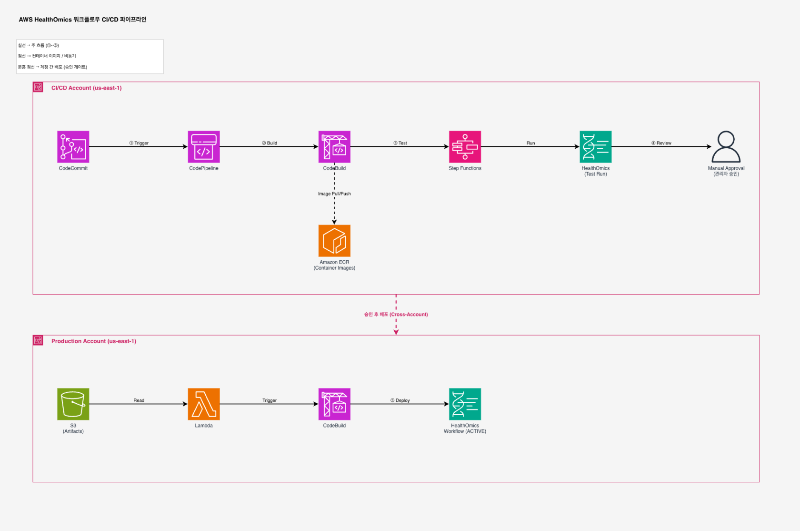

# AWS HealthOmics 워크플로우를 위한 CI/CD 파이프라인 구축하기

## DevOps 모범 사례를 바이오인포매틱스에 적용하는 방법

---

바이오인포매틱스 워크플로우는 소프트웨어입니다. 다른 소프트웨어와 마찬가지로 소스 제어, 버전 관리, 자동화된 테스트, 그리고 체계적인 배포 프로세스가 필요합니다. 하지만 현실에서는 많은 연구팀이 워크플로우를 수동으로 관리하고, 버전 추적 없이 운영하며, 배포 시마다 반복적인 수작업을 수행하고 있습니다.

이 글에서는 [Guidance for Bioinformatics Workflow Development Using DevOps on AWS](https://docs.aws.amazon.com/solutions/bioinformatics-workflow-development-using-devops-on-aws/)를 실제로 배포하고 운영하면서 얻은 경험을 공유합니다. 코드를 커밋하면 자동으로 빌드, 테스트, 배포까지 이어지는 CI/CD 파이프라인을 구축하는 전체 과정과, 실전에서 마주한 이슈 및 해결 방법을 다룹니다.

---

## 왜 바이오인포매틱스에 CI/CD가 필요한가?

유전체 분석 파이프라인은 점점 복잡해지고 있습니다. 단일 워크플로우가 수십 개의 컨테이너 이미지를 사용하고, 수 테라바이트의 데이터를 처리하며, 규제 환경에서 결과의 재현성을 보장해야 합니다.

**수동 관리의 문제점:**
- "이 결과는 어떤 버전의 워크플로우로 생성했지?"
- "지난주에 수정한 내용이 기존 분석에 영향을 주지 않을까?"
- "Production에 배포된 것과 개발 중인 것이 어떻게 다르지?"

**CI/CD가 해결하는 것:**
- 모든 변경 사항의 자동 추적 (Git + Semantic Versioning)
- 변경 시마다 실제 데이터로 자동 테스트
- 승인 후 안전한 Production 배포
- 데이터 출처(Provenance) 완벽 보장

---

## 솔루션 아키텍처

이 Guidance는 AWS의 완전 관리형 서비스들을 조합하여 바이오인포매틱스 워크플로우의 전체 수명주기를 자동화합니다.



```
┌─────────────────────────────────────────────────────────────────────┐
│                        CI/CD Account                                 │
│                                                                     │
│  CodeCommit ──▶ CodePipeline ──▶ CodeBuild ──▶ Step Functions      │
│      │              │                │              │               │
│      │         (orchestration)  (build & test)  (workflow run)      │
│      │              │                │              │               │
│      ▼              ▼                ▼              ▼               │
│  Source Code    Pipeline         ECR Images    HealthOmics          │
│                 Stages           Workflow       Test Run             │
│                                  Creation                           │
└─────────────────────────────────────────────────────────────────────┘
                          │ (Approval)
                          ▼
┌─────────────────────────────────────────────────────────────────────┐
│                     Production Account                               │
│                                                                     │
│  S3 Artifacts ──▶ Lambda ──▶ CodeBuild ──▶ HealthOmics Workflow    │
│                                                  (ACTIVE)           │
└─────────────────────────────────────────────────────────────────────┘
```

**핵심 흐름:**

1. 워크플로우 개발자가 CodeCommit에 코드를 push
2. CodePipeline이 자동으로 트리거
3. CodeBuild가 컨테이너 이미지를 ECR에 가져오고, HealthOmics 워크플로우를 생성
4. Step Functions가 테스트 데이터로 워크플로우를 실행하고 완료를 대기
5. 관리자가 테스트 결과를 검토하고 승인
6. Production 계정에 워크플로우가 배포됨

---

## 실제 배포 경험

### 환경 구성

이번 검증에서는 단일 AWS 계정(`us-east-1`)에서 CI/CD와 Production을 모두 운영하는 PoC 구성을 사용했습니다.

```json
// cdk.json 설정
{
  "cicd_account": "<ACCOUNT_ID>",
  "test_account": "<ACCOUNT_ID>",
  "prod_account": "<ACCOUNT_ID>",
  "aws_region": "us-east-1",
  "workflows": {
    "nf-core-fastqc": "aws-healthomics-nf-core-fastqc"
  }
}
```

### 배포 결과

CDK를 통해 3개의 CloudFormation 스택이 생성됩니다:

| 스택 | 역할 |
|------|------|
| `OmicsDeployCommonResourcesStack` | Production 배포 리소스 (S3, Lambda, CodeBuild) |
| `OmicsCicdCommonStack` | CI/CD 공통 리소스 (IAM, S3, Step Functions) |
| `OmicsCicdPerWorkflowStack-*` | 워크플로우별 파이프라인 (CodePipeline) |

### 예제 워크플로우: FASTQC

검증에 사용한 Nextflow 워크플로우입니다:

```groovy
// main.nf
process FASTQC {
    container "public.ecr.aws/biocontainers/fastqc:0.12.1--hdfd78af_0"
    cpus 2
    memory '4 GB'

    input:
    path reads

    output:
    path "*.html", emit: html
    path "*.zip", emit: zip

    script:
    """
    fastqc --threads ${task.cpus} ${reads}
    """
}

workflow {
    Channel.fromPath(params.input).set { read_files_ch }
    FASTQC(read_files_ch)
}
```

```groovy
// nextflow.config
manifest {
    name = 'nf-core-fastqc'
    version = '1.0.0'   // Semantic Versioning 필수
}
```

### E2E 파이프라인 실행 결과

코드를 push한 후 약 10분 만에 전체 파이프라인이 완료되었습니다:

```
✅ Source   - CodeCommit 체크아웃 (~30초)
✅ Build    - ECR 이미지 가져오기 + HealthOmics 워크플로우 생성 (~4분)
✅ Test     - 실제 FASTQ 데이터로 워크플로우 실행 (~5분)
✅ Approve  - 수동 승인
✅ Deploy   - Production 배포 (~1분)
```

생성된 HealthOmics 워크플로우:
```
nf-core-fastqc-HEAD-1.0.0.1  |  ACTIVE
```

### 코드 변경 → 자동 재배포 검증

워크플로우에 summary 출력을 추가하고 버전을 1.1.0으로 올린 후 push:

```bash
git commit -m "v1.1.0: Add summary output"
git push
# → 파이프라인 자동 트리거 → Build → Test → Approve → Deploy 전체 성공
```

결과:
```
nf-core-fastqc-HEAD-1.1.0.1  |  ACTIVE
```

코드 변경만으로 새 버전이 자동으로 테스트되고 배포되는 것을 확인했습니다.

---

## 실전에서 마주한 이슈와 해결

실제 배포 과정에서 몇 가지 이슈를 만났습니다. 이 솔루션을 도입하려는 분들에게 도움이 될 것입니다.

### 1. CDK 버전 호환성 문제

**증상:** `BucketDeployment` Lambda에서 `TypeError: unsupported operand type(s) for |: 'type' and 'type'` 에러

**원인:** `package.json`의 `aws-cdk-lib: "^2.134.0"`이 최신 버전으로 설치되면서, 내부 Lambda가 Python 3.9에서 실행되는데 urllib3의 Python 3.10+ 구문(`X | Y` type union)과 호환되지 않음

**해결:** `aws-cdk-lib`를 `2.175.0`으로 고정 (Python 3.11 Lambda 사용)

### 2. ECR Pull Through Cache Rules 충돌

**증상:** `OmxEcrHelper-ContainerPuller` 스택 배포 시 "Resource already exists" 에러

**원인:** 계정에 이미 `ecr-public`, `quay` pull through cache rules가 존재

**해결:** `buildenv_setup.sh`에서 기존 리소스 존재 여부를 확인하고, 이미 구성된 경우 ECR Helper 배포를 스킵

### 3. inspect_nf.py 유틸리티 누락

**증상:** `import_images.sh`에서 `No such file or directory` 에러

**원인:** `amazon-omics-tutorials` 레포에서 해당 스크립트가 제거됨

**해결:** 워크플로우 레포에 `container_pull_manifest.json`을 직접 포함하고, 스크립트 누락 시 이를 fallback으로 사용

### 4. 단일 계정 배포 시 cross-account 정책 오류

**증상:** `set_repository_policy.py`에서 `KeyError: 'output'`

**원인:** CI/CD와 Production이 동일 계정일 때 container puller 출력 형식이 다름

**해결:** `output` 키가 없을 때 graceful하게 스킵 (동일 계정에서는 cross-account ECR 정책이 불필요)

---

## 운영 시 고려사항

### 비용

이 솔루션의 기본 CI/CD 인프라 비용은 **월 약 $5** 수준입니다 (30회 빌드/배포 기준).

| 서비스 | 과금 방식 |
|--------|----------|
| CodeCommit | 사용자 수 기반 (5명 무료) |
| CodeBuild | 빌드 시간 (분 단위) |
| CodePipeline | 파이프라인당 월 $1 |
| ECR | 스토리지 (GB) |
| HealthOmics | 실행 시 task별 CPU/Memory/Storage |

> **Tip:** 테스트용 입력 데이터는 최소 크기(2-5MB)를 사용하면 HealthOmics 비용을 크게 절감할 수 있습니다.

### 보안 권장사항

| 단계 | PoC | Production |
|------|-----|-----------|
| IAM | AdministratorAccess | 최소 권한 정책 |
| 암호화 | S3 Managed | KMS CMK |
| 네트워크 | 기본 VPC | Private Subnet + VPC Endpoints |
| 계정 분리 | 단일 계정 | CI/CD + Production 분리 |

### Semantic Versioning

이 솔루션은 자동 버전 관리를 지원합니다:

```
워크플로우명-브랜치-MAJOR.MINOR.PATCH.BUILD
예: nf-core-fastqc-main-1.1.0.3
```

- `MAJOR.MINOR.PATCH`: `nextflow.config`의 `manifest.version`에서 결정
- `BUILD`: git tag 기반으로 자동 증가

---

## 시작하기

### 사전 요구사항 체크리스트

- [ ] AWS 계정 (HealthOmics 지원 리전)
- [ ] AWS CLI v2 + CDK 설치
- [ ] Node.js 18+ 설치
- [ ] 테스트용 FASTQ/BAM 데이터 (S3)

### 빠른 시작 (5분)

```bash
# 1. 레포 클론 & 설치
git clone https://github.com/aws-solutions-library-samples/guidance-for-bioinformatics-workflow-development-using-devops-on-aws.git
cd guidance-for-bioinformatics-workflow-development-using-devops-on-aws
npm install

# 2. cdk.json 설정 (계정 ID, 리전, 워크플로우 매핑)
# 3. CDK Bootstrap & 배포
cdk bootstrap aws://<ACCOUNT_ID>/us-east-1
npx cdk deploy --all --require-approval never

# 4. 워크플로우 레포 생성 & Push → 자동 CI/CD 시작!
```

자세한 단계별 가이드는 [DEPLOYMENT_GUIDE.md](https://github.com/hmkim/guidance-for-bioinformatics-workflow-development-using-devops-on-aws/blob/fix/deployment-improvements/DEPLOYMENT_GUIDE.md)를 참고하세요.

---

## 결론

바이오인포매틱스 워크플로우도 소프트웨어 엔지니어링의 모범 사례를 따라야 합니다. 이 Guidance를 통해:

- **반복 가능한 배포**: 수동 작업 없이 코드 push만으로 전체 프로세스 자동화
- **품질 보장**: 모든 변경 사항이 실제 데이터로 테스트된 후에만 배포
- **추적 가능성**: Semantic Versioning + Git 태그로 완벽한 데이터 출처 보장
- **안전한 배포**: 수동 승인 게이트와 Cross-Account 분리로 Production 보호

실제 배포부터 코드 변경 → 자동 재배포까지 전체 사이클이 약 10분 내에 완료되는 것을 확인했습니다. 유전체 분석 파이프라인의 규모와 복잡도가 증가하는 환경에서, 이러한 DevOps 자동화는 선택이 아닌 필수입니다.

---

## 참고 자료

- [Guidance for Bioinformatics Workflow Development Using DevOps on AWS](https://docs.aws.amazon.com/solutions/bioinformatics-workflow-development-using-devops-on-aws/)
- [AWS HealthOmics Documentation](https://docs.aws.amazon.com/omics/)
- [AWS CodeCommit GA 복귀 공지](https://aws.amazon.com/ko/blogs/korea/aws-codecommit-returns-to-general-availability/)
- [Sample Code (GitHub)](https://github.com/aws-solutions-library-samples/guidance-for-bioinformatics-workflow-development-using-devops-on-aws)
- [배포 가이드 (한국어)](https://github.com/hmkim/guidance-for-bioinformatics-workflow-development-using-devops-on-aws/blob/fix/deployment-improvements/DEPLOYMENT_GUIDE.md)

---

> **Disclaimer:** 이 글에 포함된 샘플 코드, 소프트웨어 라이브러리, 명령줄 도구, 개념 증명, 템플릿 또는 기타 관련 기술은 AWS Customer Agreement 또는 귀하와 AWS 간의 관련 서면 계약에 따라 AWS Content로 제공됩니다. Production 계정이나 Production 또는 기타 중요 데이터에 이 AWS Content를 사용해서는 안 됩니다. 특정 품질 관리 관행과 표준에 기반하여 Production 등급 사용에 적합하도록 AWS Content를 테스트, 보안, 최적화하는 것은 귀하의 책임입니다. AWS Content를 배포하면 Amazon EC2 인스턴스 실행 또는 Amazon S3 스토리지 사용과 같은 AWS 과금 리소스를 생성하거나 사용하는 데 대한 AWS 요금이 발생할 수 있습니다.
